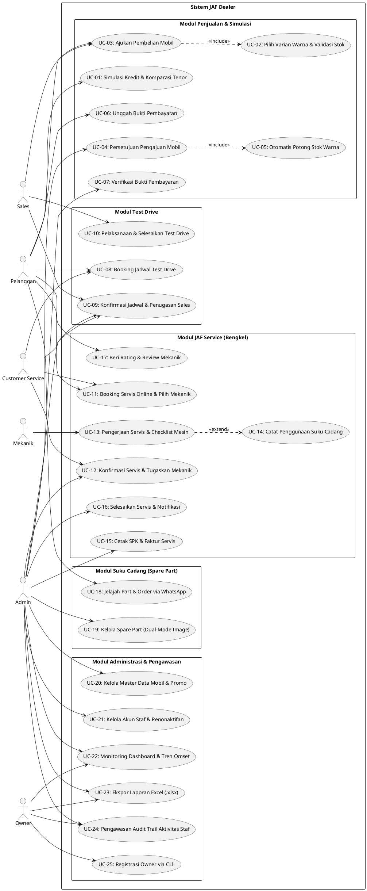
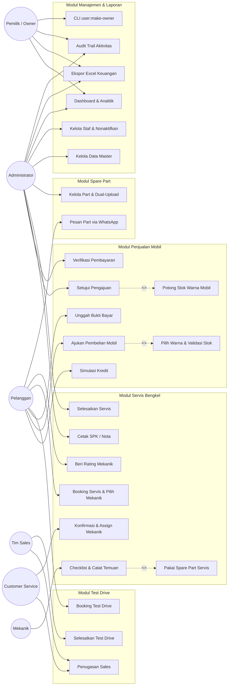
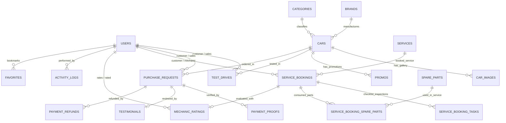

# DOKUMENTASI LENGKAP SISTEM JAF DEALER
**Panduan Komprehensif Arsitektur, Hak Akses, Use Case, Peta Kode, dan Persiapan Ujian Sidang Presentasi**

---

## DAFTAR ISI
1. [BAB 1: GAMBARAN UMUM & FITUR UNGGULAN](#bab-1-gambaran-umum--fitur-unggulan)
2. [BAB 2: PEMBAGIAN HAK AKSES & KREDENSIAL DEMO](#bab-2-pembagian-hak-akses--kredensial-demo)
3. [BAB 3: SPESIFIKASI & DIAGRAM USE CASE LENGKAP](#bab-3-spesifikasi--diagram-use-case-lengkap)
4. [BAB 4: PENJELASAN FUNGSI SETIAP MENU (PUBLIK & DASHBOARD)](#bab-4-penjelasan-fungsi-setiap-menu-publik--dashboard)
5. [BAB 5: ALUR TRANSAKSI END-TO-END (SKENARIO LIVE DEMO BERKESINAMBUNGAN)](#bab-5-alur-transaksi-end-to-end-skenario-live-demo-berkesinambungan)
6. [BAB 6: PETA KODINGAN & STRUKTUR BASIS DATA](#bab-6-peta-kodingan--struktur-basis-data)
7. [BAB 7: DAFTAR KEMUNGKINAN PERTANYAAN PENGUJI & JAWABAN TEKNIS](#bab-7-daftar-kemungkinan-pertanyaan-penguji--jawaban-teknis)

---

## BAB 1: GAMBARAN UMUM & FITUR UNGGULAN

### 1.1 Deskripsi Sistem & Tujuan Utama
**JAF Dealer** adalah aplikasi berbasis web terintegrasi untuk dealer otomotif modern yang memadukan penjualan unit mobil (baru & bekas), layanan purna jual bengkel (*JAF Service*), penyediaan suku cadang (*Spare Part*), simulasi pembiayaan kredit, pengujian kendara (*Test Drive*), hingga monitoring eksekutif bagi pemilik bisnis (*Owner*).

Sistem ini dibangun dengan arsitektur **Laravel 11**, **MySQL**, **Bootstrap 5**, dan **Blade Templating**, dirancang khusus untuk memecahkan tiga masalah klasik dealer konvensional:
1. **Disorganisasi Operasional & Silo Data:** Menghubungkan divisi penjualan (*Sales*), layanan pelanggan (*Customer Service*), mekanik bengkel (*Mechanic*), manajemen gudang, dan administrasi dalam satu sistem basis data terpusat.
2. **Asimetri Informasi Pelanggan:** Menyediakan transparansi stok per varian warna secara *real-time*, estimasi angsuran kredit transparan tanpa kalkulasi tersembunyi, serta pelacakan status servis mandiri.
3. **Akuntabilitas & Keamanan Finansial:** Memberikan jalur audit (*audit trail*) ketat untuk setiap aksi staf sensitif, verifikasi bukti bayar berjenjang, dan proteksi integritas transaksi.

---

### 1.2 Fitur Unggulan & Unik Project
Berikut adalah 8 fitur pembeda utama yang diimplementasikan secara spesifik di kode program JAF Dealer:

1. **Interactive Color Swatches, Dynamic Color Pricing & Sinkronisasi Varian Stok Mobil:**
   - Halaman detail mobil (`/mobil/{slug}`) menyajikan palet pilihan warna lingkaran interaktif.
   - Mengklik warna otomatis mengubah foto utama mobil dan membaca sisa stok varian warna tersebut secara *real-time*.
   - **Dynamic Color Pricing (Biaya Cat Khusus):** Pada mobil performa/supercar tertentu seperti *Nissan GT-R Premium Edition*, warna cat khusus/heritage memiliki biaya tambahan (misal: *Hijau Millennium Jade* +Rp 35 jt, *Abu-abu Matte* +Rp 40 jt, *Biru Bayside Blue* +Rp 25 jt). Mengklik warna ini otomatis memperbarui harga total mobil, nominal DP minimal (20%), dan tabel cicilan leasing secara instan tanpa reload halaman.
   - Jika stok warna habis (0 unit), lingkaran warna otomatis meredup (*opacity* 0.28) dan tombol pembelian dinonaktifkan.
   - Saat Admin menyetujui pengajuan pembelian mobil, sistem secara otomatis mengeksekusi method `decrementColorStock()` pada model `Car` sehingga stok warna yang dipilih berkurang presisi tanpa mengganggu warna lainnya.
2. **Simulasi Kredit Bunga Flat & Komparasi Multi-Tenor (`CreditCalculator`):**
   - Perhitungan kredit presisi dihitung secara murni di level backend (`App\Support\CreditCalculator`) menggunakan bilangan bulat berbasis *basis points* (bukan pembulatan *floating point*) untuk menghindari selisih rupiah.
   - Menyajikan matriks komparasi instan untuk seluruh tenor (12, 24, 36, 48, 60 bulan) dalam sekali klik.
   - Sisi frontend dilengkapi JavaScript live calculator (`credit-simulation.js`) yang menggunakan formula integer identik sehingga pelanggan mendapat feedback instan tanpa reload halaman.
3. **Sistem Evaluasi Kinerja & Rating Mekanik Bengkel (`MechanicRating`):**
   - Setelah servis diselesaikan, pelanggan dapat memberikan penilaian bintang 1–5 dan ulasan kepada teknisi spesifik yang menangani kendaraannya (`/akun/servis`).
   - Penilaian ini diagregasi menggunakan `withAvg('mechanicRatings', 'rating')` dan `withCount('mechanicRatings')` pada panel evaluasi staf Admin dan halaman pribadi Mekanik (`/mekanik/rating`).
   - Hasil rating bersifat evaluasi internal dealer (tidak dipublikasikan ke publik) demi menjaga privasi staf sekaligus menjadi dasar insentif manajemen.
4. **Riwayat Aktivitas & Jejak Audit Staf (`ActivityLog`):**
   - Setiap tindakan sensitif staf (perubahan role, aktivasi/penonaktifan akun, persetujuan pembelian, verifikasi pembayaran, penghapusan data) otomatis tercatat pada tabel `activity_logs`.
   - Log mencatat `user_id`, `user_name`, `user_role`, `category`, `action`, `description`, snapshot nilai lama vs baru (`properties` JSON), IP Address, dan *timestamp*.
   - Bersifat *immutable* (hanya bisa dibaca oleh Owner dan Admin, tidak disediakan tombol edit/hapus).
5. **Penonaktifan Staf Aman (Soft Deactivation tanpa Hapus Relasi):**
   - Admin/Owner dapat menonaktifkan staf yang berhenti/cuti dengan mencentang status nonaktif (`is_active = false`).
   - Staf yang dinonaktifkan dicegah login melalui `Auth::attemptWhen()` dan langsung diputus sesinya melalui middleware global `EnsureUserIsActive`.
   - **Keunggulan:** Seluruh riwayat kerja masa lalu staf (data mekanik pada faktur servis lama, SPK, nama sales pada test drive dan pengajuan mobil) tetap utuh di basis data dan tidak rusak (*foreign key constraint integrity preserved*).
6. **Pembuatan Akun Owner Melalui Artisan CLI (`php artisan user:make-owner`):**
   - Tingkat keamanan tertinggi: Akun bertaraf *Owner* sengaja tidak dapat didaftarkan lewat form publik register atau form staf admin biasa.
   - Disediakan artisan command `MakeOwner` (`app/Console/Commands/MakeOwner.php`) untuk mempromosikan email terdaftar menjadi role Owner secara aman via konsol server.
7. **Dual-Mode Media Suku Cadang (Upload Lokal vs Remote URL WebP):**
   - Admin dapat memasukkan foto suku cadang dengan dua cara: unggah berkas dari komputer **atau** menempelkan link gambar dari internet (Google / CDN marketplace) dilengkapi tombol *Cek Link* (Live Preview).
   - Saat disimpan dengan opsi unduh, sistem otomatis mengunduh gambar remote melalui HTTP Client, mengonversi dan mengompresinya menjadi berkas `.webp` lokal di storage dealer untuk menjamin kecepatan load dan menghindari *broken link*.
8. **Transparansi Dokumen Legalitas Kendaraan Bekas & Lencana Jaminan Dealer (Trust Badges):**
   - Mengatasi keraguan terbesar calon pembeli mobil bekas (*asymmetric information* / fenomena *Lemon Market*) dengan menyajikan informasi legalitas mendalam secara gamblang:
     - **Status Pajak:** Keterangan masa berlaku pajak (contoh: *Pajak Hidup s/d 10/2027*).
     - **Kelengkapan Dokumen:** Ketersediaan surat berharga (BPKB, STNK, Faktur Asli).
     - **Riwayat Kepemilikan:** Informasi tangan keberapa (contoh: *Tangan Pertama dari Baru*).
     - **Tipe Plat Nomor:** Ganjil atau Genap untuk memudahkan konsumen yang tinggal di wilayah pembatasan lalu lintas (DKI Jakarta / kota besar).
   - Menghadirkan **4 Lencana Jaminan Resmi Dealer** (*Trust & Inspection Badges*) di halaman unit mobil:
     1. *Lulus Uji Fisik 150+ Titik:* Pengecekan menyeluruh mesin, transmisi, sasis, rem, dan kelistrikan.
     2. *Bebas Banjir & Bebas Tabrakan:* Jaminan sasis utuh, bukan bekas rendaman banjir atau kecelakaan berat.
     3. *Garansi Resmi Dealer / Pabrikan:* Garansi Mesin & Transmisi 1 Tahun (unit bekas) atau Garansi Pabrikan 3 Tahun / 100.000 KM (unit baru).
     4. *Legalitas Surat Terjamin:* Validasi keabsahan dokumen ke Samsat dan kepolisian tanpa risiko dokumen bodong.

---

## BAB 2: PEMBAGIAN HAK AKSES & KREDENSIAL DEMO

### 2.1 Matriks Hak Akses Berdasarkan Role (RBAC)
Sistem JAF Dealer menerapkan *Role-Based Access Control* (RBAC) yang terpusat pada konstanta `User::PERMISSIONS` dan diregistrasikan ke Laravel Gate di `AppServiceProvider`.

| Modul / Kemampuan Sistem | Pelanggan | Customer Service | Sales | Mekanik | Admin | Owner |
| :--- | :---: | :---: | :---: | :---: | :---: | :---: |
| **Katalog Mobil & Simulasi Kredit** | Lihat & Hitung | Lihat | Lihat | - | Kelola Penuh | Lihat |
| **Data Master (Merek, Kategori, Promo)** | - | Lihat | Lihat | - | Kelola Penuh | Lihat |
| **Hapus Data Master (`master.delete`)** | - | - | - | - | Ya | Ya |
| **Pengajuan Pembelian Mobil** | Buat & Batalkan | Lihat Data | Lihat & Proses | - | Setujui / Tolak | Lihat |
| **Verifikasi Bukti Pembayaran** | Unggah Bukti | - | - | - | Verifikasi / Tolak | Lihat |
| **Jadwal Test Drive** | Ajukan & Batalkan | Konfirmasi Jadwal | Dampingi & Selesaikan | - | Kelola Penuh | Lihat |
| **Booking Servis Bengkel** | Ajukan & Batalkan | Konfirmasi Jadwal | - | - | Kelola Penuh | Lihat |
| **Pengerjaan Servis & Checklist** | - | - | - | Kerjakan & Checklist | Kelola Penuh | - |
| **Cetak SPK & Faktur Servis** | - | - | - | - | Cetak Resmi | Lihat |
| **Katalog Spare Part** | Lihat & Order WA | - | - | - | Kelola Penuh | Lihat |
| **Beri Rating & Review Mekanik** | Beri Rating | - | - | Lihat Milik Sendiri | Lihat Semua | Lihat Semua |
| **Manajemen Akun Staf** | - | - | - | - | Kelola Staf Biasa | Buat via CLI |
| **Audit Trail Riwayat Aktivitas** | - | - | - | - | Lihat | Pantau Penuh |
| **Laporan & Ekspor Excel Keuangan** | - | - | - | - | Laporan Umum | Laporan Omset & Finansial |
| **Pengaturan Profil Dealer & Rekening**| - | - | - | - | Ya | Ya |

---

### 2.2 Penjelasan Tugas & Batasan Setiap Role

1. **Pelanggan (Customer / Publik):**
   - **Tugas:** Menjelajah unit mobil, menghitung kredit, membandingkan spesifikasi unit, mengajukan pembelian, mengunggah bukti bayar, membooking test drive, membooking servis kendaraan, memesan spare part via WhatsApp, dan memberi rating kepuasan servis.
   - **Batasan:** Hanya dapat melihat dan mengelola data transaksinya sendiri (`/akun/...`). Tidak memiliki akses ke panel administrasi (`/admin` atau `/mekanik`).
2. **Customer Service (CS):**
   - **Tugas:** Garda depan konfirmasi jadwal. Memeriksa pengajuan servis dan test drive yang masuk, menghubungi konsumen, memverifikasi ketersediaan slot waktu, dan menugaskan staf awal.
   - **Batasan:** Bersifat *read-only* pada pengajuan mobil dan ulasan; tidak dapat menyetujui transaksi pembayaran dan tidak dapat mengelola akun staf.
3. **Sales:**
   - **Tugas:** Menindaklanjuti calon pembeli mobil. Menerima penugasan pendampingan test drive, mengubah status test drive menjadi *Selesai*, memonitor berkas pengajuan kredit/tunai konsumen.
   - **Batasan:** Tidak dapat menghapus master mobil, tidak dapat menyetujui (*approve*) pengajuan pembelian mobil (hak prerogatif Admin), dan tidak memiliki akses ke modul servis bengkel.
4. **Mekanik (Mechanic):**
   - **Tugas:** Membuka panel khusus `/mekanik/pekerjaan`, menekan tombol *Mulai Servis*, mencentang daftar periksa fisik mesin (*checklist tasks*), mencatat temuan kerusakan teknis, mencatat kebutuhan suku cadang, dan menyelesaikan pengerjaan. Memantau performa rating pribadi di `/mekanik/rating`.
   - **Batasan:** Terisolasi total dari modul penjualan mobil, laporan keuangan, dan modul staf.
5. **Admin:**
   - **Tugas:** Manajer operasional harian dealer. Menyetujui (*approve*) pembelian mobil yang otomatis memotong stok warna, memverifikasi transfer bank bukti bayar, mengelola stok suku cadang, mencetak Surat Perintah Kerja (SPK) bengkel, memoderasi ulasan, dan mengelola akun staf operasional (Sales, CS, Mekanik).
   - **Batasan:** Tidak dapat mengelola akun Owner dealer dan tidak dapat membuat Owner baru.
6. **Owner (Pemilik Dealer):**
   - **Tugas:** Pengawas eksekutif tertinggi (*Supervisory Role*). Memantau analitik omset penjualan dan servis bengkel pada dashboard, mengunduh laporan bulanan berformat Excel (`.xlsx`), mengawasi riwayat aktivitas staf (*Audit Trail*), serta mengelola konfigurasi fundamental dealer.
   - **Batasan:** Berfokus pada pengawasan manajerial bisnis, akun dibuat langsung via konsol server demi integritas hak kepemilikan.

---

### 2.3 Daftar Kredensial Akun Siap Demo (Database Seeder)
Seluruh akun di bawah ini telah terdaftar dan aktif di sistem lokal siap digunakan saat pengujian:

| No | Peran (Role) | Nama Pengguna | Alamat Email | Kata Sandi | Halaman Beranda Awal |
| :---: | :--- | :--- | :--- | :--- | :--- |
| 1 | **Owner** | Owner | `cruzgzz244@gmail.com` | `password` | `/admin/dashboard` |
| 2 | **Admin** | Admin | `admin@gmail.com` | `password` | `/admin/dashboard` |
| 3 | **Sales** | Sales | `sales@gmail.com` | `password` | `/admin/test-drive` |
| 4 | **Customer Service** | Costomer Service | `costumerservice@gmail.com` | `password` | `/admin/servis` |
| 5 | **Mekanik 1** | Mekanik 1 | `mekanik1@gmail.com` | `password` | `/mekanik/pekerjaan` |
| 6 | **Mekanik 2** | Mekanik 2 | `mekanik2@gmail.com` | `password` | `/mekanik/pekerjaan` |
| 7 | **Pelanggan Utama** | Muhammad Rifky | `muhamadrifky@gmail.com` | `password` | `/` (Publik / `/akun/profil`) |
| 8 | **Pelanggan Alternatif** | Yoseph Kewena | `yovanhayon@gmail.com` | `password` | `/` (Publik / `/akun/profil`) |
| 9 | **Pelanggan Alternatif** | Fadlan | `fadlan@gmail.com` | `password` | `/` (Publik / `/akun/profil`) |

---

## BAB 3: SPESIFIKASI & DIAGRAM USE CASE LENGKAP

### 3.1 Identifikasi Aktor (Actors)
1. **Pelanggan (`Customer`):** Pengguna luar yang melakukan interaksi transaksi, booking layanan, dan pembelian unit.
2. **Customer Service (`CS`):** Staf operasional penjadwalan dan komunikasi awal pelanggan.
3. **Sales (`Sales`):** Staf operasional lapangan pendamping uji kendara dan konsultasi unit mobil.
4. **Mekanik (`Mechanic`):** Teknisi bengkel pelaksana servis kendaraan dan inspeksi fisik mesin.
5. **Admin (`Admin`):** Administrator sistem pelaksana verifikasi finansial, data master, dan kontrol stok.
6. **Owner (`Owner`):** Pemilik dealer pengguna laporan eksekutif dan audit trail.

---

### 3.2 Diagram Use Case Global (PlantUML & Mermaid)

#### A. Kode Diagram PlantUML


#### B. Kode Diagram Mermaid


---

### 3.3 Tabel Spesifikasi & Skenario 5 Use Case Utama

#### 1) Skenario Use Case: Simulasi Kredit & Pengajuan Pembelian Mobil
- **Kode Use Case:** `UC-SC-01`
- **Aktor:** Pelanggan, Administrator.
- **Kondisi Awal (Pre-condition):** Pelanggan telah login, unit mobil berstatus aktif di katalog dan memiliki stok varian warna $> 0$.
- **Alur Utama (Main Flow):**
  1. Pelanggan membuka detail mobil `/mobil/{slug}` dan memilih salah satu warna interaktif.
  2. Pelanggan menekan tombol *Ajukan Pembelian* menuju halaman `/mobil/{slug}/ajukan`.
  3. Pelanggan memilih metode pembayaran (Cash atau Kredit). Bila Kredit, sistem menampilkan hasil kalkulasi tenor dan DP.
  4. Pelanggan memasukkan data diri dan menekan tombol *Kirim Pengajuan*.
  5. Sistem menerbitkan nomor pengajuan unik (misal: `PR-202611-0001`) dengan status awal *Pending*.
  6. Admin membuka `/admin/pengajuan/{id}` dan meninjau kelayakan berkas pengajuan.
  7. Admin menekan tombol **Setujui**.
  8. Sistem mengeksekusi `decrementColorStock()` pada unit mobil terkait, mengurangi stok warna sebesar 1 unit, dan memperbarui status menjadi *Disetujui*.
  9. Pelanggan mengunggah foto bukti transfer bank di `/akun/pengajuan/{id}/bukti-pembayaran`.
  10. Admin menekan tombol **Terima Pembayaran**, sistem mencatat transaksi lunas pada laporan keuangan.
- **Alur Alternatif:**
  - *Stok Warna Kosong:* Saat pelanggan mengklik warna dengan stok 0, tombol *Ajukan Pembelian* otomatis dinonaktifkan dengan label *"Stok Habis"*.
  - *Pembatalan Pengajuan:* Jika pengajuan dibatalkan oleh Admin atau Pelanggan, sistem otomatis memicu `incrementColorStock()`, mengembalikan kuota stok warna mobil (+1 unit).
- **Kondisi Akhir (Post-condition):** Pengajuan disetujui, stok warna mobil terpotong di database, bukti transfer tervalidasi, dan transaksi tercatat di pembukuan dealer.

#### 2) Skenario Use Case: Penjadwalan & Proses Test Drive
- **Kode Use Case:** `UC-SC-02`
- **Aktor:** Pelanggan, Customer Service, Sales.
- **Kondisi Awal (Pre-condition):** Pelanggan login, mobil yang dipilih berstatus aktif dan memiliki kuota test drive.
- **Alur Utama (Main Flow):**
  1. Pelanggan membuka formulir `/test-drive?mobil={slug}`, memilih tanggal reservasi dan sesi jam.
  2. Sistem menyimpan reservasi dengan status *Pending*.
  3. Customer Service membuka `/admin/test-drive/{id}`, menghubungi pelanggan untuk konfirmasi, dan memilih staf Sales pendamping.
  4. CS menekan tombol *Konfirmasi Jadwal* (status berubah menjadi *Dikonfirmasi*).
  5. Pada hari pelaksanaan, Sales mendampingi sesi uji kendara pelanggan di dealer.
  6. Sales/Admin membuka detail test drive dan menekan tombol *Selesaikan Test Drive* (status berubah menjadi *Selesai*).
- **Alur Alternatif:**
  - *Pelanggan Tidak Hadir:* Staf mengubah status menjadi *Tidak Hadir (No Show)*.
  - *Perubahan Jadwal (Reschedule):* CS mengubah tanggal dan sesi jam melalui modal ubah jadwal, sistem otomatis mencatat log jadwal baru.
- **Kondisi Akhir (Post-condition):** Test drive berstatus *Selesai*, riwayat keterlibatan sales tercatat di profil staf.

#### 3) Skenario Use Case: Booking Servis, Penugasan Mekanik, Spare Part, hingga Rating
- **Kode Use Case:** `UC-SC-03`
- **Aktor:** Pelanggan, Admin/CS, Mekanik.
- **Kondisi Awal (Pre-condition):** Pelanggan login, data master paket layanan servis dan akun mekanik aktif.
- **Alur Utama (Main Flow):**
  1. Pelanggan membuka `/servis/booking`, memilih jenis servis, memasukkan nomor polisi, kilometer mobil, keluhan, dan memilih teknisi favorit (opsional).
  2. Sistem menyimpan booking dengan status *Pending*.
  3. Admin/CS membuka `/admin/servis/{id}`, menugaskan mekanik yang bertugas, dan mengubah status menjadi *Dikerjakan*.
  4. Mekanik membuka panel `/mekanik/pekerjaan/{id}`, mencentang checklist pemeriksaan mesin (`tasks`), menginput temuan teknis, dan menambah kebutuhan suku cadang.
  5. Admin membuka detail servis dan mencetak formulir resmi Surat Perintah Kerja (SPK) ber-kop dealer via `/admin/servis/{id}/cetak-spk`.
  6. Setelah kendaraan tuntas diservis, Admin/Mekanik menekan tombol *Selesaikan Servis*.
  7. Sistem otomatis mengirim notifikasi ke akun pelanggan dan akun mekanik.
  8. Pelanggan membuka `/akun/servis` dan memberikan penilaian rating bintang 1–5 serta ulasan kerja untuk mekanik.
- **Alur Alternatif:**
  - *Pelanggan Membatalkan:* Pelanggan dapat membatalkan pesanan selama status masih *Pending* via portal akun.
- **Kondisi Akhir (Post-condition):** Servis berstatus *Selesai*, SPK tercetak, suku cadang terpotong dari inventaris, dan skor rating mekanik terbarui.

#### 4) Skenario Use Case: Manajemen Data Master & Manajemen Akun Staf
- **Kode Use Case:** `UC-SC-04`
- **Aktor:** Admin, Owner.
- **Kondisi Awal (Pre-condition):** Pengguna terautentikasi sebagai Admin atau Owner.
- **Alur Utama (Main Flow):**
  1. Admin membuka menu master `/admin/mobil`, `/admin/merek`, `/admin/kategori`, atau `/admin/spare-part`.
  2. Admin menambah atau memperbarui data (termasuk upload gambar atau paste link WebP).
  3. Untuk manajemen SDM, Admin membuka menu `/admin/staf` dan menekan *Tambah Staf* untuk membuat akun Sales, CS, atau Mekanik baru.
  4. Jika seorang staf berhenti/cuti, Admin membuka ubah staf dan menghilangkan centang *Akun Aktif*.
  5. Sistem menyimpan perubahan dan secara otomatis mencatat peristiwa di tabel `activity_logs`.
- **Alur Alternatif:**
  - *Staf Nonaktif Mencoba Login:* Sistem menolak autentikasi dengan pesan kesalahan: *"Akun Anda dinonaktifkan. Hubungi pemilik dealer."*
- **Kondisi Akhir (Post-condition):** Data master terbarui, staf dinonaktifkan secara aman tanpa merusak riwayat transaksi lampau.

#### 5) Skenario Use Case: Monitoring Dashboard & Laporan Eksekutif
- **Kode Use Case:** `UC-SC-05`
- **Aktor:** Owner, Admin.
- **Kondisi Awal (Pre-condition):** Pengguna terautentikasi sebagai Owner atau Admin.
- **Alur Utama (Main Flow):**
  1. Pengguna membuka `/admin/dashboard` dan melihat rangkuman metrik: total omset, unit mobil terjual, booking servis bulan ini, dan grafik tren penjualan 6 bulan terakhir.
  2. Pengguna membuka `/admin/laporan`, memilih filter periode bulan dan tahun.
  3. Sistem menampilkan tabel rincian pendapatan unit mobil, pendapatan jasa servis, dan penjualan suku cadang.
  4. Pengguna menekan tombol **Ekspor Excel** (`/admin/laporan/export/excel`).
  5. Browser otomatis mengunduh berkas laporan berekstensi `.xlsx` berformat resmi.
  6. Pengguna membuka `/admin/staf/aktivitas` untuk memeriksa audit log kepatuhan operasional staf.
- **Kondisi Akhir (Post-condition):** Berkas Excel laporan eksekutif berhasil diunduh dan aktivitas audit terpantau transparan.

---

## BAB 4: PENJELASAN FUNGSI SETIAP MENU (PUBLIK & DASHBOARD)

### 4.1 Halaman Publik (Frontend)

1. **Beranda (`/`):**
   - **Fungsi:** Halaman penyambutan utama dealer, menampilkan banner hero promosi, mobil unggulan (*featured cars*), layanan servis unggulan, serta ulasan konsumen yang telah dimoderasi.
   - **Input:** Interaksi klik navigasi, tombol CTA (Lihat Mobil, Booking Servis).
   - **Proses:** Memuat mobil berstatus `is_featured = true`, promo aktif, dan testimoni `is_approved = true`.
   - **Output:** Tampilan beranda interaktif dan responsif.
2. **Katalog Mobil (`/mobil`):**
   - **Fungsi:** Menampilkan seluruh stok mobil yang tersedia di dealer.
   - **Input:** Filter kata kunci pencarian, merek, kategori, kondisi (baru/bekas), transmisi, rentang harga min-maks, dan sorting.
   - **Proses:** Query Eloquent dengan *eager loading* relasi merek, kategori, dan promo aktif untuk mencegah N+1 problem.
   - **Output:** Grid kartu mobil dengan badge harga promo, transmisi, bahan bakar, dan tombol detail.
3. **Detail Mobil (`/mobil/{slug}`):**
   - **Fungsi:** Eksplorasi mendalam spesifikasi unit, galeri foto multi-sudut, palet warna interaktif, transparansi status legalitas/dokumen, lencana jaminan dealer 150+ titik, dan simulasi cicilan instan.
   - **Input:** Klik pada palet warna (color swatches), klik tombol Ajukan Pembelian, Jadwalkan Test Drive, atau Bandingkan.
   - **Proses:** JavaScript membaca data atribut hex dan stok varian warna; mengganti foto utama sesuai warna yang dipilih secara instan. Menampilkan data legalitas (Status Pajak, Dokumen STNK/BPKB, Riwayat Tangan, Tipe Plat Nomor) serta 4 Lencana Jaminan Resmi Dealer (Lulus Uji Fisik 150+ Titik, Bebas Banjir & Tabrakan, Garansi Dealer/Pabrikan, Keabsahan Surat).
   - **Output:** Tampilan interaktif spesifikasi mobil lengkap dengan kartu jaminan dealer dan tombol aksi kontekstual.
4. **Promo (`/promo` & `/promo/{slug}`):**
   - **Fungsi:** Menampilkan program diskon dan potongan harga spesial dealer yang sedang berlaku.
   - **Input:** Klik kartu promo.
   - **Proses:** Filter promo aktif berdasarkan rentang `start_date` dan `end_date`.
   - **Output:** Daftar banner promo dan nominal potongan harga pada unit terkait.
5. **Simulasi Kredit (`/simulasi-kredit`):**
   - **Fungsi:** Alat bantu finansial bagi calon pembeli untuk merencanakan skema angsuran bulanan.
   - **Input:** Pilihan unit mobil (opsional), nominal harga mobil, uang muka (DP min 20% - maks 80%), dan pilihan tenor (12–60 bulan).
   - **Proses:** `CreditCalculator` menghitung pokok hutang, total bunga flat, dan angsuran bulanan yang dibulatkan rapi ke ribuan terdekat.
   - **Output:** Kartu rincian estimasi cicilan per bulan dan tabel komparasi multi-tenor.
6. **Uji Kendara (`/test-drive`):**
   - **Fungsi:** Formulir pemesanan jadwal test drive unit mobil impian.
   - **Input:** Pilihan mobil, tanggal reservasi, sesi jam, dan catatan khusus.
   - **Proses:** Validasi tanggal masa depan, penyimpanan data ke `test_drives` dengan status *Pending*.
   - **Output:** Konfirmasi pengajuan dan pengalihan ke dashboard akun pelanggan.
7. **Layanan Servis (`/servis` & `/servis/booking`):**
   - **Fungsi:** Menampilkan katalog jasa perawatan berkala dan form booking reservasi servis online.
   - **Input:** Pilihan paket servis, nomor polisi, model kendaraan, kilometer terkini, keluhan mesin, tanggal, jam, dan pilihan mekanik favorit.
   - **Proses:** Validasi input, pembuatan kode booking unik acak, pencatatan relasi ke mekanik.
   - **Output:** Tiket booking servis online yang dapat dipantau di akun konsumen.
8. **Suku Cadang (`/spare-part` & `/spare-part/{slug}`):**
   - **Fungsi:** Katalog etalase spare part resmi (oli, kampas rem, filter, aki, aksesoris) dengan rasio foto persegi rapi 1:1.
   - **Input:** Pencarian nama part, filter kategori, rentang harga, tombol *Pesan via WhatsApp*.
   - **Proses:** Generator link WhatsApp API (`wa.me`) dengan pesan otomatis terformat rapi berisi SKU, nama part, dan harga.
   - **Output:** Tampilan etalase suku cadang dan pembukaan chat WhatsApp instan ke admin sales part.
9. **Bandingkan Mobil (`/bandingkan`):**
   - **Fungsi:** Membandingkan spesifikasi teknis dan harga 2 hingga 4 mobil secara berdampingan.
   - **Input:** Menekan tombol ikon timbangan pada kartu mobil.
   - **Proses:** Menyimpan array ID mobil pada session pengguna (bisa diakses tamu tanpa login).
   - **Output:** Tabel komparasi spesifikasi dimensi, mesin cc, transmisi, konsumsi bahan bakar, dan harga.
10. **Tentang Kami & Kontak (`/tentang-kami`, `/kontak`):**
    - **Fungsi:** Menampilkan profil dealer, visi misi, keunggulan, lokasi Google Maps, nomor telepon, dan jam operasional.
    - **Input:** Form pesan kontak atau klik link maps.
    - **Proses:** Mengambil data profil dinamis dari tabel `settings`.
    - **Output:** Informasi kontak resmi dan peta dealer.

---

### 4.2 Halaman Dashboard Administrasi (`/admin`)

1. **Dashboard Utama (`/admin/dashboard`):**
   - **Fungsi:** Pusat kendali analitik bisnis dealer.
   - **Input:** Filter rentang waktu statistik.
   - **Proses:** Agregasi omset penjualan unit, omset servis, total test drive, unit stok menipis, dan chart tren 6 bulan.
   - **Output:** Visualisasi grafik garis omset, badge counter indikator performa, dan daftar aksi mendesak (*pending approval*).
2. **Pusat Notifikasi (`/admin/notifikasi`):**
   - **Fungsi:** Menampung lonceng pemberitahuan transaksi masuk secara real-time.
   - **Input:** Klik tautan notifikasi, tombol *Tandai Semua Dibaca*.
   - **Proses:** Update field `read_at` pada tabel `notifications`.
   - **Output:** Pengalihan langsung ke dokumen transaksi yang memerlukan perhatian.
3. **Manajemen Mobil (`/admin/mobil`):**
   - **Fungsi:** Manajemen inventaris mobil dealer (CRUD) lengkap dengan spesifikasi teknis, data legalitas surat, serta jaminan dealer.
   - **Input:** Data spesifikasi mesin, bodi, transmisi, harga, stok, deskripsi, status aktif/unggulan, dan seksi *Legalitas, Dokumen & Jaminan* (Status Pajak, Kelengkapan Dokumen BPKB/STNK, Riwayat Kepemilikan, Tipe Plat Nomor Ganjil/Genap, Garansi Dealer).
   - **Proses:** Validasi request (`CarRequest`), pembuatan slug URL SEO-friendly, penyimpanan basis data ke tabel `cars`.
   - **Output:** Tabel inventaris mobil dengan toggle status aktif instan, informasi legalitas, dan tombol galeri warna.
4. **Galeri & Varian Warna Mobil (`/admin/mobil/{car}/gambar`):**
   - **Fungsi:** Mengunggah galeri foto multi-sudut, mengatur foto sampul utama (*primary*), memetakan warna dengan foto, mengelola kuota stok per warna, menentukan biaya tambahan cat khusus (*color price adjustment*), serta sinkronisasi otomatis saat foto dihapus.
   - **Input:** Berkas foto gambar, nama warna, kode hex warna, kuota stok warna, dan biaya tambahan cat (Rp).
   - **Proses:** Pemrosesan gambar lokal via `CarImageProcessor` (kompresi WebP & thumbnail otomatis), update JSON array `color_palette`. Jika sebuah foto ber-warna dihapus dan tidak ada foto lain yang memakai warna tersebut, sistem secara otomatis menghapus warna itu dari daftar `color_palette` dan menyesuaikan total kuota stok mobil.
   - **Output:** Galeri visual mobil terintegrasi varian warna, stok, dan harga dinamis yang selalu sinkron dengan foto fisik yang diunggah.
5. **Merek & Kategori (`/admin/merek`, `/admin/kategori`):**
   - **Fungsi:** Master klasifikasi pabrikan (Nissan, Toyota, Honda, dll.) dan segmen tipe kendaraan (SUV, Sedan, MPV, EV).
   - **Input:** Nama klasifikasi, slug, logo merek.
   - **Proses:** CRUD standar dengan proteksi penghapusan data jika masih memiliki unit mobil tertaut.
   - **Output:** Struktur klasifikasi katalog kendaraan.
6. **Promo & Diskon (`/admin/promo`):**
   - **Fungsi:** Pengelolaan program diskon harga unit mobil.
   - **Input:** Judul promo, pilihan mobil, nominal potongan harga (Rp), tanggal mulai, dan tanggal berakhir.
   - **Proses:** Validasi logika tanggal, update harga diskon mobil pada katalog publik.
   - **Output:** Banner promo aktif dan pemotongan harga otomatis.
7. **Jadwal Test Drive (`/admin/test-drive`):**
   - **Fungsi:** Pengelolaan dan penugasan pendampingan uji kendara.
   - **Input:** Pemilihan sales pendamping, update status (Pending, Dikonfirmasi, Selesai, Batal, No Show), modal ubah jadwal.
   - **Proses:** Update status transaksi, pencatatan relasi `sales_id`.
   - **Output:** Agenda kalender test drive dealer yang tertata.
8. **Pengajuan Pembelian Mobil (`/admin/pengajuan`):**
   - **Fungsi:** Verifikasi permohonan beli unit tunai/kredit dan persetujuan transaksi.
   - **Input:** Klik tombol Setujui, Tolak, Cetak Faktur PDF.
   - **Proses:** Saat disetujui, memanggil `decrementColorStock()` untuk mengurangi stok warna mobil; menghasilkan PDF invoice resmi.
   - **Output:** Status pengajuan disetujui dan invoice pembelian berformat PDF.
9. **Verifikasi Bukti Pembayaran (`/admin/pengajuan/{id}/bukti-pembayaran`):**
   - **Fungsi:** Audit berkas bukti transfer dana bank yang diunggah pelanggan.
   - **Input:** Klik berkas foto/PDF struk transfer, tombol Terima Pembayaran, atau Tolak dengan alasan.
   - **Proses:** Pengecekan file tersimpan di disk private, update status bayar lunas.
   - **Output:** Transaksi dinyatakan lunas dan siap serah terima unit.
10. **Booking Servis Bengkel (`/admin/servis`):**
    - **Fungsi:** Pengelolaan alur kendaraan masuk bengkel.
    - **Input:** Penugasan mekanik, checklist inspeksi kondisi mesin, penambahan suku cadang yang digunakan, cetak SPK.
    - **Proses:** Perhitungan total biaya jasa + spare part, pencetakan SPK berkop resmi.
    - **Output:** Dokumen fisik SPK dan rekapitulasi pekerjaan bengkel.
11. **Master Layanan Bengkel (`/admin/layanan`):**
    - **Fungsi:** Katalog paket jasa bengkel resmi (Ganti Oli Berkala, Tune Up Mesin, Spooring Balancing, General Check).
    - **Input:** Nama paket jasa, estimasi durasi (menit), estimasi biaya dasar.
    - **Proses:** CRUD master jasa.
    - **Output:** Pilihan paket servis saat konsumen memesan online.
12. **Master Suku Cadang / Spare Part (`/admin/spare-part`):**
    - **Fungsi:** Manajemen stok gudang suku cadang dan upload foto canggih.
    - **Input:** Nomor part (SKU), nama barang, kategori, kompatibilitas mobil, harga jual, stok gudang, file upload lokal ATAU url link gambar.
    - **Proses:** Unduh otomatis gambar eksternal menjadi WebP lokal di server, update database.
    - **Output:** Tabel inventaris suku cadang dengan thumbnail 1:1.
13. **Ulasan & Rating Mekanik (`/admin/ulasan`):**
    - **Fungsi:** Tab 1: Moderasi ulasan testimoni pembeli mobil (Setujui/Tolak agar tampil di Beranda). Tab 2: Evaluasi rating kinerja bintang 1–5 mekanik bengkel.
    - **Input:** Tombol Setujui / Tolak ulasan mobil; filter evaluasi teknisi.
    - **Proses:** Update flag `is_approved = true`; agregasi skor kepuasan pelanggan bengkel.
    - **Output:** Testimoni publik yang bersih dan metrik kepuasan kerja mekanik.
14. **Data Pelanggan (`/admin/pengguna`):**
    - **Fungsi:** Melihat direktori data pelanggan terdaftar beserta rekam jejak transaksi lampau.
    - **Input:** Pencarian nama/email, klik detail profil pelanggan.
    - **Proses:** Read-only relasi pelanggan ke riwayat pembelian, test drive, dan servis mobil.
    - **Output:** Tampilan CRM profil pelanggan 360 derajat.
15. **Laporan & Ekspor Finansial (`/admin/laporan`):**
    - **Fungsi:** Analisis rekapitulasi omset bisnis dealer dan ekspor berkas spreadsheet.
    - **Input:** Filter rentang tanggal / bulan, tombol *Ekspor Excel (.xlsx)* atau *Ekspor CSV*.
    - **Proses:** Agregasi nominal transaksi mobil lunas dan faktur servis lunas; pembuatan spreadsheet berformat profesional menggunakan PhpSpreadsheet / Laravel-Excel.
    - **Output:** File unduhan spreadsheet Excel yang siap diserahkan ke pimpinan.
16. **Manajemen Staf & Audit Aktivitas (`/admin/staf`, `/admin/staf/aktivitas`):**
    - **Fungsi:** CRUD akun staf (Admin, Sales, CS, Mekanik), toggle aktif/nonaktif akun staf, dan pemantauan riwayat log audit (*Audit Trail*).
    - **Input:** Form akun staf baru, centang status aktif, filter log audit.
    - **Proses:** Pencatatan setiap aksi sensitif ke `activity_logs`.
    - **Output:** Struktur tim kerja yang aman dan catatan audit yang akuntabel.
17. **Pengaturan Dealer (`/admin/pengaturan`):**
    - **Fungsi:** Konfigurasi identitas dealer (Nama dealer, alamat, no telepon, no rekening bank transfer, teks banner).
    - **Input:** Perubahan teks dan nomor rekening.
    - **Proses:** Penyimpanan pasangan key-value pada tabel `settings` yang menimpa file konfigurasi `.env`.
    - **Output:** Pembaruan instan identitas dealer di seluruh aplikasi publik dan cetakan invoice.

---

## BAB 5: ALUR TRANSAKSI END-TO-END (SKENARIO LIVE DEMO BERKESINAMBUNGAN)

Saat Anda mendemokan aplikasi di depan dosen penguji, jalankan skenario "Satu Cerita Berkesinambungan" berikut yang melibatkan seluruh 6 aktor secara mulus:

```
[1. Pelanggan]         [2. Customer Service]      [3. Sales]         [4. Mekanik]         [5. Admin]          [6. Owner]
      |                          |                     |                  |                    |                  |
(Jelajah Mobil)                  |                     |                  |                    |                  |
(Hitung Kredit)                  |                     |                  |                    |                  |
(Booking Test Drive) --------> (Konfirmasi Jadwal) --> |                  |                    |                  |
      |                          |             (Dampingi Uji)             |                    |                  |
(Ajukan Pembelian Warna X) -----------------------------------------------------------------> |                  |
      |                          |                     |                  |           (Setujui Pengajuan)         |
      |                          |                     |                  |           (Stok Warna -1 Unit)        |
(Unggah Bukti Bayar) ------------------------------------------------------------------------> |                  |
      |                          |                     |                  |           (Verifikasi Bayar Lunas)    |
      |                          |                     |                  |                    |                  |
(Booking Servis Online) -----> (Konfirmasi Servis) --> | -------------> (Mulai Servis)         |                  |
      |                          |                     |               (Checklist Mesin)       |                  |
      |                          |                     |               (Input Part & Selesai)  |                  |
      |                          |                     |                  |           (Cetak SPK & Faktur)        |
(Beri Rating Mekanik) -------------------------------------------------> (Terima Rating)      |                  |
      |                          |                     |                  |                    |                  |
      |                          |                     |                  |                    | ----------> (Lihat Omset)
      |                          |                     |                  |                    |             (Ekspor Excel)
      |                          |                     |                  |                    |             (Audit Trail)
```

### Urutan Langkah Demi Langkah Demo:

1. **FASE 1: Eksplorasi Pelanggan (Login: `muhamadrifky@gmail.com`)**
   - Buka `/mobil`, klik mobil (misal: *Nissan Grand Livina*).
   - Tunjukkan fitur **Color Swatches**: Klik warna Abu-abu, tunjukkan foto berubah dan angka stok varian muncul. Klik warna lain.
   - Buka `/simulasi-kredit`: Masukkan harga mobil, gerakkan slider DP, pilih tenor 36 bulan, tunjukkan rincian angsuran per bulan dan tabel multi-tenor.
   - Masuk ke form test drive `/test-drive`, pilih unit dan jam besok $\rightarrow$ Klik Submit.
   - Masuk ke form pembelian `/mobil/{slug}/ajukan`, pilih warna Abu-abu $\rightarrow$ Klik Ajukan Pembelian.
   - Masuk ke `/servis/booking`, isi data mobil, keluhan ganti oli, pilih *Mekanik 1* $\rightarrow$ Klik Booking Servis.
   - Logout.

2. **FASE 2: Layanan Pelanggan (Login: `costumerservice@gmail.com`)**
   - Buka `/admin/test-drive`: Tunjukkan jadwal pending milik Muhammad Rifky. Klik Detail $\rightarrow$ Tugaskan staf *Sales* $\rightarrow$ Ubah status ke **Dikonfirmasi**.
   - Buka `/admin/servis`: Tunjukkan booking servis pending. Klik Detail $\rightarrow$ Tugaskan *Mekanik 1* $\rightarrow$ Ubah status ke **Dikonfirmasi**.
   - Logout.

3. **FASE 3: Tindak Lanjut Lapangan (Login: `sales@gmail.com`)**
   - Buka `/admin/test-drive`: Tunjukkan sesi test drive yang ditugaskan kepada dirinya.
   - Setelah mendampingi konsumen, ubah status menjadi **Selesai**.
   - Buka `/admin/pengajuan`: Tinjau data pengajuan pembelian mobil milik Muhammad Rifky.
   - Logout.

4. **FASE 4: Pengerjaan Bengkel (Login: `mekanik1@gmail.com`)**
   - Buka `/mekanik/pekerjaan`: Tunjukkan daftar tugas servis kendaraan Livina milik konsumen.
   - Klik **Mulai Servis**.
   - Centang checklist pengecekan fisik mesin, masukkan catatan temuan (*"Kondisi oli mesin aus, kampas rem depan tipis"*).
   - Tekan tombol **Selesaikan Servis**.
   - Buka `/mekanik/rating`: Tunjukkan skor performa pribadinya saat ini.
   - Logout.

5. **FASE 5: Manajerial Operasional (Login: `admin@gmail.com`)**
   - Buka `/admin/pengajuan/{id}`:
     - Tunjukkan stok warna mobil sebelum disetujui.
     - Klik tombol **Setujui**.
     - Buka halaman edit mobil galeri warna: Tunjukkan ke penguji bahwa **stok varian warna Abu-abu otomatis terpotong -1 unit secara presisi**.
   - Buka bukti pembayaran yang diunggah konsumen, klik **Terima Pembayaran** (transaksi resmi berstatus Lunas).
   - Buka `/admin/servis/{id}`: Klik tombol **Cetak SPK** (`/admin/servis/{id}/cetak-spk`), tunjukkan format cetak invoice resmi berkop dealer.
   - Buka `/admin/spare-part/tambah`: Demokan fitur **Dual-Mode Image**; paste link foto oli dari Google/CDN $\rightarrow$ Klik **Cek Link** $\rightarrow$ Simpan $\rightarrow$ Tunjukkan gambar berhasil terunduh otomatis dalam format WebP ke server lokal.
   - Buka `/admin/staf`: Tunjukkan cara menonaktifkan akun staf tanpa menghapus datanya.
   - Logout.

6. **FASE 6: Konsumen Memberi Rating (Login: `muhamadrifky@gmail.com`)**
   - Buka `/akun/servis`: Tunjukkan servis telah selesai.
   - Berikan rating bintang 5 dan ulasan: *"Pelayanan Mekanik 1 sangat cekatan dan mobil kembali bertenaga"*.
   - Logout.

7. **FASE 7: Pengawasan Eksekutif (Login: `cruzgzz244@gmail.com`)**
   - Buka `/admin/dashboard`: Tunjukkan ringkasan omset penjualan mobil dan servis yang otomatis bertambah dari transaksi tadi.
   - Buka `/admin/laporan`: Klik tombol **Ekspor Excel** (`/admin/laporan/export/excel`), buka file Excel yang terunduh dan tunjukkan tabel pendapatan rapi ke penguji.
   - Buka `/admin/staf/aktivitas`: Tunjukkan rekam jejak **Audit Trail**; perlihatkan bahwa seluruh aksi persetujuan admin dan staf tercatat rapi beserta IP Address dan data perubahannya.

---

## BAB 6: PETA KODINGAN & STRUKTUR BASIS DATA

### 6.1 Tabel Pemetaan Modul ke File Sumber Kode

| Modul Fitur | Controller Utama | Method Kunci | Model Terkait | Middleware / Gate | Blade View |
| :--- | :--- | :--- | :--- | :--- | :--- |
| **Katalog Mobil** | `CarController` | `index`, `show` | `Car`, `CarImage`, `Brand` | `web` (publik) | `resources/views/pages/cars/index.blade.php`, `show.blade.php` |
| **Legalitas & Lencana Jaminan** | `Admin\CarController` | `edit`, `update` | `Car` (`tax_status`, `document_status`, dsb.) | `can:cars.manage` | `resources/views/admin/cars/_form.blade.php`, `show.blade.php` |
| **Color Swatches Mobil** | `CarImageController` | `updateColor`, `storeColorPalette` | `Car`, `CarImage` | `can:cars.manage` | `resources/views/admin/cars/images.blade.php` |
| **Simulasi Kredit** | `CreditSimulationController` | `index` | `Car`, `CreditCalculator` | `web` (publik) | `resources/views/pages/credit/index.blade.php` |
| **Pengajuan Mobil** | `Admin\PurchaseRequestController` | `index`, `show`, `updateStatus` | `PurchaseRequest`, `Car` | `can:purchases.approve` | `resources/views/admin/purchase-requests/show.blade.php` |
| **Bukti Pembayaran** | `Admin\PaymentProofController` | `approve`, `reject` | `PaymentProof` | `can:payments.manage` | `resources/views/admin/payment-proofs/` |
| **Booking Test Drive**| `Admin\TestDriveController` | `updateStatus`, `assignSales` | `TestDrive`, `User` | `can:test-drives.manage` | `resources/views/admin/test-drives/index.blade.php` |
| **Booking Bengkel** | `Admin\ServiceBookingController`| `updateStatus`, `printWorkOrder`| `ServiceBooking`, `User` | `can:service-bookings.manage`| `resources/views/admin/service-bookings/show.blade.php` |
| **Pekerjaan Mekanik** | `Mechanic\JobController` | `start`, `finish`, `updateFindings`| `ServiceBooking`, `ServiceBookingTask` | `role:mechanic` | `resources/views/mechanic/jobs/show.blade.php` |
| **Rating Mekanik** | `Account\MechanicRatingController`| `store` | `MechanicRating` | `auth` | `resources/views/pages/account/service-bookings/index.blade.php` |
| **Dual-Mode Spare Part**| `Admin\SparePartController` | `store`, `update` | `SparePart`, `CarImageProcessor` | `can:spare-parts.manage` | `resources/views/admin/spare-parts/_form.blade.php` |
| **Laporan & Excel** | `Admin\ReportController` | `index`, `exportExcel` | `PurchaseRequest`, `ServiceBooking` | `can:reports.view` | `resources/views/admin/reports/index.blade.php` |
| **Kelola Akun Staf** | `Admin\StaffController` | `store`, `update`, `destroy` | `User`, `ActivityLog` | `can:staff.manage` | `resources/views/admin/staff/index.blade.php`, `edit.blade.php` |
| **Audit Trail Staf** | `Admin\ActivityLogController` | `__invoke` | `ActivityLog` | `can:activity.view` | `resources/views/admin/staff/activity.blade.php` |
| **CLI Make Owner** | `Console\Commands\MakeOwner` | `handle` | `User` | Artisan Console | `app/Console/Commands/MakeOwner.php` |

---

### 6.2 Bedah Logika Penting di Kode

#### 1. Rumus Perhitungan Simulasi Kredit (`CreditCalculator.php`)
Diimplementasikan pada `app/Support/CreditCalculator.php`:
- **Formula:**
  $$\text{Principal (Pokok Hutang)} = \text{Harga Mobil} - \text{Uang Muka (DP)}$$
  $$\text{Total Bunga} = \frac{\text{Principal} \times \text{Suku Bunga Pertahun} \times \text{Tenor Bulan}}{12}$$
  $$\text{Angsuran Bulanan} = \frac{\text{Principal} + \text{Total Bunga}}{\text{Tenor Bulan}}$$
- **Implementasi Presisi Bilangan Bulat:** Untuk mengeliminasi *floating point rounding error*, sistem mengalikan bunga dengan basis poin (10.000) dan menggunakan `intdiv()` dengan faktor pengali `120.000 * tenor * rounding`:
  ```php
  $principal = $price - $downPayment;
  $rateBasisPoints = (int) round($rate * 100);
  $totalScaled = $principal * 120_000 + $principal * $rateBasisPoints * $tenor;
  $divisor = 120_000 * $tenor * $rounding;
  $monthly = intdiv($totalScaled + $divisor - 1, $divisor) * $rounding;
  ```

#### 2. Logika Agregasi Rating Kinerja Mekanik (`StaffController.php`)
Diimplementasikan menggunakan fitur agregasi relasi Eloquent tanpa pembebanan memori:
```php
$staff = User::query()
    ->whereIn('role', User::STAFF_ROLES)
    ->withAvg('mechanicRatings', 'rating')
    ->withCount([
        'mechanicRatings',
        'assignedServiceBookings as completed_jobs_count' => fn ($query) => $query->where('status', ServiceBooking::STATUS_COMPLETED),
    ])
    ->get();
```
Rata-rata diformat rapi dengan koma desimal Indonesia via `MechanicRating::formatAverage($average)`.

#### 3. Logika Pemotongan & Pengembalian Stok Varian Warna (`Car.php`)
Kolom `color_palette` disimpan sebagai format JSON array berstruktur `[['name' => 'Putih', 'hex' => '#FFF', 'stock' => 5], ...]`.
Saat transaksi disetujui:
```php
public function decrementColorStock(?string $colorName): void {
    if (! empty($this->color_palette) && is_array($this->color_palette) && $colorName) {
        $palette = $this->color_palette;
        foreach ($palette as &$item) {
            if (strcasecmp($item['name'], $colorName) === 0) {
                $item['stock'] = max(0, ((int) $item['stock']) - 1);
                break;
            }
        }
        $this->color_palette = $palette;
        $this->stock = array_sum(array_column($palette, 'stock'));
        $this->save();
    }
}
```

#### 4. Proteksi Autentikasi Staf Dinonaktifkan (`LoginRequest.php` & Middleware)
Pencegahan login dilakukan di `LoginRequest::authenticate()` menggunakan *closure* kondisi aktif:
```php
if (! Auth::attemptWhen($this->only('email', 'password'), fn ($user) => $user->isActive(), $this->boolean('remember'))) {
    $inactive = User::where('email', $this->input('email'))->where('is_active', false)->exists();
    throw ValidationException::withMessages([
        'email' => $inactive ? 'Akun Anda dinonaktifkan. Hubungi pemilik dealer.' : __('auth.failed'),
    ]);
}
```
Dan dicegat secara global oleh middleware `EnsureUserIsActive`:
```php
if ($request->user() && ! $request->user()->isActive()) {
    Auth::guard('web')->logout();
    $request->session()->invalidate();
    return redirect()->route('login')->with('error', 'Akun Anda dinonaktifkan. Hubungi pemilik dealer.');
}
```

#### 5. Pembuatan Akun Owner via Console Command (`MakeOwner.php`)
Perintah konsol: `php artisan user:make-owner pemilik@dealer.com`
```php
public function handle(): int {
    $user = User::firstWhere('email', $this->argument('email'));
    if (! $user) {
        $this->error('Akun dengan email itu tidak ditemukan.');
        return self::FAILURE;
    }
    $user->role = User::ROLE_OWNER;
    $user->is_active = true;
    $user->save();
    $this->info("{$user->name} ({$user->email}) sekarang owner.");
    return self::SUCCESS;
}
```

#### 6. Dynamic Color Pricing & Sinkronisasi Validasi Leasing (`Car.php` & `SubmitPurchaseRequest.php`)
Setiap elemen array JSON `color_palette` mendukung atribut opsional `extra_price` (misal `35_000_000` untuk cat khusus *Millennium Jade*).
Model `Car` mengkalkulasi harga dinamis melalui:
```php
public function colorExtraPrice(?string $colorName): int {
    foreach ($this->colorSwatches() as $swatch) {
        if (strcasecmp($swatch['name'], $colorName) === 0) {
            return (int) ($swatch['extra_price'] ?? 0);
        }
    }
    return 0;
}

public function finalPriceForColor(?string $colorName): int {
    return max(0, ($this->price + $this->colorExtraPrice($colorName)) - $this->promoDiscount());
}
```
Pada `SubmitPurchaseRequest`, validasi DP kredit 20% dan perekaman snapshot harga `car_price` dihitung berdasarkan warna yang dipilih konsumen:
```php
$price = $car->finalPriceForColor($data['color'] ?? null);
$minDp = $this->credit->minDownPayment($price);
```
Hal ini menjamin integritas finansial dealer tetap kedap manipulasi (*tamper-proof*).

---

### 6.3 Struktur Basis Data Utama & Relasi (Entity Relationship)



#### Rincian Tabel Utama & Kunci Relasi (Foreign Key):
1. **`users`:** Tabel sentral aktor. Primary Key: `id`. Memiliki kolom `role` (`owner`, `admin`, `sales`, `customer_service`, `mechanic`, `customer`) dan boolean `is_active`.
2. **`cars`:** Tabel unit mobil. Foreign Key: `brand_id` $\rightarrow$ `brands.id`, `category_id` $\rightarrow$ `categories.id`. Memiliki kolom JSON `color_palette`, serta kolom legalitas dan garansi dealer: `tax_status` (VARCHAR 100), `document_status` (VARCHAR 150), `ownership_history` (VARCHAR 100), `plate_type` (VARCHAR 20), dan `warranty_info` (VARCHAR 255).
3. **`car_images`:** Foto galeri mobil. Foreign Key: `car_id` $\rightarrow$ `cars.id` (ON DELETE CASCADE). Kolom `color_name` memetakan foto ke warna spesifik.
4. **`purchase_requests`:** Transaksi mobil. Foreign Key: `user_id` $\rightarrow$ `users.id`, `car_id` $\rightarrow$ `cars.id`, `sales_id` $\rightarrow$ `users.id`.
5. **`payment_proofs`:** Bukti transfer dana. Foreign Key: `purchase_request_id` $\rightarrow$ `purchase_requests.id`, `user_id` $\rightarrow$ `users.id`.
6. **`service_bookings`:** Booking servis bengkel. Foreign Key: `user_id` $\rightarrow$ `users.id`, `service_id` $\rightarrow$ `services.id`, `mechanic_id` $\rightarrow$ `users.id`.
7. **`service_booking_tasks`:** Checklist fisik mesin. Foreign Key: `service_booking_id` $\rightarrow$ `service_bookings.id` (ON DELETE CASCADE).
8. **`service_booking_spare_parts`:** Pemakaian suku cadang bengkel. Foreign Key: `service_booking_id` $\rightarrow$ `service_bookings.id`, `spare_part_id` $\rightarrow$ `spare_parts.id`.
9. **`mechanic_ratings`:** Rating teknisi. Foreign Key: `service_booking_id` $\rightarrow$ `service_bookings.id`, `mechanic_id` $\rightarrow$ `users.id`, `user_id` $\rightarrow$ `users.id`.
10. **`activity_logs`:** Audit trail. Foreign Key: `user_id` $\rightarrow$ `users.id` (nullable). Kolom `properties` bertipe JSON.
11. **`spare_parts`:** Suku cadang. Primary Key: `id`. Kolom `image` bertipe TEXT (mendukung URL gambar panjang dari Google/CDN).
12. **`settings`:** Konfigurasi dinamis dealer. Pasangan `key` dan `value`.

---

## BAB 7: DAFTAR KEMUNGKINAN PERTANYAAN PENGUJI & JAWABAN TEKNIS

Berikut adalah 12 pertanyaan kritis yang paling sering diujikan dosen penguji sistem informasi / rekayasa perangkat lunak beserta jawaban berbasis bukti kode program JAF Dealer:

### Q1: "Mengapa sistem ini memiliki 6 role pengguna, dan bagaimana Anda memastikan seorang Sales tidak bisa menyetujui transaksi mobil atau membuka menu laporan keuangan?"
> **Jawaban Teknis:**
> Hak akses di JAF Dealer dikontrol secara terpusat menggunakan arsitektur **RBAC (Role-Based Access Control)** pada konstanta `User::PERMISSIONS`. Di file `app/Providers/AppServiceProvider.php`, seluruh kemampuan ini diregistrasikan ke dalam **Laravel Gate** saat proses *booting* aplikasi.
> Pada rute `routes/web.php`, tombol dan aksi dilindungi oleh middleware `can:purchases.approve` dan `can:reports.view`. Pada `User::PERMISSIONS`, kemampuan `purchases.approve` hanya dimiliki oleh role `admin`, sedangkan `reports.view` hanya untuk `owner` dan `admin`. Jika akun ber-role Sales mencoba mengakses endpoint `/admin/pengajuan/{id}/status` untuk menyetujui transaksi atau membuka `/admin/laporan`, Laravel Gate otomatis menggagalkannya dan mengembalikan HTTP Response `403 Forbidden`. Selain itu, tombol aksi tersebut di Blade View dibungkus menggunakan direktif `@can('purchases.approve')` sehingga secara visual tidak pernah dirender di browser Sales.

---

### Q2: "Bagaimana cara sistem menangani stok mobil jika satu model mobil memiliki beberapa pilihan warna yang berbeda?"
> **Jawaban Teknis:**
> Sistem menggunakan struktur data JSON array pada kolom `cars.color_palette` yang menyimpan nama warna, kode heksadesimal, dan kuota stok per varian (misal: `[{"name":"Putih","hex":"#FFF","stock":3}, {"name":"Hitam","hex":"#000","stock":0}]`).
> Di frontend `/mobil/{slug}`, JavaScript membaca array ini untuk mengaktifkan palet warna. Jika stok warna bernilai 0, lingkaran warna diredupkan (*opacity: 0.28*) dan tombol beli dinonaktifkan.
> Di backend, model `Car` dilengkapi method `decrementColorStock($colorName)`. Ketika Admin menyetujui pengajuan pembelian di `AdminPurchaseRequestController`, sistem mencari warna terkait di dalam JSON array, menguranginya 1 unit, dan menghitung ulang total stok agregat mobil via `array_sum()`. Jika transaksi dibatalkan, method `incrementColorStock()` dipanggil untuk mengembalikan kuota stok warna secara otomatis.

---

### Q3: "Mengapa Anda memilih perhitungan kredit bunga flat di backend, dan bagaimana Anda mengatasi masalah pembulatan desimal (floating-point issue)?"
> **Jawaban Teknis:**
> Pembulatan pecahan desimal pada *float* komputer sering menimbulkan selisih Rp 1 atau Rp 2 yang fatal dalam pembukuan finansial dealer. Untuk mengatasinya, kelas `App\Support\CreditCalculator` menerapkan perhitungan murni menggunakan bilangan bulat (*integer*) dengan konsep **basis points**:
> 1. Suku bunga tahunan dikalikan 100 menjadi basis poin (contoh: 5.5% menjadi 550 basis poin).
> 2. Perhitungan pokok dan bunga diskalakan ke faktor 120.000 ($12 \text{ bulan} \times 10.000$).
> 3. Pembagian menggunakan fungsi bawaan PHP `intdiv($totalScaled + $divisor - 1, $divisor) * $rounding`.
> Dengan teknik ini, hasil angsuran bulanan dijamin selalu bulat ke kelipatan seribu terdekat (konfigurasi `credit.rounding`) tanpa pernah mengalami selisih desimal. Di sisi frontend, `public/js/credit-simulation.js` mereplikasi algoritma integer ini sehingga kalkulasi di layar pengguna sama persis dengan validasi di server.

---

### Q4: "Bagaimana sistem Anda melindungi integritas data jika seorang staf berhenti bekerja atau dinonaktifkan?"
> **Jawaban Teknis:**
> Sistem kami menerapkan konsep **Soft Deactivation** melalui kolom boolean `users.is_active` dan tidak menghapus fisik baris staf dari tabel database (*tidak menggunakan hard delete*).
> Di `LoginRequest.php`, autentikasi menggunakan `Auth::attemptWhen(..., fn ($user) => $user->isActive())`. Jika staf dinonaktifkan (`is_active = false`), login langsung ditolak dengan pesan khusus. Jika staf dinonaktifkan saat masih aktif membuka aplikasi, middleware global `EnsureUserIsActive` akan mencegat request berikutnya, menghancurkan sesi (`session()->invalidate()`), me-logout staf, dan me-redirect ke login.
> Keuntungan arsitekturalnya: Seluruh rekam jejak integritas relasi tabel masa lalu (misal: nama mekanik pada faktur servis 2 tahun lalu, nama sales pada invoice pembelian mobil) tetap terjaga utuh (*referential integrity*), tidak rusak oleh *orphan foreign key*, dan laporan keuangan historis tetap akurat.

---

### Q5: "Mengapa akun Owner tidak dibuat melalui form registrasi atau menu kelola staf biasa?"
> **Jawaban Teknis:**
> Hal ini merupakan penerapan prinsip pertahanan berlapis (*defense-in-depth*). Jika role Owner bisa dibuat melalui antarmuka web, celah eksploitasi seperti *Mass Assignment* atau manipulasi parameter HTTP (*Privilege Escalation*) berisiko disalahgunakan oleh pihak tidak berwenang untuk mengangkat dirinya menjadi pemilik tertinggi dealer.
> Oleh karena itu, form registrasi publik secara permanen menetapkan role `customer`. Menu Staf Admin diatur oleh konstanta `User::MANAGEABLE_STAFF_ROLES` yang secara eksplisit melarang pembuatan akun `owner`. Akun Owner hanya dapat diangkat melalui **Artisan Console Command** (`php artisan user:make-owner {email}`), yang memerlukan akses fisik atau SSH langsung ke server terminal backend dealer.

---

### Q6: "Bagaimana cara kerja sistem evaluasi kinerja mekanik bengkel, dan mengapa rating ini tidak dimunculkan di halaman publik?"
> **Jawaban Teknis:**
> Diimplementasikan melalui relasi one-to-one antara `service_bookings` dan `mechanic_ratings`. Setelah servis selesai, pelanggan dapat mengirim rating 1–5 dan komentar via `/akun/servis/{id}/rating`.
> Pada backend, performa dievaluasi menggunakan agregasi Eloquent:
> `$staff->withAvg('mechanicRatings', 'rating')->withCount('mechanicRatings')`.
> Rating ini sengaja tidak ditampilkan di katalog publik karena dirancang khusus sebagai alat **Manajemen Mutu Internal (KPI Bengkel)**. Tujuannya adalah agar pimpinan dealer dan Admin dapat mengevaluasi mekanik mana yang berkinerja prima (untuk pembagian insentif/bonus) dan mekanik mana yang membutuhkan pelatihan teknis tambahan, tanpa menciptakan perang persepsi negatif di mata calon konsumen publik.

---

### Q7: "Jelaskan bagaimana sistem menangani upload foto suku cadang jika admin memasukkan link eksternal dari internet!"
> **Jawaban Teknis:**
> Pada form suku cadang (`/admin/spare-part/_form.blade.php`), kami menyediakan *Dual-Mode Input* (File Upload lokal atau URL Google/CDN).
> Saat admin menempelkan tautan URL dan mencentang opsi simpan ke server, `AdminSparePartController` melakukan pemanggilan HTTP Client `Http::get($url)`. Berkas gambar biner yang diterima kemudian diproses oleh `CarImageProcessor::storeSingle()`.
> Gambar remote tersebut dikompresi, dikonversi menjadi format modern `.webp` yang ringan, dan disimpan ke storage lokal disk publik dealer (`storage/app/public/spare-parts/`). Kolom `image` di database kemudian diperbarui menunjuk ke file lokal baru tersebut. Jika proses unduh gagal (misal koneksi server CDN lambat), sistem memiliki mekanisme *fallback* aman dengan tetap menyimpan string URL asli sehingga foto suku cadang tidak pernah hilang dari etalase.

---

### Q8: "Apa fungsi tabel `activity_logs` dan bagaimana jaminan keamanannya dari manipulasi staf?"
> **Jawaban Teknis:**
> `activity_logs` berfungsi sebagai sistem **Audit Trail** non-repudiasi. Setiap kali staf melakukan operasi berdampak (mengubah data akun, mengubah role, memverifikasi pembayaran, menyetujui pembelian, menghapus promo), controller memanggil method statis `ActivityLog::record()`.
> Log ini mencatat snapshot nilai sebelum dan sesudah perubahan dalam format JSON (`properties`), nama pengguna, peran, kategori aksi, IP address, dan waktu presisi kejadian.
> Keamanannya terjamin karena:
> 1. Model `ActivityLog` tidak mendefinisikan timestamp `UPDATED_AT` (`public const UPDATED_AT = null`).
> 2. Pada `routes/web.php` dan `ActivityLogController`, modul ini hanya menyediakan method *Read-Only* (`index`). Tidak ada rute `edit`, `update`, maupun `destroy`.
> 3. Hanya akun dengan hak akses `activity.view` (Admin dan Owner) yang dapat membaca log ini.

---

### Q9: "Bagaimana Anda mencegah masalah query N+1 pada aplikasi ini saat memuat banyak data mobil dan relasinya?"
> **Jawaban Teknis:**
> Masalah N+1 diatasi dengan dua lapis perlindungan:
> 1. **Lapis Pencegahan Aktif:** Di `app/Providers/AppServiceProvider.php`, kami mengaktifkan `Model::preventLazyLoading(! $this->app->isProduction())`. Pengaturan ini memaksa Laravel melempar *exception error* seketika jika ada query yang melakukan *lazy loading* tidak sengaja selama masa pengembangan dan pengujian otomatis.
> 2. **Eager Loading Terstruktur:** Setiap query katalog mobil menggunakan *eager loading* spesifik kolom untuk meminimalkan beban memori:
>    ```php
>    Car::with([
>        'brand:id,name,slug',
>        'category:id,name,slug',
>        'primaryImage:id,car_id,path,thumb_path',
>        'activePromos:id,car_id,discount_amount'
>    ])->paginate(12);
>    ```
> Dengan cara ini, sebanyak apapun mobil yang tampil di halaman katalog publik, jumlah query SQL ke database tetap konstan (hanya 4–5 query agregat cepat).

---

### Q10: "Bagaimana sistem menangani keamanan dari serangan brute-force login dan pencurian sesi?"
> **Jawaban Teknis:**
> Keamanan autentikasi dibangun dengan beberapa lapis proteksi:
> 1. **Rate Limiting:** Pada `LoginRequest.php`, sistem menggunakan `RateLimiter::tooManyAttempts($key, 5)` dengan waktu jeda *decay* 60 detik. Kunci throttle dikombinasikan dari format huruf kecil `email|ip_address`.
> 2. **Session Regeneration:** Sesaat setelah kredensial terverifikasi valid, sistem memanggil `$request->session()->regenerate()` untuk mencegah serangan *Session Fixation*.
> 3. **Global Security Headers Middleware (`SecurityHeaders.php`):** Setiap response HTTP dari server dipersenjatai header keamanan ketat:
>    - `X-Frame-Options: SAMEORIGIN` (mencegah Clickjacking).
>    - `X-Content-Type-Options: nosniff` (mencegah MIME-sniffing exploit).
>    - `Content-Security-Policy (CSP)` (mencegah eksekusi skrip injeksi XSS liar).
>    - `Referrer-Policy: strict-origin-when-cross-origin`.

---

### Q11: "Bagaimana sistem Anda meningkatkan kepercayaan calon pembeli mobil bekas (menghilangkan fenomena 'Lemon Market' / mobil bekas bermasalah)?"
> **Jawaban Teknis:**
> Masalah klasik dalam bisnis jual-beli mobil bekas adalah *asymmetric information* (pembeli takut mendapatkan unit bekas banjir, tabrakan, atau surat bermasalah / bodong).
> Sistem JAF Dealer mengatasinya secara terstruktur di tingkat basis data dan antarmuka:
> 1. **Atribut Legalitas Terstruktur:** Pada tabel `cars`, kami menambahkan kolom `tax_status`, `document_status`, `ownership_history`, dan `plate_type` (Ganjil/Genap). Di halaman detail mobil (`/mobil/{slug}`), data ini ditampilkan transparan di grid spesifikasi sehingga calon pembeli langsung mengetahui tanggal jatuh tempo pajak dan kelengkapan faktur/BPKB.
> 2. **Dealer Trust Badges & Standar Inspeksi 150+ Titik:** Terdapat komponen UI *Lencana Jaminan & Standar Dealer* yang menegaskan 4 pilar kepercayaan: Lulus Uji Inspeksi 150+ Titik, Bebas Banjir & Bebas Tabrakan Besar, Garansi Mesin & Transmisi 1 Tahun dari Dealer JAF (`warranty_info`), dan Jaminan Keabsahan Surat Resmi.
> 3. **Pembedaan Cerdas Mobil Baru vs Bekas:** Menggunakan helper method `$car->isUsed()` di model `Car`, jika unit adalah mobil bekas bersertifikasi, lencana garansi dealer dan riwayat tangan pemilik ditonjolkan secara otomatis, sedangkan unit baru menampilkan garansi pabrikan resmi.

---

### Q12: "Mengapa sistem Anda mengizinkan harga mobil berbeda berdasarkan warna cat (seperti pada Nissan GT-R), dan bagaimana Anda menjamin integritas kalkulasi leasing serta validasi DP-nya di backend?"
> **Jawaban Teknis:**
> Fitur ini mengadopsi standar **Exclusive Car Configurator** pabrikan otomotif premium (seperti Porsche Exclusive Manufaktur atau Nissan Special Heritage Paint):
> 1. **Alasan Bisnis:** Pada mobil performa seperti Nissan GT-R Premium Edition, warna cat tertentu (seperti *Millennium Jade* atau *Abu-abu Matte*) merupakan cat multi-layer bertaraf kolektor yang memiliki biaya tambahan (*special color surcharge*, misal +Rp 35.000.000) dibandingkan warna standar (Putih atau Hitam).
> 2. **Sinkronisasi Frontend Reaktif:** Saat konsumen mengklik lingkaran warna cat khusus di `/mobil/{slug}`, JavaScript membaca `data-extra-price`, memperbarui teks harga mobil, dan langsung menghitung ulang tabel cicilan kredit (tenor 12–60 bulan) dan DP minimum 20% tanpa memuat ulang halaman.
> 3. **Integritas Validasi Finansial di Backend:** Sistem tidak pernah mempercayai angka harga dari browser (*Zero-Trust Frontend Client*). Di kelas `App\Actions\SubmitPurchaseRequest`, backend mengeksekusi `$price = $car->finalPriceForColor($color)`. Batasan minimal DP (20%) dan pokok hutang leasing dihitung ulang di level server berdasarkan harga varian warna yang dipilih. Jika konsumen sengaja memanipulasi form untuk membayar DP di bawah 20% dari harga warna khusus tersebut, sistem langsung melempar `ValidationException` dan menolak transaksi secara otomatis.

---

*Dokumentasi ini disusun secara komprehensif berdasarkan basis kode asli project JAF Dealer sebagai referensi resmi materi presentasi dan pengujian sidang tugas akhir / skripsi.*
