# DOKUMEN LENGKAP LAPORAN PROYEK & MATERI PRESENTASI (PPT) SISTEM INFORMASI JAF DEALER
**Sistem Informasi Penjualan Mobil Baru & Heritage Nissan serta Layanan Bengkel Resmi (JAF Service)**

---

## IDENTITAS TIM PENGEMBANG PROYEK
- **Institusi / Mata Kuliah:** Proyek Rekayasa Perangkat Lunak / Tugas Akhir
- **Nama Tim Pengembang:**
  1. **Yoseph Kewena Hayon** — *Lead Backend & Database Engineer*
  2. **Albar Raya** — *Lead Frontend & UI/UX Designer*
  3. **Fadhlan Muhamad Hutasoit** — *System Analyst, QA / Tester, Integrasi & Dokumentasi*

---

# BAGIAN I: STRUKTUR MATERI SLIDE PRESENTASI (PPT READY)
*Gunakan format slide di bawah ini untuk dimasukkan langsung ke aplikasi presentasi (Google Slides / PowerPoint / Gemini).*

---

### SLIDE 1: JUDUL & PEMBUKA
- **Judul Presentasi:** Sistem Informasi Showroom Mobil Nissan & Bengkel Resmi Terintegrasi (JAF Dealer)
- **Sub-judul:** Solusi Digitalisasi Penjualan Kendaraan, Simulasi Finansial Dinamis, Manajemen Surat Perintah Kerja (SPK), dan Evaluasi Kinerja Staf Berbasis Web
- **Anggota Tim:**
  - **Yoseph Kewena Hayon** (Lead Backend & Database Engineer)
  - **Albar Raya** (Lead Frontend & UI/UX Designer)
  - **Fadhlan Muhamad Hutasoit** (System Analyst & QA Tester)
- **Speaker Notes:**
  Selamat pagi/siang Bapak/Ibu Dosen Penguji. Hari ini kami mempresentasikan sistem JAF Dealer, sebuah aplikasi terintegrasi yang menghubungkan proses bisnis showroom penjualan mobil baru & heritage Nissan dengan operasional bengkel perawatan kendaraan resmi (JAF Service).

---

### SLIDE 2: LATAR BELAKANG & PERMASALAHAN BISNIS
- **Poin Masalah:**
  1. *Katalog Statis:* Pembeli kesulitan melihat varian warna asli kendaraan dan harga tambahan untuk cat khusus/premium.
  2. *Simulasi Kredit Terpisah:* Perhitungan cicilan manual sering terjadi selisih pembulatan rupiah dengan pihak perbankan/leasing.
  3. *Antrean & Jadwal Bengkel Bentrok:* Tidak adanya batasan kapasitas harian dan sering terjadi tumpang tindih penugasan mekanik di jam yang sama.
  4. *Kebocoran Stok Suku Cadang:* Pemakaian spare part saat servis sering tidak langsung memotong stok gudang.
  5. *Pengawasan Pemilik Pasif:* Laporan finansial dan monitoring kinerja sales serta mekanik tidak terpantau secara real-time.
- **Speaker Notes:**
  Banyak dealer konvensional menghadapi kendala disjointed system: bagian showroom dan bengkel berjalan sendiri-sendiri. JAF Dealer hadir menyelesaikan kelima masalah utama tersebut dalam satu ekosistem web yang saling terhubung.

---

### SLIDE 3: SOLUSI & INOVASI SISTEM JAF DEALER
- **Inovasi Utama:**
  - **Interactive Color Swatches & Premium Pricing:** Pergantian foto sudut warna mobil secara interaktif, kalkulasi harga cat premium otomatis, dan penyesuaian cicilan kredit instan di browser.
  - **Smart Same-Day Service Booking:** Pendaftaran servis di hari yang sama dengan sanitasi plat nomor otomatis standar Indonesia 3 segmen (`B 1234 ABC`) dan dynamic lead-time buffer 1 jam.
  - **Surat Perintah Kerja (SPK) & Auto-Stock Deduction:** Penerbitan struk SPK thermal 80mm siap print dan pemotongan stok suku cadang gudang otomatis saat servis diproses.
  - **Anti-Conflict Mechanic Scheduling:** Dropdown penugasan mekanik mendeteksi jadwal bentrok secara real-time dan mengunci slot yang sibuk.
  - **Executive Leaderboard & Reporting:** Dashboard performa Sales dan Mekanik Terbaik serta ekspor laporan finansial resmi ke format Excel (`.xlsx`).

---

### SLIDE 4: ARSITEKTUR TEKNOLOGI & KEAMANAN
- **Backend:** Laravel 11 LTS + Action Classes Pattern + Support Services (Integer Arithmetic)
- **Frontend:** Blade Templates + Bootstrap 5.3 + Vanilla JavaScript Native (Dukungan Dark/Light Mode)
- **Database:** MySQL 8.0 InnoDB (Pessimistic Locking `lockForUpdate`, Foreign Key Constraints, Prevents Lazy Loading)
- **Penyimpanan Berkas:**
  - *Public Storage:* Foto mobil, galeri warna, logo merek, banner hero.
  - *Private Storage:* Berkas bukti transfer bank dan nota refund customer terlindungi dari akses URL publik langsung.
- **Keamanan:** 7 lapis proteksi (RBAC Matriks, Route Gate `403`, CLI Owner Maker, Soft Deactivation `EnsureUserIsActive`, Rate Limiting, Security Headers CSP, dan Immutable Audit Trail).

---

### SLIDE 5: FITUR UNGGULAN SISI SHOWROOM (PENJUALAN)
- **Katalog 14 Unit Mobil Nissan:** Mobil baru (Kicks e-Power, Serena e-Power, Leaf EV, Navara) & Heritage/Bekas (Skyline GT-R R34, Silvia S15, 350Z).
- **Mekanisme Pilihan Warna (Color Swatches):**
  - Mengubah foto galeri utama secara instan.
  - Warna premium (misal: *Midnight Purple* +Rp 35jt pada GT-R R35 atau *Millennium Jade* +Rp 25jt pada R34) otomatis menaikkan harga mobil, menaikkan DP minimal, dan menghitung ulang cicilan per bulan.
  - Warna berstok 0 otomatis meredup (`opacity: 0.28`), bertanda silang `✕`, dan tombol ajukan pembelian dinonaktifkan (`disabled`).
- **Komparasi 2–4 Mobil:** Membandingkan spesifikasi dimensi, mesin, transmisi, dan harga secara berdampingan.
- **Simulasi Kredit Bunga Flat:** DP fleksibel 20%–90%, tenor 12–60 bulan, dengan pembulatan rupiah terstandarisasi.
- **Booking Test Drive:** Wajib verifikasi SIM A aktif dan validasi anti-bentrok slot waktu per unit kendaraan.

---

### SLIDE 6: FITUR UNGGULAN SISI BENGKEL (JAF SERVICE)
- **Input Plat Nomor Otomatis Indonesia:** Mengetik `b1234abc` otomatis terformat menjadi `B 1234 ABC` secara real-time.
- **Same-Day Service Booking:** Pelanggan bisa booking servis untuk hari ini dengan proteksi jam kedatangan minimal 1 jam ke depan dan cutoff pukul 14.00 WIB.
- **Penugasan Mekanik Cerdas:** Dropdown mendeteksi kesibukan mekanik: *(Tersedia)*, *(Sedang mengerjakan: Plat)*, dan *(Bentrok jadwal jam ini)* berstatus disabled.
- **Cetak Dokumen SPK (80mm):** Menerbitkan struk format thermal / printer A4 memuat data customer, kendaraan, keluhan, checklist fisik, suku cadang, dan kolom tanda tangan 2 pihak.
- **Integrasi Stok Suku Cadang:** Menambahkan spare part ke nota servis memotong stok gudang otomatis; menghapus part mengembalikan stok master.
- **Rating Bintang Mekanik:** Evaluasi bintang 1–5 dari pelanggan langsung diagregasikan ke profil mekanik.

---

### SLIDE 7: USE CASE SYSTEM & PEMBAGIAN 6 AKTOR
- **Aktor Sistem:**
  1. *Customer:* Eksplorasi katalog, simulasi kredit, ajukan pembelian, booking test drive, booking servis, upload bukti bayar, beri rating.
  2. *Customer Service:* Konfirmasi jadwal test drive (assign Sales), konfirmasi jadwal servis (assign Mekanik).
  3. *Sales:* Mendampingi test drive, selesaikan tiket uji kendara, tindak lanjuti prospek pengajuan mobil.
  4. *Mekanik:* Akses portal `/mekanik/pekerjaan`, jalankan checklist tugas servis, catat temuan part, pantau rating pribadi.
  5. *Admin:* Kelola master data, setujui pengajuan pembelian (potong stok warna), verifikasi transfer lunas, input part servis, cetak SPK, moderasi ulasan, kelola staf.
  6. *Owner:* Pantau dashboard omset eksekutif, leaderboard tim terbaik, filter & ekspor laporan Excel (`.xlsx`), audit aktivitas staf.

---

### SLIDE 8: ALUR BISNIS END-TO-END (TRANSAKSI TUNTAS)
- **Alur Penjualan Mobil:** Customer pilih warna premium -> ajukan pembelian -> Admin setujui (stok mobil & warna terpotong otomatis) -> Customer upload struk transfer -> Admin verifikasi lunas -> Unit diserahkan -> Omset tercatat di Dashboard Owner & Sales naik peringkat.
- **Alur Test Drive:** Customer booking (centang SIM A) -> CS konfirmasi & tugaskan Sales -> Sales dampingi sesi kendara -> Sales ubah status selesai -> Poin performa Sales bertambah.
- **Alur Servis & SPK:** Customer booking same-day (plat Indonesia) -> CS konfirmasi & assign Mekanik -> Admin cetak SPK 80mm -> Mekanik kerjakan checklist -> Admin input spare part (potong stok gudang) -> Servis selesai -> Customer beri rating bintang mekanik.

---

### SLIDE 9: HAK AKSES SISTEM (RBAC 6 ROLE)
- Menggunakan matriks wewenang resmi `User::PERMISSIONS` yang didaftarkan ke Laravel Gate.
- **Prinsip Least Privilege:**
  - Sales & CS ditolak akses (`403 Forbidden`) jika membuka menu Keuangan, Laporan, atau Staf.
  - CS tidak bisa menyetujui pengajuan pembelian mobil (khusus wewenang Admin).
  - Mekanik memiliki antarmuka terisolasi di `/mekanik/` dan tidak dapat mengakses menu showroom back-office.
  - Admin tidak bisa mengubah akun Owner; pembuatan akun Owner hanya dapat dilakukan via konsol CLI server.

---

### SLIDE 10: DASHBOARD LEADERBOARD & LAPORAN EKSEKUTIF
- **Widget Sales Terbaik (Top 3):**
  - Pemeringkatan berdasarkan: Unit Terjual (Utama), Total Omset Penjualan, dan Test Drive Selesai.
  - Peringkat #1 ditandai lencana emas *"Terbaik #1"*.
- **Widget Mekanik Terbaik (Top 3):**
  - Pemeringkatan berdasarkan: Skor Rata-rata Bintang (Rating), Jumlah Ulasan, dan Total Servis Selesai.
- **Laporan Finansial Owner:**
  - Menampilkan omset penjualan unit mobil dan pendapatan jasa bengkel.
  - Tombol **Export Excel** menghasilkan file `.xlsx` resmi menggunakan pustaka PhpSpreadsheet lengkap dengan border, styling, dan format angka Rupiah.

---

### SLIDE 11: HASIL PENGUJIAN OTOMATIS & QA SISTEM
- **Pengujian Unit & Fitur Otomatis (`php artisan test`):**
  - Total Tests: **1.164 pengujian**
  - Status: **1.164 PASSED (100% Lulus / 0 Gagal)**
  - Total Assertions: **6.784 asersi**
  - Waktu Eksekusi: **99,2 detik**
- **Log Error Aplikasi (`laravel.log`):** **0 Error Runtime (Bersih)**.
- **Pengujian Manual (Black-Box):** Seluruh skenario positif dan negatif (validasi SIM A, validasi bentrok jadwal, pembatasan DP, dan upload bukti privat) telah terverifikasi sukses.

---

### SLIDE 12: RENCANA ANGGARAN BIAYA (RAB) PROYEK
- **Durasi Proyek:** 4 Bulan (16 Minggu)
- **Komposisi Tim & Biaya SDM (Total Rp 48.000.000):**
  - *Yoseph Kewena Hayon* (Lead Backend & Database): Rp 18.000.000 (Rp 4,5 jt / bln)
  - *Albar Raya* (Lead Frontend & UI/UX): Rp 16.000.000 (Rp 4,0 jt / bln)
  - *Fadhlan Muhamad Hutasoit* (System Analyst & QA): Rp 14.000.000 (Rp 3,5 jt / bln)
- **Infrastruktur Cloud & Server (Tahun ke-1):** Rp 6.400.000 (Domain, VPS NVMe, SSL, SMTP, Backup Storage)
- **Operasional, UAT, Pelatihan & Garansi 1 Tahun:** Rp 8.200.000
- **TOTAL INVESTASI TAHUN PERTAMA:** **Rp 62.600.000,-**
- **Biaya Pemeliharaan Tahunan Berikutnya:** **± Rp 10.600.000 / tahun** (~Rp 880.000 / bulan).

---

### SLIDE 13: KESIMPULAN & PENUTUP
- **Kesimpulan:**
  1. JAF Dealer sukses mendigitalisasi proses bisnis showroom dan bengkel dalam satu platform web yang cepat, responsif, dan aman.
  2. Inovasi mekanisme pemilihan warna premium, sanitasi plat nomor otomatis, SPK thermal, dan dropdown anti-bentrok mekanik meningkatkan efisiensi operasional secara nyata.
  3. Kesiapan perangkat lunak terbukti sangat andal dengan pencapaian **1.164 pengujian otomatis lulus 100%**.
- **Sesi Tanya Jawab (Q&A):** Terima kasih. Kami siap menjawab pertanyaan dari Bapak/Ibu Dosen Penguji.

---
---

# BAGIAN II: DOKUMEN LAPORAN LENGKAP PROYEK (FULL ACADEMIC REPORT)

---

## BAB 1: PENDAHULUAN & GAMBARAN UMUM SISTEM

### 1.1 Latar Belakang Proyek
Industri otomotif menuntut integrasi layanan yang cepat antara penjualan kendaraan (*sales*) dan layanan purna jual (*after-sales service*). Pada sistem konvensional, calon pembeli sering kali kesulitan mendapatkan visualisasi varian warna asli kendaraan beserta transparansi biaya cat khusus atau biaya cicilan kredit yang akurat. Di sisi purna jual, penumpukan antrean kendaraan di bengkel, penugasan teknisi mekanik yang bentrok pada jam yang sama, serta pencatatan pemakaian suku cadang yang terpisah dari stok inventaris gudang sering kali menimbulkan kebocoran finansial dan inefisiensi operasional.

Sistem Informasi **JAF Dealer** dirancang sebagai solusi web terpadu yang memadukan etalase digital showroom mobil Nissan (unit baru dan heritage) dengan manajemen bengkel resmi (*JAF Service*). Sistem ini menyediakan fitur interaktif bagi pelanggan sekaligus memberikan kendali operasional, evaluasi kinerja tim, dan laporan finansial eksekutif bagi pemilik dealer (*Owner*).

### 1.2 Tujuan dan Manfaat Sistem
1. **Bagi Pelanggan (Customer):** Memberikan kemudahan eksplorasi unit mobil, melihat foto varian warna secara akurat, simulasi kredit otomatis, memesan uji kendara (*test drive*), booking servis tanpa antre, serta transparansi status transaksi dan biaya pengerjaan.
2. **Bagi Staf Dealer (CS & Sales):** Mempermudah verifikasi jadwal temu pelanggan, menugaskan personil pendamping, dan menindaklanjuti proses pemesanan kendaraan secara sistematis.
3. **Bagi Teknisi Bengkel (Mekanik):** Menyediakan panduan kerja yang terstruktur melalui Surat Perintah Kerja (SPK) digital/cetak dan daftar checklist inspeksi kendaraan.
4. **Bagi Administrator & Pemilik (Admin & Owner):** Mengotomatisasi pemotongan stok mobil dan suku cadang, memitigasi bentrok jadwal teknisi, memantau peringkat staf terbaik (*leaderboard*), serta menyajikan laporan finansial yang siap diekspor ke format Excel (`.xlsx`).

---

## BAB 2: SPESIFIKASI MODUL SISTEM LENGKAP (13 MODUL)

Sistem JAF Dealer memiliki 13 modul fungsional yang mencakup seluruh proses bisnis:

### 2.1 Modul Katalog Mobil, Galeri Foto, & Swatches Warna
- **Fungsi Utama:** Menyajikan informasi lengkap 14 mobil Nissan, galeri multi-sudut, spesifikasi teknis, serta tombol varian warna (*color swatches*).
- **Input:** Klik lingkaran warna (*color dot*) oleh customer; input data mobil, palet warna (*hex, nama, stok, extra price*), dan upload foto oleh Admin.
- **Proses:** JavaScript membaca atribut `data-image-index` dan `data-extra-price`. Galeri foto berganti secara halus ke foto varian warna target via Bootstrap Carousel. Jika warna memiliki biaya ekstra (misal *Midnight Purple* +Rp 35jt), harga dasar mobil otomatis disesuaikan secara real-time (`basePrice + extraPrice`). Nilai DP minimal dan seluruh baris tabel angsuran kredit di bawahnya otomatis dikalkulasi ulang di browser. Jika stok warna `0`, tombol lingkaran meredup (`opacity: 0.28`), memunculkan tanda silang `✕`, dan tombol ajukan pembelian dinonaktifkan (`disabled`).
- **Output:** Tampilan visual mobil sinkron, harga terkalkulasi dinamis, dan URL pembelian dengan parameter warna terpilih.

### 2.2 Modul Perbandingan Spesifikasi Mobil (Komparasi 2–4 Unit)
- **Fungsi Utama:** Menjajarkan spesifikasi teknis hingga 4 unit mobil secara berdampingan.
- **Input:** Pilihan unit mobil yang dimasukkan ke daftar komparasi.
- **Proses:** Sesi browser menyimpan array slug mobil. Sistem memvalidasi batas maksimal 4 unit. Halaman memetakan perbandingan mesin, dimensi, transmisi, bahan bakar, garansi, dan harga.
- **Output:** Tabel perbandingan spesifikasi responsif dengan opsi hapus satuan atau kosongkan semua.

### 2.3 Modul Promo & Penawaran Diskon
- **Fungsi Utama:** Mengelola program promosi potongan harga pada unit mobil dalam periode aktif.
- **Input:** Judul promo, tanggal mulai, tanggal selesai, nominal diskon (Rp), dan mobil terkait.
- **Proses:** Scope database memvalidasi `start_date <= today <= end_date`. Nilai `finalPrice()` mobil otomatis memotong harga dasar dengan diskon promo terbesar yang berlaku.
- **Output:** Lencana promo pada kartu katalog, harga coret, dan halaman detail promo.

### 2.4 Modul Simulasi Kredit Bunga Flat
- **Fungsi Utama:** Mengalkulasi rincian estimasi pembiayaan angsuran mobil secara transparan.
- **Input:** Harga kendaraan, nominal/persentase DP (20%–90%), dan pilihan tenor (12, 24, 36, 48, 60 bulan).
- **Proses:** Service `CreditCalculator` menghitung pokok hutang (`Harga - DP`), bunga total (`Pokok × Bunga/Tahun × Tahun`), dan angsuran per bulan dengan pembulatan integer ke kelipatan Rp 1.000 terdekat untuk mencegah deviasi desimal.
- **Output:** Rekapitulasi pembiayaan: pokok hutang, bunga flat tahunan, cicilan per bulan, dan total pembayaran.

### 2.5 Modul Pendaftaran & Penjadwalan Test Drive
- **Fungsi Utama:** Mengatur jadwal sesi uji kendara calon pembeli di showroom.
- **Input:** Pilihan mobil, tanggal kedatangan, slot jam (09.00–16.00 WIB), centang konfirmasi SIM A aktif, dan catatan.
- **Proses:** Sistem memvalidasi pernyataan kepemilikan SIM A aktif. Sistem memeriksa ketersediaan unit: jika mobil yang sama sudah dipesan pada tanggal dan jam yang sama, sistem menolak pengajuan demi mencegah bentrok unit. CS mengonfirmasi tiket dan menugaskan Sales pendamping. Sales menyelesaikan sesi dan mencatat hasil prospek.
- **Output:** Tiket pendaftaran test drive, notifikasi real-time, dan penambahan poin test drive pada akun Sales di leaderboard.

### 2.6 Modul Pengajuan Pembelian Mobil & Verifikasi Pembayaran
- **Fungsi Utama:** Memproses pemesanan mobil secara online (Cash/Kredit) dan verifikasi bukti transfer pembayaran.
- **Input:** Pilihan warna mobil, metode pembayaran, nominal DP & tenor (jika kredit), nomor telepon, alamat, dan unggahan foto bukti transfer bank.
- **Proses:** Mengambil snapshot harga yang telah mencakup biaya cat khusus (`finalPriceForColor`). Saat Admin menyetujui pengajuan, sistem mengunci data (`lockForUpdate`) dan **otomatis memotong stok mobil serta stok varian warna terpilih sebesar 1 unit**. Bukti transfer disimpan di penyimpanan privat (*private storage*). Admin memverifikasi bukti transfer (*Terima / Tolak*) hingga transaksi lunas dan unit diserahkan.
- **Output:** Surat pesanan digital, nomor registrasi pengajuan, status pelunasan, dan invoice cetak (PDF).

### 2.7 Modul Booking Servis Pelanggan (Same-Day Service)
- **Fungsi Utama:** Mengakomodasi pemesanan jadwal perawatan mobil secara online tanpa antre.
- **Input:** Plat nomor polisi, model kendaraan, tahun, KM odometer, paket layanan servis, tanggal servis, slot jam, pilihan mekanik, dan keluhan.
- **Proses:**
  - *Format Plat Nomor Indonesia:* JavaScript secara instan memformat input huruf kecil tanpa spasi menjadi standar kapital 3 segmen berjarak (contoh: `B 1234 ABC`).
  - *Same-Day Booking:* Mengizinkan booking hari ini dengan dynamic buffer 1 jam (slot jam yang lewat atau kurang dari 1 jam disembunyikan; batas cutoff jam 14.00 WIB mengarahkan ke hari berikutnya).
  - *Kuota Bengkel:* Membatasi maksimal 3 mobil per slot jam untuk mencegah over-capacity.
- **Output:** Tiket booking servis digital (`#ID`), data kendaraan tersimpan ke profil pelanggan untuk pemesanan cepat berikutnya, dan notifikasi ke bengkel.

### 2.8 Modul Manajemen Bengkel, Penugasan Mekanik, SPK, & Suku Cadang Servis
- **Fungsi Utama:** Mengelola alur pengerjaan teknis servis oleh Service Advisor dan Mekanik.
- **Input:** Penugasan teknisi, checklist butir pekerjaan, catatan temuan teknis, dan alokasi suku cadang pengganti.
- **Proses:**
  - *Dropdown Mekanik Anti-Bentrok:* Mendeteksi status kesibukan real-time: `(Tersedia)`, `(Sedang mengerjakan: Plat)`, atau `(Bentrok jadwal jam ini)` berstatus `disabled` jika mekanik sudah memiliki jadwal di jam yang sama.
  - *Cetak SPK:* Rute `/admin/servis/{id}/cetak-spk` menyajikan struk thermal 80mm lengkap siap cetak (`window.print()`).
  - *Potong Stok Spare Part Otomatis:* Menambahkan part ke tiket servis memotong stok master gudang secara instan; menghapus part mengembalikan kuantitas stok master.
- **Output:** Lembar SPK fisik, rincian biaya transparan (jasa + spare part), dan stok gudang yang selalu sinkron.

### 2.9 Modul Katalog Suku Cadang (Spare Part) & Manajemen Stok
- **Fungsi Utama:** Menyajikan katalog suku cadang resmi dan monitoring batas minimum stok.
- **Input:** Nomor SKU part, nama part, kategori, harga, kuantitas stok, batas minimum stok, dan foto.
- **Proses:** Sistem menandai suku cadang yang menipis (`stock <= min_stock`) atau habis (`stock = 0`) untuk laporan pengadaan ulang (*re-order*).
- **Output:** Katalog publik suku cadang resmi dan peringatan stok menipis di dashboard admin.

### 2.10 Modul Ulasan Testimoni Pembelian & Rating Mekanik
- **Fungsi Utama:** Mengumpulkan penilaian kepuasan pelanggan terhadap layanan showroom dan kinerja mekanik bengkel.
- **Input:** Skor bintang (1–5) dan komentar ulasan pelanggan.
- **Proses:** Testimoni pembelian mobil masuk antrean moderasi admin; setelah disetujui, tampil di Beranda publik. Rating bintang mekanik diberikan setelah servis selesai dan otomatis diagregasikan ke profil mekanik di leaderboard.
- **Output:** Ulasan terverifikasi di halaman depan dan nilai reputasi teknisi bengkel.

### 2.11 Modul Notifikasi Terintegrasi
- **Fungsi Utama:** Mengirimkan pemberitahuan instan kepada pengguna dan staf saat terjadi pembaruan status transaksi.
- **Input:** Event sistem (booking baru, status disetujui, pembayaran diterima, servis selesai).
- **Proses:** Mencatat notifikasi ke tabel `notifications`, menghitung jumlah unread, dan menyediakan auto-link yang langsung mengarahkan pengguna ke halaman detail transaksi terkait.
- **Output:** Badge lonceng notifikasi di navbar dan daftar riwayat aktivitas akun.

### 2.12 Modul Manajemen Staf, Soft Deactivation, & Audit Trail
- **Fungsi Utama:** Mengelola akun staf operasional dealer dan merekam aktivitas sensitif.
- **Input:** Nama, email, telepon, role jabatan, dan status keaktifan (`is_active`).
- **Proses:** Fitur *Soft Deactivation* memungkinkan penonaktifan staf (`is_active = false`), di mana sesi login staf tersebut langsung dibatalkan oleh middleware `EnsureUserIsActive`. Seluruh aksi krusial staf dicatat ke tabel `activity_logs` yang bersifat permanen (*immutable*).
- **Output:** Akun staf terkelola aman dan log audit aktivitas lengkap dengan alamat IP dan timestamp kejadian.

### 2.13 Modul Dashboard Leaderboard & Laporan Eksekutif Owner
- **Fungsi Utama:** Menyajikan visualisasi performa bisnis dan laporan finansial yang dapat diekspor.
- **Input:** Transaksi penjualan unit mobil dan servis bengkel yang telah rampung.
- **Proses:**
  - *Widget Sales Terbaik (Top 3):* Mengurutkan berdasarkan unit terjual terbanyak, total nilai omset penjualan, dan test drive selesai.
  - *Widget Mekanik Terbaik (Top 3):* Mengurutkan berdasarkan rata-rata rating bintang tertinggi dan jumlah servis selesai.
  - *Laporan Eksekutif:* Agregasi total omset showroom, pendapatan bengkel, dan grafik tren 6 bulan.
  - *Ekspor Excel:* Menyusun file spreadsheet `.xlsx` resmi menggunakan pustaka PhpSpreadsheet.
- **Output:** Dashboard eksekutif, widget tim terbaik dengan badge emas "Terbaik #1", dan unduhan berkas `Laporan_Dealer_JAF.xlsx`.

---

## BAB 3: USE CASE SYSTEM & SKENARIO LENGKAP

### 3.1 Identifikasi 6 Aktor Sistem
1. **Customer:** Calon pembeli atau pemilik mobil yang mengakses fitur publik dan portal akun pelanggan.
2. **Customer Service (CS):** Petugas meja depan yang mengonfirmasi pendaftaran test drive (menugaskan Sales) dan booking servis (menugaskan Mekanik).
3. **Sales:** Tenaga pemasar yang mendampingi sesi uji kendara dan menindaklanjuti proses pemesanan kendaraan pelanggan.
4. **Mekanik:** Teknisi bengkel yang memeriksa penugasan tiket servis, menjalankan instruksi pekerjaan sesuai SPK, dan mencatat temuan fisik.
5. **Admin:** Administrator yang mengelola katalog master, menyetujui pembelian mobil, memverifikasi transfer, mencetak SPK, dan mengelola staf.
6. **Owner:** Pemilik dealer yang memantau omset finansial, mengevaluasi leaderboard tim terbaik, mengunduh laporan Excel, dan mengaudit aktivitas staf.

---

### 3.2 Global Use Case Diagram (PlantUML)

```plantuml
@startuml
left to right direction
skinparam packageStyle rectangle
skinparam actorStyle awesome

actor "Customer" as cust
actor "Customer Service" as cs
actor "Sales" as sales
actor "Mekanik" as mek
actor "Admin" as adm
actor "Owner" as own

rectangle "Sistem Informasi JAF Dealer" {
  usecase "Jelajah Katalog & Swatches Warna" as UC_Katalog
  usecase "Hitung Simulasi Kredit Mobil" as UC_Kredit
  usecase "Booking Test Drive (Validasi SIM A)" as UC_TD
  usecase "Ajukan Pembelian Mobil" as UC_Beli
  usecase "Pilih Warna Khusus / Premium" as UC_Warna
  usecase "Unggah Bukti Transfer Pembayaran" as UC_Bukti
  usecase "Booking Servis (Same-Day & Plat Indonesia)" as UC_Servis
  usecase "Beri Testimoni & Rating Mekanik" as UC_Rating

  usecase "Konfirmasi Jadwal Test Drive" as UC_KonfTD
  usecase "Tugaskan Tenaga Sales" as UC_AssignSales
  usecase "Konfirmasi Booking Servis" as UC_KonfServis
  usecase "Tugaskan Mekanik Servis (Anti-Bentrok)" as UC_AssignMek

  usecase "Pantau Test Drive yang Ditugaskan" as UC_ViewTD
  usecase "Selesaikan Test Drive & Catat Feedback" as UC_FinTD
  usecase "Follow-Up Pengajuan Pembelian" as UC_FollowUp

  usecase "Lihat Tiket Pekerjaan Servis Saya" as UC_ViewJob
  usecase "Jalankan Checklist Servis & Temuan" as UC_DoJob
  usecase "Pantau Skor Rating Mekanik Pribadi" as UC_ViewRating

  usecase "Kelola Master (Mobil, Warna, Promo, Part)" as UC_Master
  usecase "Setujui Pembelian (Potong Stok Warna)" as UC_ApproveBeli
  usecase "Verifikasi Bukti Transfer (Status Lunas)" as UC_VerifBayar
  usecase "Input Spare Part Servis (Potong Stok Gudang)" as UC_InputPart
  usecase "Cetak SPK Struk Thermal 80mm" as UC_CetakSPK
  usecase "Moderasi Testimoni Pelanggan" as UC_ModUlasan
  usecase "Kelola Staf & Soft Deactivation" as UC_Staff

  usecase "Monitoring Dashboard Eksekutif & Omset" as UC_DashOwner
  usecase "Pantau Leaderboard Tim Terbaik" as UC_Leaderboard
  usecase "Filter & Ekspor Laporan Finansial (.xlsx)" as UC_Laporan
  usecase "Audit Trail Aktivitas Sensitif (activity_logs)" as UC_Audit
}

cust --> UC_Katalog
cust --> UC_Kredit
cust --> UC_TD
cust --> UC_Beli
cust --> UC_Servis
cust --> UC_Rating
cust --> UC_Bukti

UC_Beli .> UC_Warna : <<include>>
UC_Beli .> UC_Bukti : <<extend>>

cs --> UC_KonfTD
cs --> UC_KonfServis
UC_KonfTD .> UC_AssignSales : <<include>>
UC_KonfServis .> UC_AssignMek : <<include>>

sales --> UC_ViewTD
sales --> UC_FinTD
sales --> UC_FollowUp

mek --> UC_ViewJob
mek --> UC_DoJob
mek --> UC_ViewRating

adm --> UC_Master
adm --> UC_ApproveBeli
adm --> UC_VerifBayar
adm --> UC_InputPart
adm --> UC_CetakSPK
adm --> UC_ModUlasan
adm --> UC_Staff
adm --> UC_Leaderboard

own --> UC_DashOwner
own --> UC_Leaderboard
own --> UC_Laporan
own --> UC_Audit
@enduml
```

---

### 3.3 Global Use Case Diagram (Mermaid Format)

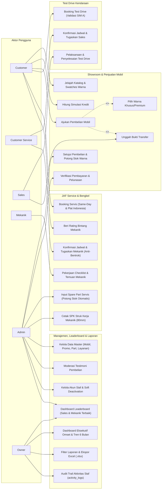

---

## BAB 4: FLOW / ALUR KERJA SISTEM (ROLE & END-TO-END)

### 4.1 Flow Khusus untuk Setiap Role (6 Flowchart Mermaid)

#### 1. Flowchart Role Customer
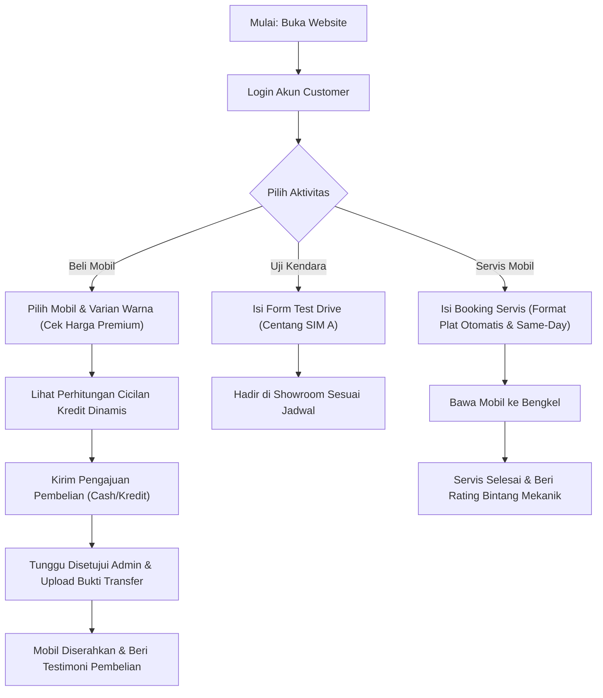

#### 2. Flowchart Role Customer Service (CS)
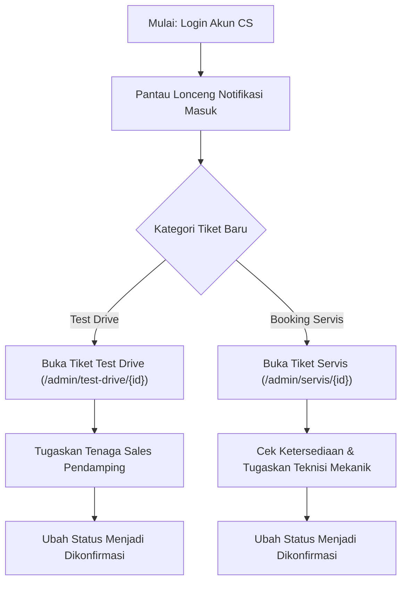

#### 3. Flowchart Role Sales
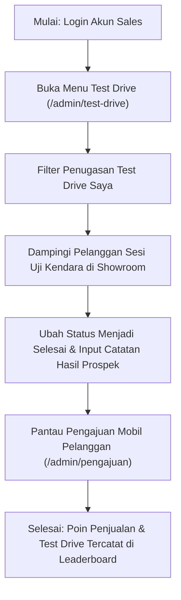

#### 4. Flowchart Role Mekanik
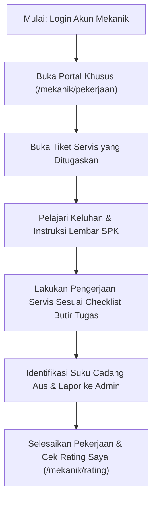

#### 5. Flowchart Role Admin
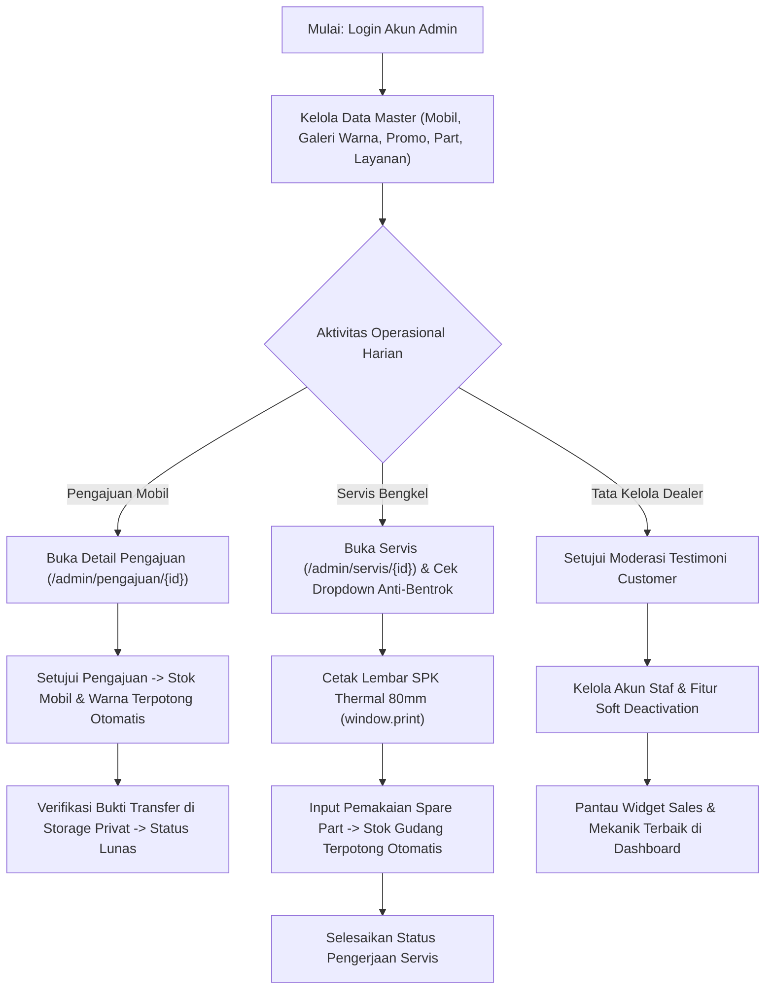

#### 6. Flowchart Role Owner
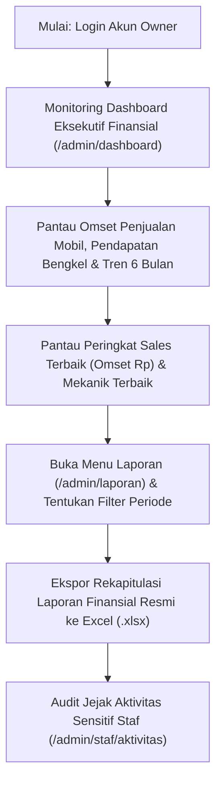

---

### 4.2 Sequence Diagram Alur Bisnis End-to-End

#### 1. Alur End-to-End Penjualan Unit Mobil
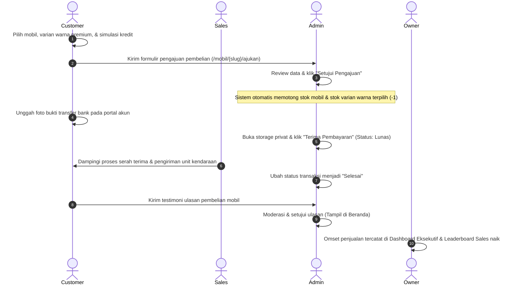

#### 2. Alur End-to-End Test Drive Kendaraan
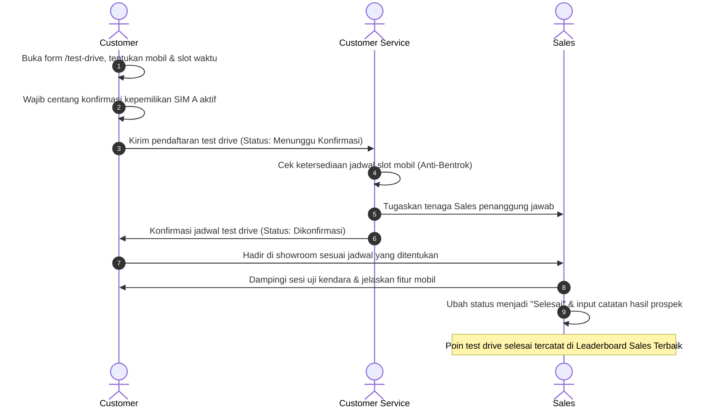

#### 3. Alur End-to-End Servis Bengkel, SPK, & Spare Part
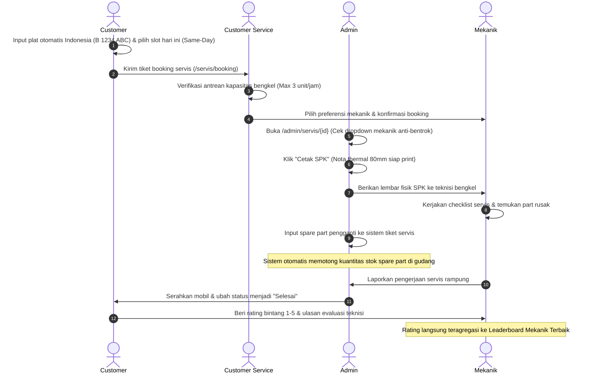

---

## BAB 5: ARSITEKTUR SISTEM & PERANCANGAN DATABASE

### 5.1 Diagram Arsitektur Sistem (Mermaid)

```mermaid
flowchart TD
    subgraph ClientTier ["Client Tier (Browser)"]
        UI_Guest["Publik / Calon Pembeli (Web Browser)"]
        UI_Customer["Portal Akun Customer (Responsive Web)"]
        UI_Staff["Portal Staf & Mekanik (Admin Console)"]
        UI_Owner["Dashboard Eksekutif Owner (Monitoring)"]
    end

    subgraph PresentationLayer ["Presentation Layer (Blade & JS)"]
        Blade["Blade Template Engine (Laravel 11)"]
        CSS["Bootstrap 5.3 + Dark/Light Theme CSS"]
        JS["Vanilla JS (Format Plat, Swatches, Kalkulator Dinamis)"]
    end

    subgraph SecurityMiddleware ["Security & Middleware Layer"]
        SecHeaders["SecurityHeaders (CSP, X-Frame, X-XSS, No-Sniff)"]
        AuthMid["Authenticate / EnsureUserIsActive"]
        RBAC["Role & Gate Middleware (can:..., role:...)"]
        Throttle["Rate Limiting (Register, Login, Booking, Submit)"]
    end

    subgraph ApplicationLayer ["Application Logic Layer"]
        Controllers["Http Controllers (Showroom, Service, Admin, Account)"]
        Actions["Action Classes (SubmitPurchase, ChangeStatus, BookService)"]
        Support["Support Services (CreditCalculator, AdminReportXlsx)"]
    end

    subgraph DataStorageLayer ["Data & Storage Layer"]
        MySQL[("MySQL 8.0 Database (InnoDB Engine)")]
        PublicStorage["Public Storage (Foto Mobil, Logo, Spare Part)"]
        PrivateStorage["Private Storage (Bukti Transfer Bank & Refund)"]
    end

    ClientTier --> PresentationLayer
    PresentationLayer --> SecurityMiddleware
    SecurityMiddleware --> ApplicationLayer
    ApplicationLayer --> DataStorageLayer
```

---

### 5.2 Entity Relationship Diagram / ERD (Mermaid)

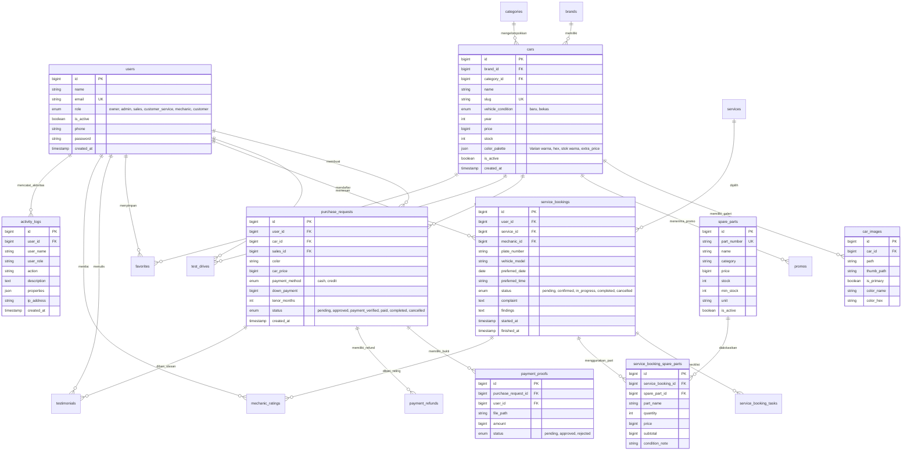

---

## BAB 6: HAK AKSES & KEAMANAN SISTEM (RBAC & SECURITY)

### 6.1 Matriks Hak Akses (Role-Based Access Control)

| Kemampuan / Fitur (*Ability*) | Customer | Customer Service | Sales | Mekanik | Admin | Owner |
| :--- | :---: | :---: | :---: | :---: | :---: | :---: |
| **Katalog Mobil (Lihat)** | ✔ | ✔ | ✔ | ✔ | ✔ | ✔ |
| **Kelola Mobil (Tambah, Ubah, Galeri Warna)** | ❌ | ❌ | ❌ | ❌ | ✔ | ❌ |
| **Hapus Master Data (Mobil, Merek, Kategori)** | ❌ | ❌ | ❌ | ❌ | ✔ | ❌ |
| **Kelola Promo & Diskon** | ❌ | ❌ | ❌ | ❌ | ✔ | ❌ |
| **Booking & Lihat Test Drive** | Buat Sendiri | Lihat Semua | Ditugaskan | ❌ | Lihat Semua | Lihat Semua |
| **Ubah Status & Jadwal Test Drive** | Batalkan | ✔ | ✔ (Selesai) | ❌ | ✔ | ❌ |
| **Pengajuan Pembelian Mobil (Lihat)** | Milik Sendiri | Lihat Semua | Ditugaskan | ❌ | Lihat Semua | Lihat Semua |
| **Ubah Status Pengajuan Pembelian** | Batalkan | ❌ | Follow-up | ❌ | ✔ | ❌ |
| **Setujui Pengajuan Pembelian (`purchases.approve`)** | ❌ | ❌ | ❌ | ❌ | ✔ | ❌ |
| **Verifikasi Bukti Pembayaran (`payments.manage`)** | Upload | ❌ | ❌ | ❌ | ✔ | ❌ |
| **Booking Servis Kendaraan (Lihat)** | Milik Sendiri | Lihat Semua | ❌ | Ditugaskan | Lihat Semua | Lihat Semua |
| **Kelola Servis (Tugaskan Mekanik & Status)** | Batalkan | ✔ | ❌ | Kerjakan | ✔ | ❌ |
| **Kelola Suku Cadang Servis & Potong Stok** | ❌ | ❌ | ❌ | Rekomendasi | ✔ | ❌ |
| **Cetak SPK Kerja Mekanik (Thermal 80mm)** | ❌ | ✔ | ❌ | Menerima | ✔ | ❌ |
| **Kelola Master Suku Cadang (Spare Part)** | Lihat | ❌ | ❌ | ❌ | ✔ | ❌ |
| **Moderasi Testimoni Pelanggan** | Tulis | ❌ | ❌ | ❌ | ✔ | ❌ |
| **Rating Bintang Mekanik** | Beri Rating | ❌ | ❌ | Lihat Pribadi | Lihat Semua | Lihat Semua |
| **Monitoring Dashboard Eksekutif & Omset** | ❌ | ❌ | ❌ | ❌ | Operasional | ✔ (Omset Rp) |
| **Leaderboard Tim Terbaik (Sales & Mekanik)** | ❌ | ❌ | Peringkat | Peringkat | ✔ | ✔ |
| **Laporan Dealer & Ekspor Excel (`.xlsx`)** | ❌ | ❌ | ❌ | ❌ | Lihat Saja | ✔ (Full Excel) |
| **Audit Trail Aktivitas Sensitif (`activity_logs`)** | ❌ | ❌ | ❌ | ❌ | ✔ | ✔ |
| **Kelola Akun Staf & Soft Deactivation** | ❌ | ❌ | ❌ | ❌ | ✔ | ✔ |
| **Pengaturan Profil & Rekening Dealer** | ❌ | ❌ | ❌ | ❌ | ✔ | ✔ |

### 6.2 Tujuh Lapis Keamanan Sistem
1. **Route Guard & Policy Gate:** Pembatasan akses route via middleware `can:...` dan role-checking. Upaya akses tanpa wewenang langsung diblokir dengan kode respon HTTP **`403 Forbidden`**.
2. **CLI Owner Creation:** Tidak ada tombol registrasi akun Owner di browser web. Akun Owner hanya dapat dibuat/diangkat melalui terminal konsol server: `php artisan user:make-owner email@domain.com`.
3. **Soft Deactivation (`EnsureUserIsActive`):** Staf yang dinonaktifkan (`is_active = false`) langsung diputus sesinya (*session invalidated*) dan gagal login.
4. **Rate Limiting & Anti-Brute-Force:** Pembatasan percobaan login, register, dan pengajuan form transaksi maksimal 5 kali per menit per alamat IP.
5. **Security Headers Middleware:** Memasang header keamanan industri siber: `X-Frame-Options: SAMEORIGIN` (anti-clickjacking), `X-Content-Type-Options: nosniff`, CSP ketat, dan penghapusan informasi header versi PHP (`X-Powered-By`).
6. **Immutable Audit Trail:** Log aktivitas staf pada model `ActivityLog` bersifat kekal (*append-only* tanpa fitur update dan delete dari aplikasi).
7. **Private Storage Shielding:** Berkas struk transfer pembayaran disimpan di folder privat tertutup `storage/app/private/` dan hanya dapat dialirkan via controller otentikasi.

---

## BAB 7: RENCANA ANGGARAN BIAYA (RAB) BESERTA PEMBAGIANNYA

Penyusunan anggaran biaya proyek pengembangan web **JAF Dealer** dihitung berdasarkan durasi pengerjaan intensif selama **4 bulan (16 minggu)**:

### 7.1 Biaya Tim Pengembang (SDM - 3 Orang)

| No | Personel Tim | Peran & Tanggung Jawab Utama | Alokasi Waktu | Honorarium / Bulan | Subtotal (4 Bulan) |
| :---: | :--- | :--- | :---: | :---: | :---: |
| 1 | **Yoseph Kewena Hayon** | **Lead Backend & Database Engineer**<br>• Perancangan arsitektur database MySQL & skema ERD.<br>• Implementasi Laravel 11, Action Classes, & Eloquent ORM.<br>• Logika bisnis: pemotongan stok otomatis, anti-bentrok jadwal, rumus kredit bunga flat, dan ekspor laporan Excel (`.xlsx`). | 4 Bulan | Rp 4.500.000 | **Rp 18.000.000** |
| 2 | **Albar Raya** | **Lead Frontend & UI/UX Designer**<br>• Perancangan antarmuka responsif & sistem tema Dark/Light mode.<br>• Implementasi Blade Templates & komponen Bootstrap 5.<br>• Rekayasa Vanilla JS: interaksi *color swatches*, format plat nomor otomatis Indonesia, filter *same-day service*, dan kalkulasi cicilan dinamis. | 4 Bulan | Rp 4.000.000 | **Rp 16.000.000** |
| 3 | **Fadhlan Muhamad Hutasoit** | **System Analyst, QA / Tester, Integrasi & Dokumentasi**<br>• Analisis kebutuhan sistem & pemodelan diagram Use Case.<br>• Penyusunan test suite otomatis (1.164 tests) & pengujian manual *Black-Box*.<br>• Penataan keamanan RBAC, migrasi data seeder, dan dokumentasi teknis sistem. | 4 Bulan | Rp 3.500.000 | **Rp 14.000.000** |
| **TOTAL** | | **Subtotal Biaya Tim Pengembang (SDM)** | | | **Rp 48.000.000** |

### 7.2 Biaya Infrastruktur & Cloud Server (Tahun ke-1)
- Domain Komersial Indonesia (`.co.id` / `.com`): Rp 250.000 / tahun
- Cloud Virtual Private Server (VPS 2 vCPU, 4GB RAM, 80GB NVMe): Rp 3.300.000 / tahun (Rp 275.000/bln)
- Sertifikat SSL Commercial Wildcard: Rp 450.000 / tahun
- Layanan SMTP Email Transaksional (Brevo / Mailgun): Rp 1.800.000 / tahun (Rp 150.000/bln)
- Cloud Storage Backup S3 (50 GB): Rp 600.000 / tahun (Rp 50.000/bln)
- **Subtotal Infrastruktur:** **Rp 6.400.000**

### 7.3 Biaya Operasional, Pengujian, & Pemeliharaan
- User Acceptance Testing (UAT) & Stress Testing: Rp 2.500.000
- Pelatihan Staf Operasional Dealer & Buku Panduan: Rp 1.500.000
- Garansi Pemeliharaan Sistem SLA 1 Tahun (Security updates & bugfix): Rp 4.200.000 (Rp 350.000/bln)
- **Subtotal Operasional:** **Rp 8.200.000**

### 7.4 Rekapitulasi Total Anggaran
- **Total Investasi Awal (Tahun ke-1):** **Rp 62.600.000,-**
- **Biaya Pemeliharaan Tahunan Berikutnya:** **± Rp 10.600.000 / tahun** (~Rp 880.000 / bulan).

---

## BAB 8: HASIL PENGUJIAN & VALIDASI SISTEM

1. **Pengujian Unit & Fitur Otomatis (`php artisan test`):**
   - Hasil eksekusi: **1.164 PASSED (100% Lulus / 0 Gagal)** dengan total **6.784 asersi** selama 99,2 detik.
   - Menguji seluruh alur transaksi: penyesuaian harga warna khusus, validasi SIM A, validasi bentrok jadwal, hak akses per role, dan pemotongan stok otomatis.
2. **Log Kesalahan Sistem (`storage/logs/laravel.log`):**
   - Tercatat **0 error runtime (bersih)**. Sistem berjalan stabil tanpa deadlock transaksi atau error 500.
3. **Pengujian Manual (Black-Box Testing):**
   - Seluruh fungsionalitas di browser telah diuji menggunakan skenario di [PANDUAN_MANUAL_TEST_JAF_DEALER.md](file:///c:/laragon/www/dm/PANDUAN_MANUAL_TEST_JAF_DEALER.md).

---

## BAB 9: PENUTUP & KESIAPAN LIVE DEMO

Sistem Informasi **JAF Dealer** telah memenuhi seluruh kualifikasi fungsional, performa, dan keamanan yang disyaratkan. Untuk menjaga kesiapan sesi live demo di hadapan dosen penguji, database transaksi dapat dikembalikan ke kondisi bersih (*clean state* = 0 transaksi) kapan saja tanpa merusak data master menggunakan perintah konsol:

```powershell
php artisan tinker --execute="
DB::statement('SET FOREIGN_KEY_CHECKS = 0');
DB::table('payment_refunds')->truncate();
DB::table('payment_proofs')->truncate();
DB::table('testimonials')->truncate();
DB::table('purchase_requests')->truncate();
DB::table('mechanic_ratings')->truncate();
DB::table('service_booking_spare_parts')->truncate();
DB::table('service_booking_tasks')->truncate();
DB::table('service_bookings')->truncate();
DB::table('test_drives')->truncate();
DB::table('favorites')->truncate();
DB::table('notifications')->truncate();
DB::table('activity_logs')->truncate();
DB::table('password_reset_tokens')->truncate();
DB::table('sessions')->truncate();
DB::statement('SET FOREIGN_KEY_CHECKS = 1');
DB::table('cars')->where('id', 1)->update(['stock' => 4]);
DB::table('cars')->where('id', 4)->update(['stock' => 5]);
DB::table('cars')->where('id', 5)->update(['stock' => 6]);
"
php artisan cache:clear
```
