# LAPORAN TUGAS AKHIR / PROYEK PENGEMBANGAN SISTEM INFORMASI

## RANCANG BANGUN SISTEM INFORMASI SHOWROOM MOBIL NISSAN & BENGKEL RESMI TERINTEGRASI BERBASIS WEB (JAF DEALER)

---

### IDENTITAS TIM PENGEMBANG PROYEK
- **Mata Kuliah / Program:** Proyek Rekayasa Perangkat Lunak / Tugas Akhir Sistem Informasi
- **Nama Tim Pengembang:**
  1. **Yoseph Kewena Hayon** — *Lead Backend & Database Engineer*
  2. **Albar Raya** — *Lead Frontend & UI/UX Designer*
  3. **Fadhlan Muhamad Hutasoit** — *System Analyst, QA / Tester, Integrasi & Dokumentasi*
- **Tahun Akademik:** 2026 / 2027
- **Teknologi Utama:** PHP 8.2+, Laravel 11 LTS, MySQL 8.0 InnoDB, Bootstrap 5.3, Vanilla JavaScript, PhpSpreadsheet

---

## RINGKASAN EKSEKUTIF (EXECUTIVE SUMMARY)

Sistem Informasi **JAF Dealer** adalah aplikasi berbasis web enterprise yang mengintegrasikan dua pilar operasional dealer otomotif: penjualan kendaraan (*showroom sales*) untuk lini kendaraan baru dan *heritage* Nissan, serta operasional bengkel perawatan resmi (*after-sales service / JAF Service*). 

Pengembangan sistem ini dilatarbelakangi oleh inefisiensi yang umum terjadi pada dealer konvensional, antara lain:
1. Katalog kendaraan statis yang tidak mampu merefleksikan varian warna asli secara dinamis maupun selisih biaya cat premium.
2. Deviasi pembulatan pada perhitungan kredit manual antara dealer dan lembaga pembiayaan (*leasing*).
3. Penumpukan antrean servis dan tumpang tindih (*bentrok*) penugasan mekanik pada slot waktu kerja yang sama.
4. Kebocoran inventaris akibat pemakaian suku cadang bengkel yang tidak terintegrasi secara *real-time* dengan pengurangan stok master gudang.
5. Lemahnya pengawasan eksekutif (*Owner*) terhadap omset berkala, evaluasi kinerja tim, dan rekonsiliasi laporan keuangan.

Untuk menjawab permasalahan tersebut, JAF Dealer dikembangkan dengan arsitektur modern berbasis **Laravel 11**, pola desain **Action Classes**, pengamanan berlapis **Role-Based Access Control (RBAC)** untuk 6 aktor (Customer, Customer Service, Sales, Mekanik, Admin, Owner), serta pengamanan penyimpanan berkas privat. Sistem ini menghadirkan fitur-fitur inovatif:
- *Interactive Color Swatches & Dynamic Premium Pricing* yang secara instan menyesuaikan harga kendaraan, DP minimal, dan angsuran kredit di browser.
- *Smart Same-Day Service Booking* dengan format plat nomor standar Indonesia otomatis (`B 1234 ABC`) dan *dynamic buffer*.
- *Anti-Conflict Mechanic Assignment* pada dropdown Service Advisor/Admin yang memvalidasi ketersediaan teknisi.
- Penerbitan dokumen Surat Perintah Kerja (SPK) format struk thermal 80mm siap cetak.
- *Automated Stock Deduction* untuk unit mobil dan pemakaian suku cadang bengkel.
- *Leaderboard Eksekutif* untuk pemeringkatan Sales Terbaik (berdasarkan omset Rp dan unit terjual) dan Mekanik Terbaik (berdasarkan skor rating ulasan), serta ekspor laporan finansial resmi ke format Microsoft Excel (`.xlsx`).

Sistem telah diuji secara komprehensif dengan **1.164 pengujian otomatis unit & fitur (`php artisan test`) yang mencatatkan tingkat kelulusan 100% (0 gagal, 6.784 asersi)** serta evaluasi *Black-Box Testing* yang tervalidasi stabil dengan log kesalahan sistem `laravel.log` bersih (0 *runtime exception*).

---

## KATA PENGANTAR

Puji dan syukur kami panjatkan ke hadirat Tuhan Yang Maha Esa atas limpahan rahmat dan karunia-Nya, sehingga laporan proyek perancangan dan implementasi **"Sistem Informasi Showroom Mobil Nissan & Bengkel Resmi Terintegrasi (JAF Dealer)"** ini dapat diselesaikan dengan baik dan tepat waktu.

Laporan ini disusun sebagai dokumentasi teknis, analisis kebutuhan, perancangan arsitektur, dan laporan evaluasi sistem yang komprehensif dalam rangka pemenuhan Tugas Akhir / Proyek Rekayasa Perangkat Lunak. 

Kami menyampaikan terima kasih yang sebesar-besarnya kepada:
1. Dosen Pembimbing dan Dosen Penguji yang telah memberikan arahan, saran, serta kritik membangun selama proses perancangan hingga pengujian sistem.
2. Rekan-rekan tim pengembang yang telah bekerja secara sinergis:
   - **Yoseph Kewena Hayon** atas dedikasinya dalam merancang arsitektur backend, optimasi kueri basis data, dan integritas transaksi finansial.
   - **Albar Raya** atas keahlian desain antarmuka responsif, penerapan tema gelap/terang, dan interaktivitas JavaScript sisi klien.
   - **Fadhlan Muhamad Hutasoit** atas ketelitiannya dalam menyusun skenario analisis kebutuhan, pengujian otomatis berdaya cakup tinggi, serta dokumentasi sistem.
3. Seluruh pihak yang telah memberikan dukungan teknis maupun moril selama pelaksanaan proyek ini.

Kami menyadari bahwa laporan ini masih memiliki ruang untuk pengembangan lebih lanjut. Oleh karena itu, kami mengharapkan kritik dan saran yang konstruktif dari para pembaca dan penguji demi penyempurnaan sistem di masa depan.

Jakarta, November 2026  
**Tim Pengembang JAF Dealer**

---

# DAFTAR ISI

1. **BAB I: PENDAHULUAN**
   - 1.1 Latar Belakang Masalah
   - 1.2 Rumusan Masalah
   - 1.3 Batasan Masalah
   - 1.4 Tujuan Pengembangan Sistem
   - 1.5 Manfaat Sistem
2. **BAB II: LANDASAN TEORI & TEKNOLOGI PENDUKUNG**
   - 2.1 Framework Laravel 11 & Action Pattern
   - 2.2 Blade Templating, Bootstrap 5.3, & Vanilla JavaScript
   - 2.3 Basis Data Relasional MySQL 8.0 & Pessimistic Locking
   - 2.4 Keamanan Data, Public vs Private Storage, & Audit Trail
   - 2.5 Metodologi Pengembangan Perangkat Lunak
3. **BAB III: ANALISIS KEBUTUHAN & USE CASE SYSTEM**
   - 3.1 Analisis Kebutuhan Fungsional & Non-Fungsional
   - 3.2 Identifikasi & Karakteristik 6 Aktor Sistem
   - 3.3 Spesifikasi Detail 13 Modul Sistem (Input, Proses, Output)
   - 3.4 Global Use Case Diagram (PlantUML & Mermaid)
   - 3.5 Skenario Use Case Lengkap (4 Kasus Kritis)
4. **BAB IV: PERANCANGAN ARSITEKTUR & BASIS DATA**
   - 4.1 Arsitektur Perangkat Lunak Multi-Tier
   - 4.2 Entity Relationship Diagram (ERD 15+ Entitas)
   - 4.3 Kamus Data (Data Dictionary) Entitas Kunci
   - 4.4 Flow Peran Pengguna (6 Flowchart Role)
   - 4.5 Sequence Diagram Alur Bisnis End-to-End
5. **BAB V: IMPLEMENTASI FITUR UNGGULAN SISTEM**
   - 5.1 Interactive Color Swatches & Dynamic Premium Pricing
   - 5.2 Auto-formatting Plat Nomor Standar Indonesia & Same-Day Service Booking
   - 5.3 Penugasan Mekanik Cerdas & Anti-Bentrok Jadwal
   - 5.4 Penerbitan Surat Perintah Kerja (SPK) Struk Thermal 80mm
   - 5.5 Pemakaian Spare Part Servis & Pemotongan Stok Gudang Otomatis
   - 5.6 Dashboard Leaderboard Eksekutif & Ekspor Laporan Excel
6. **BAB VI: KEAMANAN SISTEM & ROLE-BASED ACCESS CONTROL (RBAC)**
   - 6.1 Matriks Wewenang & Hak Akses (RBAC)
   - 6.2 Implementasi 7 Lapis Keamanan Perangkat Lunak
7. **BAB VII: RENCANA ANGGARAN BIAYA (RAB) & MANAJEMEN PROYEK**
   - 7.1 Pembagian Alokasi SDM Tim Pengembang
   - 7.2 Biaya Infrastruktur Cloud & Perangkat Lunak
   - 7.3 Biaya Operasional, UAT, Pelatihan, & Garansi SLA
   - 7.4 Rekapitulasi Anggaran & Estimasi OPEX Tahunan
8. **BAB VIII: HASIL PENGUJIAN & VALIDASI SISTEM**
   - 8.1 Pengujian Unit & Fitur Otomatis (`php artisan test`)
   - 8.2 Pengujian Fungsional Manual (Black-Box Testing)
   - 8.3 Evaluasi Log Kesalahan Sistem
9. **BAB IX: PENUTUP & KESIAPAN OPERASIONAL**
   - 9.1 Kesimpulan
   - 9.2 Saran Pengembangan Sistem
   - 9.3 Prosedur Reset Database (*Clean State*) untuk Live Demo
10. **DAFTAR PUSTAKA**

---

# BAB I: PENDAHULUAN

### 1.1 Latar Belakang Masalah
Industri ritel otomotif mengalami dinamika persaingan yang menuntut digitalisasi terpadu. Pada lanskap operasional dealer kendaraan saat ini, interaksi dengan pelanggan tidak lagi terbatas pada kunjungan fisik ke showroom, melainkan dimulai dari eksplorasi digital melalui platform web. Di sisi lain, pendapatan dealer sangat ditopang oleh keberlangsungan layanan purna jual (*after-sales service*) yang mencakup servis berkala, perbaikan kendaraan, dan penggantian suku cadang asli.

Namun, banyak dealer resmi skala menengah masih beroperasi dengan sistem yang terpisah (*disjointed systems*) atau pencatatan semi-manual. Kondisi ini melahirkan sejumlah permasalahan nyata:
1. **Ketidaksesuaian Visualisasi & Transparansi Biaya Varian Warna:** Calon pembeli mobil sering kali ingin melihat kendaraan dalam pilihan warna spesifik. Pada kendaraan tertentu (misalnya model performa tinggi seperti Nissan GT-R R35 atau edisi heritage Skyline GT-R R34), terdapat cat khusus (*premium paint*) seperti *Midnight Purple* atau *Millennium Jade* yang membebankan biaya tambahan signifikan (mencapai puluhan juta rupiah). Sistem konvensional umumnya menampilkan foto generik dengan harga flat, sehingga pembeli terkejut saat menerima surat penawaran resmi.
2. **Ketidakakuratan Kalkulasi Angsuran Kredit:** Sebagian besar pembelian kendaraan dilakukan melalui skema pembiayaan (kredit). Perhitungan manual atau kalkulator kredit sederhana kerap menghasilkan deviasi nilai angsuran akibat penanganan nilai desimal yang tidak konsisten dengan standar pembulatan bank.
3. **Ketidakteraturan Antrean Bengkel & Bentrok Penugasan Teknisi:** Pelanggan yang datang langsung ke bengkel (*walk-in*) sering menghadapi waktu tunggu yang lama. Ketika pendaftaran online dibuka tanpa sistem kuota per jam dan tanpa deteksi jadwal teknisi, sering kali terjadi penugasan mekanik yang tumpang tindih (*double-booking*) pada jam kerja yang sama, menurunkan produktivitas bengkel.
4. **Kebocoran Inventaris Suku Cadang Bengkel:** Penggunaan oli, filter, busi, dan komponen fast-moving lainnya saat servis sering kali baru dicatat di akhir hari atau akhir bulan. Keterlambatan ini menyebabkan selisih antara pencatatan pembukuan dengan stok fisik di rak gudang (*inventory shrinkage*).
5. **Ketiadaan Alat Monitoring Kinerja Staf & Evaluasi Finansial Terpusat:** Pemilik dealer (*Owner*) kesulitan memantau personil penjualan (*Sales*) yang paling produktif menghasilkan omset dan teknisi (*Mekanik*) yang memiliki reputasi kepuasan pelanggan tertinggi. Rekonsiliasi data untuk audit keuangan bulanan memakan waktu lama karena harus menarik data dari berbagai berkas kertas.

### 1.2 Rumusan Masalah
Berdasarkan latar belakang di atas, rumusan masalah dalam proyek ini adalah:
1. Bagaimana merancang antarmuka katalog mobil interaktif yang dapat mengubah visualisasi foto galeri, menghitung penambahan harga cat premium secara *real-time*, dan memperbarui simulasi angsuran kredit secara otomatis?
2. Bagaimana membangun mekanisme pendaftaran servis harian (*same-day service*) yang mencegah over-capacity bengkel, memvalidasi format plat nomor standar Indonesia secara instan, dan mencegah bentrok penugasan teknisi mekanik?
3. Bagaimana mengintegrasikan pemakaian suku cadang dalam Surat Perintah Kerja (SPK) servis agar secara otomatis memotong stok gudang secara konsisten (*atomicity*)?
4. Bagaimana menerapkan pembagian hak akses terperinci (*Role-Based Access Control*) untuk 6 aktor serta menyajikan dasbor performa tim terbaik (*leaderboard*) dan laporan finansial yang dapat diekspor ke format Excel resmi?

### 1.3 Batasan Masalah
Ruang lingkup dan batasan dalam pengembangan sistem ini meliputi:
1. Lini produk kendaraan difokuskan pada 14 unit mobil Nissan (unit baru dan heritage) dengan database varian warna, galeri multi-sudut, dan spesifikasi mesin lengkap.
2. Simulasi kredit menggunakan skema suku bunga flat konvensional dengan parameter Uang Muka (DP) 20% hingga 90% serta tenor 12, 24, 36, 48, dan 60 bulan.
3. Alur pembayaran mobil mendukung metode Cash dan Kredit, dengan mekanisme verifikasi berkas transfer bank yang diunggah oleh pelanggan dan disimpan pada direktori privat yang terlindungi.
4. Operasional bengkel difokuskan pada pemesanan servis berkala (*booking*), penugasan mekanik, *checklist* pemeriksaan fisik, pemakaian suku cadang resmi, penerbitan struk SPK cetak format thermal 80mm, serta pemberian rating bintang (1–5) oleh pelanggan.
5. Pembuatan akun Owner dibatasi secara ketat melalui antarmuka konsol server (*Command Line Interface* / CLI) demi mencegah ekskalasi hak akses ilegal melalui antarmuka web.

### 1.4 Tujuan Pengembangan Sistem
Tujuan yang dicapai melalui pengembangan sistem JAF Dealer:
1. Menghadirkan portal web responsif yang memberikan transparansi visual dan finansial dalam pemilihan kendaraan, warna cat khusus, dan simulasi kredit.
2. Membangun modul operasional bengkel terotomatisasi yang memitigasi bentrok teknisi, membatasi kapasitas antrean servis harian, dan menghasilkan SPK standar industri.
3. Menjamin akurasi inventaris dealer melalui mekanisme pemotongan stok otomatis saat pembelian mobil disetujui dan saat suku cadang dialokasikan ke tiket servis.
4. Menerapkan tata kelola sistem berbasis hak akses least-privilege, audit log aktivitas sensitif, serta penyediaan data analytics bagi pengambil keputusan (*executive dashboard & Excel reports*).

### 1.5 Manfaat Sistem
- **Bagi Pelanggan (Customer):** Memberikan kenyamanan transaksi digital, transparansi harga dan cicilan, kemudahan reservasi uji kendara (*test drive*) tanpa antre, serta transparansi biaya pengerjaan servis mobil.
- **Bagi Staf Customer Service & Sales:** Mempermudah alokasi jadwal temu pelanggan, monitoring status pemesanan kendaraan, dan pencatatan riwayat uji kendara secara terstruktur.
- **Bagi Teknisi Mekanik:** Memperoleh lembar instruksi kerja (SPK) yang jelas, daftar *checklist* pekerjaan yang terstandarisasi, dan rekognisi performa melalui akumulasi rating bintang kepuasan pelanggan.
- **Bagi Administrator & Pemilik (Admin & Owner):** Mengeliminasi kebocoran inventaris, menyederhanakan audit operasional melalui *activity logs*, memotivasi staf melalui *leaderboard* transparan, dan mempercepat rekonsiliasi keuangan melalui laporan Excel yang terstruktur.

---

# BAB II: LANDASAN TEORI & TEKNOLOGI PENDUKUNG

### 2.1 Framework Laravel 11 & Action Pattern
Laravel 11 merupakan kerangka kerja pengembangan web berbasis PHP yang mengusung arsitektur Model-View-Controller (MVC) dengan penyempurnaan struktur konfigurasi yang ramping. Pada proyek JAF Dealer, Laravel 11 dikombinasikan dengan arsitektur **Action Classes Pattern**. 

Pola ini memisahkan logika bisnis yang kompleks dari Controller ke dalam kelas tunggal yang memiliki tanggung jawab tunggal (*Single Responsibility Principle*). Contoh implementasinya adalah kelas `App\Actions\Purchase\ApprovePurchaseAction` yang mengelola validasi stok, penguncian data, pemotongan stok mobil, pemotongan kuantitas varian warna spesifik, pencatatan log audit, dan pengiriman notifikasi dalam satu transaksi database tunggal.

### 2.2 Blade Templating, Bootstrap 5.3, & Vanilla JavaScript
Antarmuka pengguna (*frontend*) dibangun menggunakan **Blade Template Engine** yang dipadukan dengan **Bootstrap 5.3 CSS Framework**. Blade memfasilitasi modularisasi antarmuka melalui *component layout*, *partials*, dan *slot injection*.

Untuk memastikan performa muat halaman yang optimal tanpa *overhead* pustaka pihak ketiga yang berat, interaktivitas halaman dibangun menggunakan **Vanilla JavaScript murni**. Fitur-fitur seperti *interactive color swatches*, pemformatan plat nomor polisi Indonesia secara *real-time*, validasi tanggal pemesanan servis *same-day*, serta kalkulasi dinamis tabel cicilan kredit dieksekusi secara instan di sisi klien (*client-side execution*) dengan efisiensi memori yang tinggi.

### 2.3 Basis Data Relasional MySQL 8.0 & Pessimistic Locking
Manajemen data dikelola oleh **MySQL 8.0** menggunakan mesin penyimpanan **InnoDB**. InnoDB mendukung integritas data referensial melalui *Foreign Key Constraints* dengan aksi kaskade yang terkontrol.

Untuk mencegah terjadinya kondisi balapan (*race condition*) atau pembacaan data kotor (*dirty read*) pada transaksi krusial (misalnya ketika dua pelanggan mengajukan pembelian mobil dengan sisa stok 1 unit secara bersamaan), sistem menerapkan mekanisme **Pessimistic Locking** menggunakan klausa `lockForUpdate()`. Kueri ini mengunci baris data di level basis data hingga transaksi selesai (`commit` atau `rollback`), menjamin tidak terjadi *overselling*.

### 2.4 Keamanan Data, Public vs Private Storage, & Audit Trail
Sistem memisahkan penyimpanan berkas ke dalam dua zona:
1. **Public Storage (`storage/app/public/`):** Menyimpan aset gambar yang dapat diakses publik melalui symbolic link web, seperti galeri foto mobil, logo merek, dan foto suku cadang.
2. **Private Storage (`storage/app/private/`):** Menyimpan berkas transaksi sensitif, khususnya foto bukti transfer bank pelanggan (`payment-proofs`) dan nota pengembalian dana (`payment-refunds`). Berkas pada direktori ini tidak dipublikasikan ke web server dan hanya dapat diunduh melalui rute terproteksi yang memverifikasi identitas pengguna melalui controller otentikasi.

Selain itu, seluruh aktivitas krusial dicatat ke dalam tabel `activity_logs`. Model ini dirancang bersifat *immutable* (hanya mendukung aksi *create* tanpa fitur *edit* atau *delete* dari antarmuka web), memastikan rekaman audit dapat dipercaya secara forensik.

### 2.5 Metodologi Pengembangan Perangkat Lunak
Pengembangan sistem mengadopsi pendekatan **Iterative & Incremental Development** yang menggabungkan prinsip-prinsip Agile. Setiap tahapan iterasi mencakup analisis kebutuhan, perancangan skema, pengkodean logika bisnis, pengujian otomatis berulang (*Test-Driven mindset*), hingga evaluasi antarmuka. Pendekatan ini memungkinkan identifikasi dini terhadap potensi anomali logika bisnis sebelum sistem memasuki fase uji terima akhir (*User Acceptance Test*).

---

# BAB III: ANALISIS KEBUTUHAN & USE CASE SYSTEM

### 3.1 Analisis Kebutuhan Fungsional & Non-Fungsional

#### Kebutuhan Fungsional (Functional Requirements)
1. **FR-01 (Katalog & Warna):** Sistem harus mampu menampilkan katalog mobil beserta spesifikasi, galeri foto, dan tombol pilihan warna interaktif (*color swatches*) yang menyesuaikan foto utama dan menghitung harga cat premium secara otomatis.
2. **FR-02 (Komparasi Kendaraan):** Sistem harus mampu menjajarkan spesifikasi teknis 2 hingga 4 unit kendaraan secara berdampingan.
3. **FR-03 (Simulasi Finansial):** Sistem harus menyediakan simulasi kredit bunga flat dengan persentase DP 20%–90%, pilihan tenor 1–5 tahun, dan pembulatan angsuran ke kelipatan Rp 1.000 terdekat.
4. **FR-04 (Pemesanan Test Drive):** Sistem harus memvalidasi kepemilikan SIM A aktif dan memverifikasi ketersediaan jadwal mobil uji kendara agar tidak terjadi bentrok pemesanan unit.
5. **FR-05 (Pengajuan Pembelian):** Sistem harus mencatat pemesanan mobil (Cash/Kredit), mengunci varian warna terpilih, dan secara otomatis memotong stok mobil serta stok warna sebesar 1 unit saat pengajuan disetujui Admin.
6. **FR-06 (Verifikasi Pembayaran):** Sistem harus mengamankan unggahan berkas bukti transfer ke penyimpanan privat dan memfasilitasi verifikasi pelunasan oleh Admin.
7. **FR-07 (Booking Servis Cerdas):** Sistem harus memformat plat nomor Indonesia secara otomatis, mendukung pendaftaran di hari yang sama (*same-day*) dengan pembatasan jam operasional, dan membatasi kuota maksimal 3 unit per slot jam.
8. **FR-08 (Penugasan Mekanik Anti-Bentrok):** Sistem harus mendeteksi kesibukan teknisi mekanik secara *real-time* dan menonaktifkan pilihan teknisi yang sudah memiliki jadwal kerja pada slot jam yang sama.
9. **FR-09 (Surat Perintah Kerja):** Sistem harus mampu mencetak dokumen SPK format struk thermal 80mm yang memuat identitas pelanggan, keluhan kendaraan, *checklist* inspeksi, dan alokasi suku cadang.
10. **FR-10 (Pengurangan Stok Suku Cadang):** Sistem harus secara otomatis memotong stok gudang saat suku cadang dimasukkan ke dalam tiket pengerjaan servis, dan mengembalikan stok jika dibatalkan.
11. **FR-11 (Evaluasi Reputasi):** Sistem harus memfasilitasi pemberian ulasan pembelian mobil termoderasi dan penilaian rating bintang (1–5) teknisi mekanik.
12. **FR-12 (Dasbor & Laporan Eksekutif):** Sistem harus menampilkan peringkat Sales dan Mekanik Terbaik serta menyajikan fitur unduh laporan finansial resmi ke format Excel (`.xlsx`).

#### Kebutuhan Non-Fungsional (Non-Functional Requirements)
1. **NFR-01 (Keamanan):** Menerapkan enkripsi password dengan algoritma Bcrypt/Argon2id, proteksi CSRF di seluruh form POST/PUT/DELETE, sanitasi input terhadap XSS, dan implementasi HTTP Security Headers (CSP, X-Frame-Options, X-Content-Type-Options).
2. **NFR-02 (Performa):** Waktu respon muat halaman publik rata-rata di bawah 1,5 detik dengan pemanfaatan aset CSS/JS termitigasi dan optimasi kueri basis data (pencegahan *N+1 query problem* via `with()`).
3. **NFR-03 (Reliabilitas):** Integritas data transaksi terlindungi dengan transaksi atomik (`DB::transaction`) dan pengujian otomatis terverifikasi 100% lulus.
4. **NFR-04 (Kemudahan Penggunaan / Usability):** Antarmuka responsif ramah perangkat bergerak (*mobile-friendly*), mendukung mode gelap (*Dark Mode*) dan terang (*Light Mode*), serta navigasi menu berbasis hierarki wewenang pengguna.

---

### 3.2 Identifikasi & Karakteristik 6 Aktor Sistem

| Nama Aktor | Definisi Peran & Tanggung Jawab Operasional |
| :--- | :--- |
| **Customer** | Pengguna publik terdaftar yang melakukan eksplorasi kendaraan, simulasi pembiayaan, pengajuan pembelian mobil, pemesanan uji kendara (*test drive*), booking servis kendaraan, pengunggahan bukti transfer, serta pemberian ulasan testimoni dan rating teknisi. |
| **Customer Service (CS)** | Staf meja depan yang bertanggung jawab memvalidasi tiket masuk, mengonfirmasi pendaftaran jadwal *test drive* dengan menugaskan Sales pendamping, serta mengonfirmasi booking servis berkala dengan menugaskan Mekanik bengkel. |
| **Sales** | Tenaga pemasar yang mendampingi sesi uji kendara calon pembeli, mencatat hasil prospek tindak lanjut, memantau pengajuan pembelian unit kendaraan, dan berkontribusi terhadap target omset dealer. |
| **Mekanik** | Teknisi bengkel yang mengakses portal kerja khusus (`/mekanik/pekerjaan`), mempelajari instruksi lembar SPK, menjalankan *checklist* butir inspeksi fisik, melaporkan temuan suku cadang aus, dan memantau reputasi rating kinerja pribadi. |
| **Admin** | Administrator operasional yang mengelola seluruh data master (mobil, varian warna, galeri, promo, layanan servis, suku cadang), menyetujui pengajuan pembelian mobil (pemotongan stok mobil & warna), memverifikasi bukti transfer pembayaran di penyimpanan privat, mengalokasikan suku cadang servis, mencetak struk SPK 80mm, memoderasi testimoni pelanggan, dan mengelola akun staf operasional. |
| **Owner** | Pemilik tunggal dealer yang memiliki hak tertinggi untuk memantau performa finansial pada *Executive Dashboard* (total omset penjualan unit dan jasa servis), memantau peringkat personil terbaik pada *Leaderboard*, memfilter dan mengekspor laporan keuangan ke format Microsoft Excel (`.xlsx`), serta mengaudit jejak aktivitas staf operasional pada log keamanan sistem. |

---

### 3.3 Spesifikasi Detail 13 Modul Sistem

```
+---------------------------------------------------------------------------------------------------+
| MODUL 1: KATALOG MOBIL, GALERI FOTO, & SWATCHES WARNA INTERAKTIF                                 |
+---------------------------------------------------------------------------------------------------+
| - Fungsi : Menampilkan data teknis 14 mobil Nissan, foto multi-sudut, dan interaksi warna cat.   |
| - Input  : Klik tombol warna (Customer); data mobil, palet warna, foto varian (Admin).            |
| - Proses : JavaScript membaca data-image-index & data-extra-price; mengubah carousel foto utama;  |
|            menghitung basePrice + extraPrice; menghitung ulang DP minimal dan tabel angsuran      |
|            kredit; menonaktifkan tombol (disabled) & meredupkan tombol jika stok warna habis (0). |
| - Output : Visualisasi foto mobil sinkron, kalkulasi harga dinamis, parameter warna terpilih.     |
+---------------------------------------------------------------------------------------------------+

+---------------------------------------------------------------------------------------------------+
| MODUL 2: PERBANDINGAN SPESIFIKASI MOBIL (KOMPARASI 2-4 UNIT)                                      |
+---------------------------------------------------------------------------------------------------+
| - Fungsi : Menjajarkan spesifikasi teknis dan harga 2 hingga 4 mobil secara berdampingan.         |
| - Input  : Pilihan unit mobil yang dimasukkan ke keranjang komparasi.                             |
| - Proses : Sesi browser menyimpan array slug mobil; memvalidasi batasan kuota 2-4 mobil;         |
|            memetakan parameter mesin, dimensi, transmisi, konsumsi BBM, dan harga jual.           |
| - Output : Tabel matriks perbandingan spesifikasi teknis yang responsif.                          |
+---------------------------------------------------------------------------------------------------+

+---------------------------------------------------------------------------------------------------+
| MODUL 3: PROMO & PENAWARAN DISKON DEALER                                                          |
+---------------------------------------------------------------------------------------------------+
| - Fungsi : Mengelola program potongan harga mobil dalam rentang tanggal promosi aktif.            |
| - Input  : Judul promo, periode tanggal mulai & selesai, nominal potongan diskon (Rp).            |
| - Proses : Kueri database mengevaluasi start_date <= today <= end_date; kalkulasi method          |
|            finalPrice() memotong harga dasar mobil secara otomatis jika ada promo aktif.          |
| - Output : Label diskon pada kartu katalog mobil, tampilan harga coret, dan halaman promo.        |
+---------------------------------------------------------------------------------------------------+

+---------------------------------------------------------------------------------------------------+
| MODUL 4: SIMULASI KREDIT BUNGA FLAT OTOMATIS                                                      |
+---------------------------------------------------------------------------------------------------+
| - Fungsi : Mengalkulasi estimasi pembiayaan angsuran mobil secara transparan dan presisi.         |
| - Input  : Harga mobil (termasuk warna premium), persentase DP (20%-90%), tenor (12-60 bulan).    |
| - Proses : Class CreditCalculator menghitung pokok hutang (Harga - DP), total bunga flat per tahun,|
|            serta cicilan per bulan dengan pembulatan integer (round to nearest Rp 1.000).        |
| - Output : Rekapitulasi finansial: nilai DP, pokok hutang, bunga flat, dan angsuran per bulan.    |
+---------------------------------------------------------------------------------------------------+

+---------------------------------------------------------------------------------------------------+
| MODUL 5: PENDAFTARAN & PENJADWALAN TEST DRIVE                                                     |
+---------------------------------------------------------------------------------------------------+
| - Fungsi : Memfasilitasi pendaftaran uji kendara calon pembeli di showroom dealer.                |
| - Input  : Pilihan mobil, tanggal kunjungan, slot jam (09.00-16.00 WIB), centang wajib SIM A.     |
| - Proses : Sistem memvalidasi pernyataan kepemilikan SIM A; mengecek jadwal bentrok pada mobil   |
|            dan jam yang sama; CS mengonfirmasi dan menugaskan Sales pendamping; Sales mencatat    |
|            hasil prospek dan menyelesaikan tiket.                                                 |
| - Output : Tiket reservasi test drive, notifikasi sistem, akumulasi skor performa Sales.          |
+---------------------------------------------------------------------------------------------------+

+---------------------------------------------------------------------------------------------------+
| MODUL 6: PENGAJUAN PEMBELIAN MOBIL & VERIFIKASI PEMBAYARAN                                        |
+---------------------------------------------------------------------------------------------------+
| - Fungsi : Menangani alur transaksi pembelian kendaraan (Cash/Kredit) dan verifikasi bukti transfer.|
| - Input  : Varian warna mobil, metode pembayaran, skema kredit, upload foto bukti transfer bank.   |
| - Proses : Sistem mengunci harga final warna khusus; saat Admin menyetujui, sistem menjalankan    |
|            DB::transaction dengan pessimistic lock, memotong stok mobil dan stok warna (-1);     |
|            bukti transfer disimpan di folder privat; Admin memverifikasi bukti hingga lunas.      |
| - Output : Surat pesanan kendaraan, nomor registrasi transaksi, status lunas, invoice PDF cetak.  |
+---------------------------------------------------------------------------------------------------+

+---------------------------------------------------------------------------------------------------+
| MODUL 7: BOOKING SERVIS BENGKEL PELANGGAN (SAME-DAY SERVICE)                                      |
+---------------------------------------------------------------------------------------------------+
| - Fungsi : Reservasi perawatan kendaraan berkala secara online tanpa antrean manual.              |
| - Input  : Plat nomor polisi, model mobil, tahun, KM, paket servis, tanggal, jam, keluhan.        |
| - Proses : JS memformat plat polisi otomatis (contoh: b1234abc -> B 1234 ABC); sistem mendukung   |
|            same-day booking dengan dynamic buffer minimal 1 jam dan cutoff pukul 14.00 WIB;       |
|            sistem membatasi maksimal 3 mobil per slot jam operasional bengkel.                    |
| - Output : Tiket booking servis digital, penyimpanan data mobil ke profil pengguna.               |
+---------------------------------------------------------------------------------------------------+

+---------------------------------------------------------------------------------------------------+
| MODUL 8: MANAJEMEN BENGKEL, PENUGASAN MEKANIK, SPK, & SUKU CADANG                                 |
+---------------------------------------------------------------------------------------------------+
| - Fungsi : Manajemen pengerjaan teknis servis oleh Service Advisor dan Mekanik bengkel.           |
| - Input  : Penugasan teknisi mekanik, checklist butir pengerjaan, alokasi suku cadang pengganti.   |
| - Proses : Dropdown mekanik cerdas mendeteksi kesibukan real-time dan mengunci mekanik bentrok;   |
|            rute cetak SPK menyajikan lembar kerja thermal 80mm; penambahan spare part ke servis   |
|            secara instan memotong kuantitas stok gudang (penghapusan part mengembalikan stok).    |
| - Output : Lembar SPK fisik tercetak, rekapitulasi biaya servis, sinkronisasi stok gudang.        |
+---------------------------------------------------------------------------------------------------+

+---------------------------------------------------------------------------------------------------+
| MODUL 9: KATALOG SUKU CADANG (SPARE PART) & MONITORING INVENTARIS                                 |
+---------------------------------------------------------------------------------------------------+
| - Fungsi : Menampilkan etalase suku cadang resmi dan pengawasan batas minimum stok gudang.        |
| - Input  : Nomor part (SKU), nama komponen, kategori, harga satuan, stok fisik, batas stok minimum.|
| - Proses : Pengecekan status ketersediaan; penandaan status 'Menipis' (stok <= min_stock) dan     |
|            'Habis' (stok = 0) untuk keperluan restock pengadaan suku cadang.                      |
| - Output : Katalog suku cadang publik dan notifikasi peringatan stok di dashboard admin.          |
+---------------------------------------------------------------------------------------------------+

+---------------------------------------------------------------------------------------------------+
| MODUL 10: ULASAN TESTIMONI PEMBELIAN & RATING BINTANG MEKANIK                                     |
+---------------------------------------------------------------------------------------------------+
| - Fungsi : Penjaringan feedback kepuasan pelanggan terhadap showroom dan layanan teknisi bengkel. |
| - Input  : Skor rating bintang (1-5) dan teks komentar ulasan dari akun Customer.                 |
| - Proses : Ulasan pembelian mobil masuk antrean moderasi Admin sebelum dipublikasikan ke Beranda; |
|            rating servis mobil langsung diagregasikan ke profil Mekanik pada Leaderboard.         |
| - Output : Testimoni publik terverifikasi dan reputasi bintang teknisi bengkel.                   |
+---------------------------------------------------------------------------------------------------+

+---------------------------------------------------------------------------------------------------+
| MODUL 11: PUSAT NOTIFIKASI PENGGUNA & STAF                                                        |
+---------------------------------------------------------------------------------------------------+
| - Fungsi : Distribusi pemberitahuan instan atas perubahan status tiket transaksi sistem.          |
| - Input  : Event pemicu (booking baru, persetujuan pembelian, verifikasi transfer, servis selesai)|
| - Proses : Pencatatan record notifikasi ke tabel notifications dengan auto-linking ke URL tiket.  |
| - Output : Counter badge merah di lonceng navbar dan panel daftar riwayat pemberitahuan.          |
+---------------------------------------------------------------------------------------------------+

+---------------------------------------------------------------------------------------------------+
| MODUL 12: MANAJEMEN AKUN STAF, SOFT DEACTIVATION, & AUDIT TRAIL                                   |
+---------------------------------------------------------------------------------------------------+
| - Fungsi : Tata kelola identitas akun staf dealer dan pemantauan keamanan operasional.            |
| - Input  : Nama, email, telepon, role jabatan, dan sakelar status aktif (is_active).              |
| - Proses : Fitur Soft Deactivation memutuskan sesi login staf non-aktif via EnsureUserIsActive;   |
|            seluruh aksi sensitif dicatat ke tabel activity_logs secara permanen (immutable).      |
| - Output : Manajemen personil terisolasi dan log audit aktivitas lengkap dengan IP Address.       |
+---------------------------------------------------------------------------------------------------+

+---------------------------------------------------------------------------------------------------+
| MODUL 13: DASHBOARD LEADERBOARD EKSEKUTIF & EKSPOR LAPORAN EXCEL                                  |
+---------------------------------------------------------------------------------------------------+
| - Fungsi : Analitik performa bisnis dealer dan penyusunan laporan keuangan formal.                |
| - Input  : Data agregasi transaksi penjualan mobil dan tiket servis yang telah berstatus selesai.  |
| - Proses : Algoritma meranking Top 3 Sales Terbaik (unit terjual, omset Rp, test drive selesai);  |
|            meranking Top 3 Mekanik Terbaik (skor rating bintang, ulasan, total pengerjaan servis);|
|            service AdminReportXlsx mengompilasi lembar kerja Excel dengan border dan format mata  |
|            uang Rupiah resmi via PhpSpreadsheet.                                                  |
| - Output : Widget Leaderboard berlabel emas 'Terbaik #1' dan berkas unduhan Laporan_Dealer_JAF.xlsx|
+---------------------------------------------------------------------------------------------------+
```

---

### 3.4 Global Use Case Diagram

#### 1. Format PlantUML

```plantuml
@startuml
left to right direction
skinparam packageStyle rectangle
skinparam actorStyle awesome

actor "Customer" as cust
actor "Customer Service" as cs
actor "Sales" as sales
actor "Mekanik" as mek
actor "Admin" as adm
actor "Owner" as own

rectangle "Sistem Informasi JAF Dealer Terintegrasi" {
  usecase "Jelajah Katalog & Swatches Warna" as UC_Katalog
  usecase "Hitung Simulasi Kredit Dinamis" as UC_Kredit
  usecase "Booking Test Drive (Validasi SIM A)" as UC_TD
  usecase "Ajukan Pembelian Mobil" as UC_Beli
  usecase "Pilih Varian Warna Cat Premium" as UC_Warna
  usecase "Unggah Bukti Transfer Pembayaran" as UC_Bukti
  usecase "Booking Servis (Same-Day & Plat Indo)" as UC_Servis
  usecase "Beri Testimoni & Rating Mekanik" as UC_Rating

  usecase "Konfirmasi Jadwal Test Drive" as UC_KonfTD
  usecase "Tugaskan Tenaga Sales Pendamping" as UC_AssignSales
  usecase "Konfirmasi Jadwal Booking Servis" as UC_KonfServis
  usecase "Tugaskan Mekanik (Anti-Bentrok)" as UC_AssignMek

  usecase "Pantau Penugasan Test Drive" as UC_ViewTD
  usecase "Selesaikan Uji Kendara & Catat Prospek" as UC_FinTD
  usecase "Follow-Up Pengajuan Pembelian" as UC_FollowUp

  usecase "Akses Portal Tiket Servis Saya" as UC_ViewJob
  usecase "Jalankan Checklist Inspeksi & Temuan" as UC_DoJob
  usecase "Pantau Skor Rating Mekanik Pribadi" as UC_ViewRating

  usecase "Kelola Master Data (Mobil, Promo, Part)" as UC_Master
  usecase "Setujui Pembelian (Potong Stok Warna)" as UC_ApproveBeli
  usecase "Verifikasi Bukti Transfer di Storage Privat" as UC_VerifBayar
  usecase "Input Spare Part Servis (Potong Stok Gudang)" as UC_InputPart
  usecase "Cetak SPK Struk Thermal 80mm" as UC_CetakSPK
  usecase "Moderasi Testimoni Pembelian" as UC_ModUlasan
  usecase "Kelola Akun Staf & Soft Deactivation" as UC_Staff

  usecase "Monitoring Executive Dashboard & Omset Rp" as UC_DashOwner
  usecase "Pantau Leaderboard Tim Terbaik" as UC_Leaderboard
  usecase "Filter & Ekspor Laporan Finansial (.xlsx)" as UC_Laporan
  usecase "Audit Log Aktivitas Keamanan Staf" as UC_Audit
}

cust --> UC_Katalog
cust --> UC_Kredit
cust --> UC_TD
cust --> UC_Beli
cust --> UC_Servis
cust --> UC_Rating
cust --> UC_Bukti

UC_Beli .> UC_Warna : <<include>>
UC_Beli .> UC_Bukti : <<extend>>

cs --> UC_KonfTD
cs --> UC_KonfServis
UC_KonfTD .> UC_AssignSales : <<include>>
UC_KonfServis .> UC_AssignMek : <<include>>

sales --> UC_ViewTD
sales --> UC_FinTD
sales --> UC_FollowUp

mek --> UC_ViewJob
mek --> UC_DoJob
mek --> UC_ViewRating

adm --> UC_Master
adm --> UC_ApproveBeli
adm --> UC_VerifBayar
adm --> UC_InputPart
adm --> UC_CetakSPK
adm --> UC_ModUlasan
adm --> UC_Staff
adm --> UC_Leaderboard

own --> UC_DashOwner
own --> UC_Leaderboard
own --> UC_Laporan
own --> UC_Audit
@enduml
```

#### 2. Format Mermaid

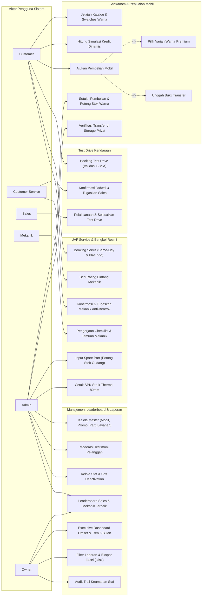

---

### 3.5 Skenario Use Case Lengkap (4 Kasus Kritis)

#### Kasus 1: Simulasi Kredit, Pemilihan Warna Premium, & Pengajuan Pembelian Mobil
- **Aktor Utama:** Customer
- **Aktor Pendukung:** Admin, Sales
- **Pre-condition:** Customer telah memiliki akun dan berada dalam status login di sistem; unit mobil memiliki status aktif dengan sisa stok > 0.
- **Main Flow (Alur Utama):**
  1. Customer membuka halaman detail mobil (`/mobil/{slug}`).
  2. Customer mengeklik salah satu varian warna pada *color swatches* (misal: *Midnight Purple*).
  3. Sistem mengubah tampilan galeri foto mobil ke sudut varian warna terpilih secara halus.
  4. Sistem mendeteksi biaya ekstra cat premium (misal: +Rp 35.000.000) dan secara otomatis menaikkan harga mobil di layar, memperbarui batas minimal DP, serta menghitung ulang cicilan pada tabel simulasi kredit di bawahnya.
  5. Customer memilih skema pembayaran (Kredit), menentukan DP (30%) dan Tenor (36 Bulan).
  6. Customer mengeklik tombol *"Ajukan Pembelian"*.
  7. Sistem membuka form pengajuan dengan parameter warna terkunci sesuai pilihan customer.
  8. Customer melengkapi alamat pengiriman dan nomor kontak, lalu menekan tombol *"Kirim Pengajuan"*.
  9. Sistem mencatat transaksi ke database dengan status `pending` dan menampilkan invoice pesanan digital.
  10. Admin membuka detail pengajuan di back-office dan menekan *"Setujui Pengajuan"*.
  11. Sistem secara atomik memotong stok master mobil (-1 unit) dan mengurangi stok varian warna spesifik (-1 unit).
  12. Customer mengunggah foto struk transfer pembayaran ke portal akun.
  13. Admin memverifikasi bukti di folder privat dan mengubah status menjadi `paid` (Lunas).
- **Alternative Flow (Alur Alternatif):**
  - *Stok Varian Warna Habis (0):* Jika varian warna yang diklik memiliki stok 0, tombol lingkaran warna meredup (`opacity: 0.28`), menampilkan tanda silang `✕`, memunculkan label *"Stok Habis"*, dan tombol *"Ajukan Pembelian"* dinonaktifkan (`disabled`) sehingga transaksi tidak dapat dilanjutkan.
  - *Bukti Transfer Tidak Valid:* Jika Admin menolak bukti transfer karena nominal tidak sesuai, Admin menekan tombol *"Tolak Bukti"*, status kembali ke `approved`, dan Customer menerima notifikasi untuk mengunggah ulang bukti yang benar.
- **Post-condition:** Transaksi tercatat lunas, stok kendaraan berkurang akurat, dan unit siap diserahterimakan oleh Sales.

#### Kasus 2: Penjadwalan & Pelaksanaan Test Drive Kendaraan
- **Aktor Utama:** Customer
- **Aktor Pendukung:** Customer Service (CS), Sales
- **Pre-condition:** Customer memiliki akun terdaftar dan login; memiliki dokumen SIM A yang masih berlaku.
- **Main Flow:**
  1. Customer membuka menu Test Drive (`/test-drive`).
  2. Customer memilih model mobil yang diminati, tanggal uji kendara, dan slot jam kedatangan (09.00–16.00 WIB).
  3. Customer wajib mencentang kotak persetujuan: *"Saya menyatakan memiliki Surat Izin Mengemudi (SIM A) yang masih berlaku"*.
  4. Customer menekan tombol *"Kirim Pengajuan Test Drive"*.
  5. Sistem memeriksa ketersediaan slot: jika mobil tersebut belum dipesan orang lain pada jam tersebut, tiket berhasil dibuat dengan status `pending`.
  6. Staf CS menerima notifikasi di lonceng sistem, membuka tiket test drive, memilih tenaga Sales pendamping yang tersedia, dan menekan *"Konfirmasi Jadwal"*.
  7. Status tiket berubah menjadi `confirmed`, dan notifikasi jadwal dikirimkan ke akun Customer dan akun Sales.
  8. Pada hari pelaksanaan, Customer hadir di showroom dan didampingi oleh Sales yang bertugas.
  9. Setelah sesi selesai, Sales membuka portal admin dan menekan tombol *"Selesaikan Test Drive"* serta menuliskan catatan hasil prospek.
- **Alternative Flow:**
  - *Jadwal Bentrok:* Jika mobil yang sama telah dikonfirmasi untuk pengguna lain pada jam yang sama, form menolak pengajuan dengan pesan kesalahan validasi: *"Unit mobil sedang digunakan pada slot waktu tersebut, silakan pilih jam atau tanggal lain"*.
  - *SIM A Tidak Dicentang:* Tombol kirim pengajuan ditolak oleh validasi sisi klien dan server jika kotak SIM A tidak dicentang.
- **Post-condition:** Tiket berstatus `completed`, dan total unit test drive Sales bertambah 1 poin pada widget *Sales Terbaik*.

#### Kasus 3: Booking Servis Same-Day, SPK Struk Thermal, & Potong Stok Spare Part
- **Aktor Utama:** Customer
- **Aktor Pendukung:** Customer Service, Admin, Mekanik
- **Pre-condition:** Bengkel beroperasi pada hari kerja; stok suku cadang master tersedia di gudang.
- **Main Flow:**
  1. Customer membuka form booking servis (`/servis/booking`).
  2. Customer mengetik plat nomor kendaraan (misal: `b1234abc`).
  3. JavaScript memformat teks secara *real-time* menjadi format standar Indonesia berjarak: `B 1234 ABC`.
  4. Customer memilih tanggal booking (mendukung hari ini / *same-day*) dan slot jam kedatangan.
  5. Sistem memvalidasi ketersediaan kuota (maksimal 3 mobil per slot jam) dan jam cutoff (maksimal sebelum 14.00 WIB untuk hari ini).
  6. Customer mengirim tiket servis; CS mengonfirmasi dan menugaskan teknisi Mekanik.
  7. Admin membuka detail servis (`/admin/servis/{id}`), mengecek ketersediaan mekanik melalui dropdown anti-bentrok, dan menekan *"Cetak SPK"*.
  8. Sistem membuka jendela cetak struk thermal 80mm yang memuat data pelanggan, kendaraan, dan *checklist* pekerjaan.
  9. Lembar fisik SPK diserahkan kepada Mekanik di area bengkel.
  10. Mekanik melakukan servis dan melaporkan komponen aus (misal: Filter Oli).
  11. Admin menginput suku cadang *"Filter Oli"* (Qty: 1) ke form suku cadang servis.
  12. Sistem secara otomatis memotong stok Filter Oli di tabel `spare_parts` sebesar 1 unit.
  13. Mekanik menyelesaikan pekerjaan, Admin mengubah status servis menjadi `completed`.
  14. Customer menerima notifikasi selesai dan memberikan penilaian rating bintang (1–5) serta komentar untuk Mekanik.
- **Alternative Flow:**
  - *Mekanik Bentrok Jadwal:* Jika seorang mekanik telah ditugaskan pada mobil lain di slot jam yang sama, dropdown pada layar Admin menandai mekanik tersebut dengan label `(Bentrok jadwal jam ini)` dan atribut `disabled`, mencegah terjadinya *double-booking*.
  - *Suku Cadang Dibatalkan:* Jika suku cadang keliru dimasukkan, Admin menghapus baris part tersebut dari tiket servis, dan sistem secara otomatis mengembalikan stok master gudang (+1).
- **Post-condition:** Mobil selesai diservis, struk SPK terarsip, stok suku cadang gudang berkurang akurat, dan skor rating Mekanik langsung diagregasikan ke *Leaderboard*.

#### Kasus 4: Tata Kelola Back-Office, Leaderboard Tim Terbaik, & Laporan Excel Owner
- **Aktor Utama:** Owner
- **Aktor Pendukung:** Admin
- **Pre-condition:** Transaksi penjualan unit mobil dan pengerjaan servis telah berlangsung di sistem.
- **Main Flow:**
  1. Owner melakukan login menggunakan akun berwewenang Owner.
  2. Owner membuka Dasbor Eksekutif (`/admin/dashboard`).
  3. Sistem menyajikan grafik metrik finansial: total omset penjualan mobil, total pendapatan jasa bengkel, dan grafik tren bulanan.
  4. Owner melihat widget *Sales Terbaik* (Top 3 berdasarkan unit terjual dan nominal rupiah) serta *Mekanik Terbaik* (Top 3 berdasarkan rating bintang).
  5. Owner membuka menu Laporan (`/admin/laporan`), menentukan filter tanggal (misal: kuartal berjalan), dan menekan tombol *"Export Excel"*.
  6. Kelas pendukung `AdminReportXlsx` menyusun lembar kerja `.xlsx` lengkap dengan gaya format akuntansi resmi.
  7. Berkas `Laporan_Dealer_JAF.xlsx` terunduh secara instan ke komputer Owner.
  8. Owner membuka menu Log Aktivitas (`/admin/staf/aktivitas`) untuk meninjau riwayat login dan perubahan status yang dilakukan seluruh staf.
- **Alternative Flow:**
  - *Akses Ditolak Staf Non-Wewenang:* Jika akun ber-role Sales atau CS mencoba mengakses URL `/admin/laporan`, middleware keamanan Laravel langsung mencegat dan mengembalikan halaman error **`403 Forbidden`**.
- **Post-condition:** Pemilik dealer memperoleh transparansi operasional dan berkas audit keuangan formal siap pakai.

---

# BAB IV: PERANCANGAN ARSITEKTUR & BASIS DATA

### 4.1 Arsitektur Perangkat Lunak Multi-Tier

```mermaid
flowchart TD
    subgraph ClientTier ["Client Tier (Browser Antarmuka Pengguna)"]
        UI_Guest["Pengunjung Publik (Katalog & Komparasi)"]
        UI_Customer["Portal Akun Pelanggan (Transaksi & Booking)"]
        UI_Staff["Portal Staf Operasional (CS, Sales, Mekanik)"]
        UI_Owner["Executive Dashboard (Admin & Owner)"]
    end

    subgraph PresentationTier ["Presentation Layer (Blade & Vanilla JS)"]
        Blade["Blade Template Engine (Layout, Partials, Dark/Light Mode)"]
        JS_Swatches["JS Interactive Color Swatches & Dynamic Price"]
        JS_Plate["JS Auto-Formatting Plat Nomor Indonesia"]
        JS_Calc["JS Dynamic Credit Calculator"]
    end

    subgraph SecurityMiddleware ["Security & Middleware Tier"]
        SecHeaders["SecurityHeaders (CSP, X-Frame-Options, No-Sniff)"]
        AuthMid["Authenticate & EnsureUserIsActive (Soft Deactivation)"]
        GateMiddleware["Role & Ability Authorization (can:..., role:...)"]
        ThrottleMid["Rate Limiting (Anti-Brute Force pada Form Login & Submit)"]
    end

    subgraph ApplicationTier ["Application Logic Tier (Laravel 11)"]
        Controllers["Http Controllers (Showroom, Service, Admin, Account)"]
        ActionClasses["Action Classes (ApprovePurchase, BookService, etc.)"]
        SupportServices["Support Services (CreditCalculator, AdminReportXlsx)"]
    end

    subgraph DataStorageTier ["Data & Storage Tier"]
        MySQL[("MySQL 8.0 Database (InnoDB Engine, Pessimistic Locking)")]
        PublicDisk["Public Storage (Foto Mobil, Galeri Warna, Logo Merek)"]
        PrivateDisk["Private Storage (Bukti Transfer Bank & Dokumen Refund)"]
    end

    ClientTier --> PresentationTier
    PresentationTier --> SecurityMiddleware
    SecurityMiddleware --> ApplicationTier
    ApplicationTier --> DataStorageTier
```

---

### 4.2 Entity Relationship Diagram (ERD)

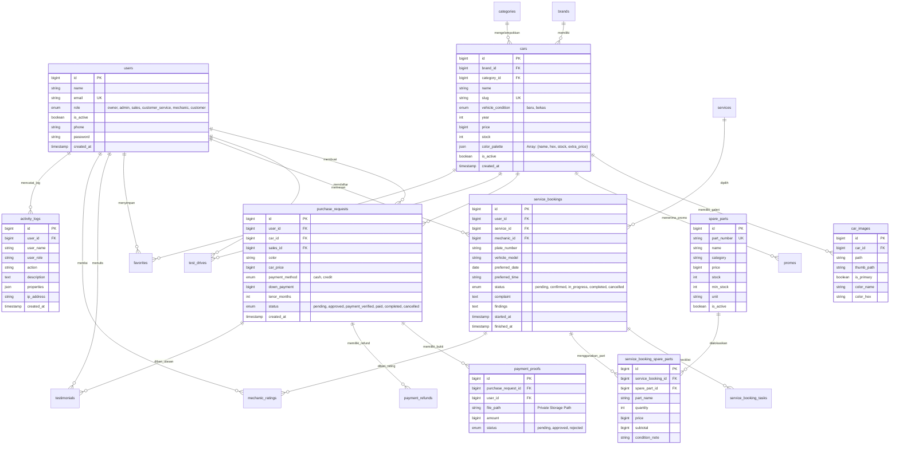

---

### 4.3 Kamus Data Entitas Kunci

#### 1. Tabel `users`
Menyimpan identitas seluruh aktor dalam sistem JAF Dealer.
- `id` (BigInt, PK, Auto Increment): Identifikator unik pengguna.
- `name` (VarChar 255, Not Null): Nama lengkap pengguna.
- `email` (VarChar 255, Unique, Not Null): Alamat surat elektronik resmi untuk otentikasi login.
- `role` (Enum: `owner`, `admin`, `sales`, `customer_service`, `mechanic`, `customer`): Klasifikasi peran hak akses pengguna.
- `is_active` (Boolean, Default True): Status keaktifan akun untuk mekanisme *Soft Deactivation*.
- `phone` (VarChar 20, Nullable): Nomor kontak seluler / WhatsApp.
- `password` (VarChar 255, Not Null): Hash kata sandi terenkripsi (Bcrypt).

#### 2. Tabel `cars`
Menyimpan data katalog 14 unit kendaraan Nissan beserta konfigurasi varian warnanya.
- `id` (BigInt, PK, Auto Increment): Identifikator unik unit mobil.
- `brand_id` (BigInt, FK ke `brands.id`): Relasi merek kendaraan (Nissan).
- `category_id` (BigInt, FK ke `categories.id`): Kategori mobil (Sedan, SUV, EV, Sports, MPV).
- `name` (VarChar 255, Not Null): Nama komersial mobil (contoh: *Nissan Kicks e-Power VL*).
- `slug` (VarChar 255, Unique, Not Null): Pengenal ramah URL (*SEO-friendly*).
- `price` (BigInt, Not Null): Harga dasar kendaraan sebelum penambahan cat premium (disimpan dalam integer rupiah penuh).
- `stock` (Integer, Not Null): Total kuantitas fisik kendaraan yang tersedia di showroom.
- `color_palette` (JSON, Not Null): Array JSON yang memuat konfigurasi varian warna kendaraan dengan skema:
  ```json
  [
    {"name": "Midnight Purple", "hex": "#2B1A2F", "stock": 2, "extra_price": 35000000},
    {"name": "Brilliant White Pearl", "hex": "#EAEAEA", "stock": 3, "extra_price": 0}
  ]
  ```

#### 3. Tabel `purchase_requests`
Menyimpan rekaman transaksi pengajuan pemesanan mobil oleh pelanggan.
- `id` (BigInt, PK, Auto Increment): Nomor registrasi pesanan.
- `user_id` (BigInt, FK ke `users.id`): Akun pelanggan pemesan.
- `car_id` (BigInt, FK ke `cars.id`): Unit mobil yang dipesan.
- `sales_id` (BigInt, FK ke `users.id`, Nullable): Tenaga Sales yang mengawal transaksi.
- `color` (VarChar 100, Not Null): Varian warna spesifik yang dipilih pembeli.
- `car_price` (BigInt, Not Null): *Snapshot* harga akhir kendaraan saat dipesan (termasuk ekstra harga cat warna khusus dan potongan promo).
- `payment_method` (Enum: `cash`, `credit`): Metode pembayaran yang diajukan.
- `down_payment` (BigInt, Default 0): Nominal uang muka yang disepakati.
- `tenor_months` (Integer, Default 0): Durasi periode angsuran dalam hitungan bulan.
- `status` (Enum: `pending`, `approved`, `payment_verified`, `paid`, `completed`, `cancelled`): Siklus status pemesanan kendaraan.

#### 4. Tabel `service_bookings`
Menyimpan data reservasi perawatan kendaraan di bengkel resmi JAF Service.
- `id` (BigInt, PK, Auto Increment): Nomor tiket servis berkala.
- `user_id` (BigInt, FK ke `users.id`): Akun pelanggan pemilik kendaraan.
- `service_id` (BigInt, FK ke `services.id`): Paket layanan yang dipilih (Servis Ringan, Berkala, Besar).
- `mechanic_id` (BigInt, FK ke `users.id`, Nullable): Teknisi mekanik yang ditugaskan menangani kendaraan.
- `plate_number` (VarChar 20, Not Null): Nomor plat registrasi kendaraan (format standar: `B 1234 ABC`).
- `vehicle_model` (VarChar 100, Not Null): Tipe/model mobil yang diservis.
- `preferred_date` (Date, Not Null): Tanggal reservasi pengerjaan.
- `preferred_time` (VarChar 10, Not Null): Slot waktu pengerjaan (contoh: `09:00`).
- `status` (Enum: `pending`, `confirmed`, `in_progress`, `completed`, `cancelled`): Siklus status pengerjaan servis bengkel.
- `complaint` (Text, Nullable): Keluhan atau catatan awal pelanggan.
- `findings` (Text, Nullable): Catatan teknis temuan mekanik saat inspeksi kendaraan.

---

### 4.4 Flow Peran Pengguna (6 Flowchart Role)

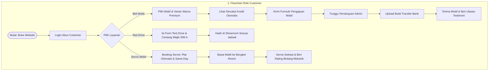

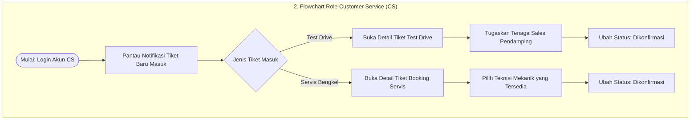

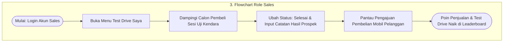

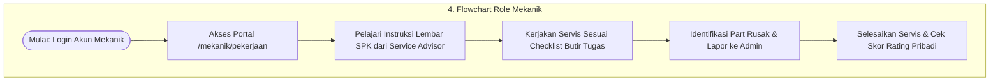

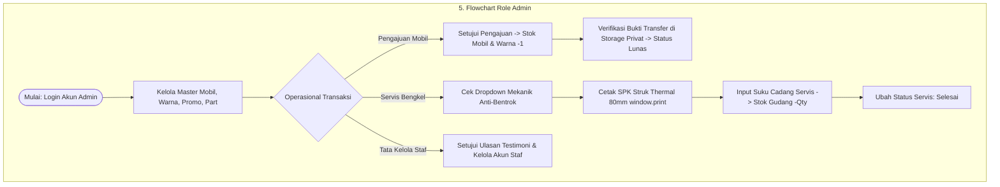

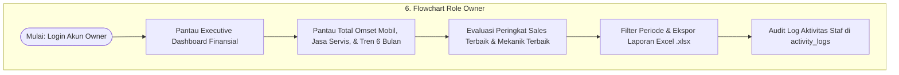

---

### 4.5 Sequence Diagram Alur Bisnis End-to-End

#### 1. Alur End-to-End Penjualan Unit Mobil & Pembayaran

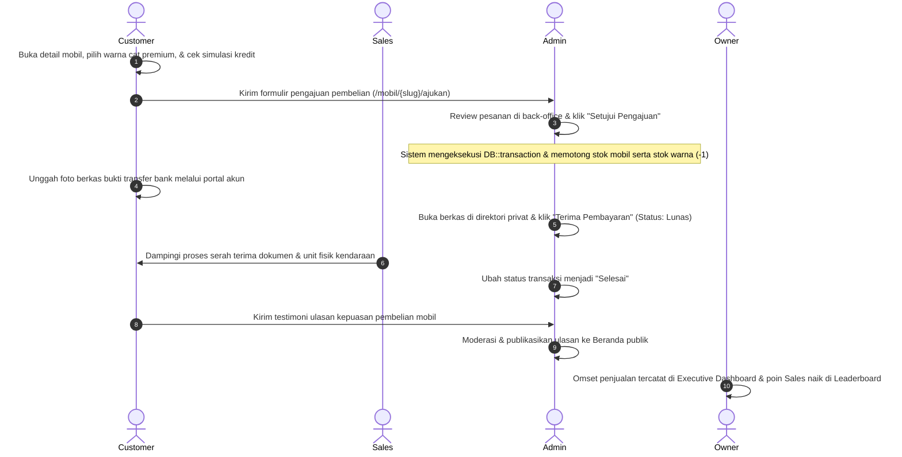

#### 2. Alur End-to-End Reservasi & Pelaksanaan Test Drive

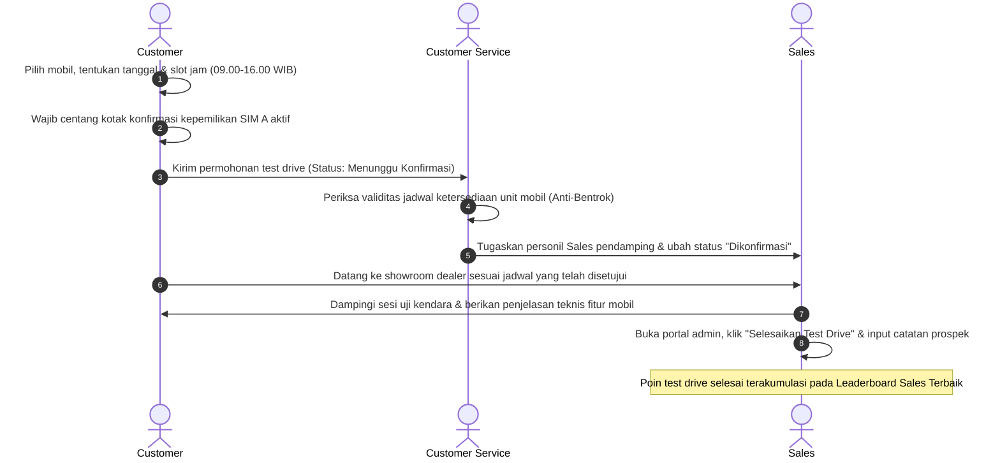

#### 3. Alur End-to-End Servis Bengkel, Cetak SPK, & Spare Part

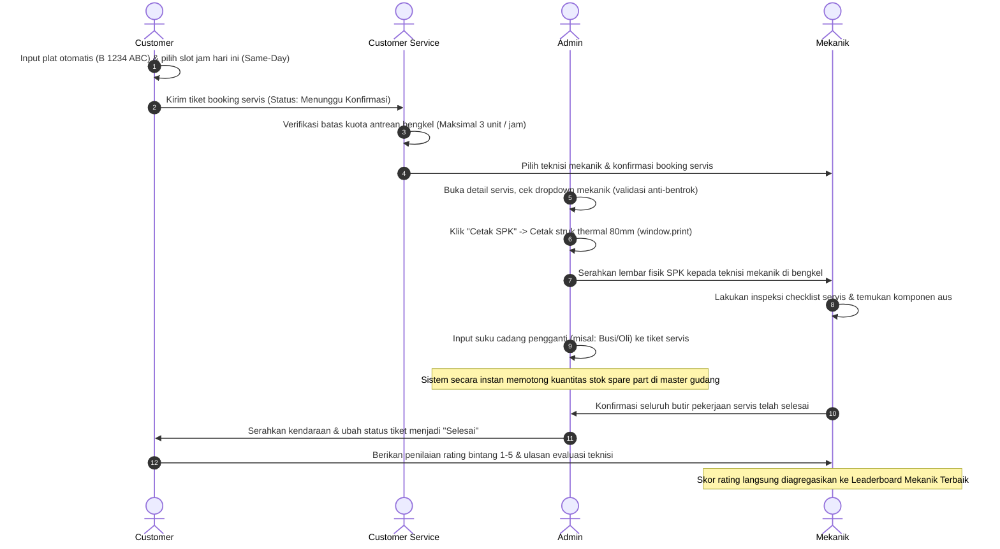

---

# BAB V: IMPLEMENTASI FITUR UNGGULAN SISTEM

### 5.1 Interactive Color Swatches & Dynamic Premium Pricing
Fitur ini mengatasi keterbatasan visualisasi etalase digital mobil. Diimplementasikan pada berkas tampilan `resources/views/pages/cars/show.blade.php`, sistem merender lingkaran warna (*color dot*) dari kolom JSON `cars.color_palette`.

Setiap elemen lingkaran disuntikkan atribut HTML5:
- `data-image-index`: Mengindeks posisi foto spesifik warna tersebut pada galeri gambar kendaraan.
- `data-color-name`: Nama resmi varian warna (contoh: *Midnight Purple*).
- `data-extra-price`: Selisih harga tambahan untuk cat warna khusus (misal: `35000000`).
- `data-stock`: Jumlah ketersediaan stok fisik untuk warna terkait.

Saat pengguna mengeklik lingkaran warna, event listener JavaScript mengeksekusi operasi sinkron:
1. Menggeser Carousel galeri foto secara halus ke foto varian warna target tanpa me-refresh halaman.
2. Mengalkulasi ulang harga total kendaraan: `totalPrice = basePrice + extraPrice`.
3. Memperbarui teks harga mobil dan label varian warna secara dinamis dengan format mata uang Rupiah (`Intl.NumberFormat`).
4. Menyesuaikan batas minimal Uang Muka (DP 20%) dan secara otomatis menghitung ulang seluruh nilai cicilan pada tabel simulasi angsuran di bawahnya.
5. Memperbarui parameter URL tombol *"Ajukan Pembelian"* (`/mobil/{slug}/ajukan?color=Midnight+Purple`).
6. Jika `data-stock == 0`, sistem memberikan kelas visual redup (`opacity: 0.28`), menampilkan ikon silang `✕`, menyematkan badge teks *"Stok Habis"*, dan menonaktifkan tombol pemesanan (`disabled = true`) untuk mencegah transaksi invalid.

### 5.2 Auto-formatting Plat Nomor Standar Indonesia & Same-Day Service Booking
Pada form pemesanan perawatan kendaraan (`resources/views/pages/services/booking.blade.php`), diterapkan rekayasa penataan format input plat nomor kendaraan bermotor di Indonesia yang terdiri dari 3 segmen:
- Segmen 1: 1–2 huruf kode wilayah (contoh: `B`, `DK`, `AB`).
- Segmen 2: 1–4 digit angka nomor polisi (contoh: `1234`).
- Segmen 3: 1–3 huruf kode seri akhir (contoh: `ABC`).

Skrip Vanilla JavaScript memantau event `input`. Setiap kali pengguna mengetik karakter tanpa spasi atau huruf kecil (misal: `b1234abc`), skrip secara instan membersihkan karakter non-alfanumerik, mengubah huruf menjadi kapital, memecah segmen menggunakan ekspresi reguler (*regex*), dan menyusunnya kembali dengan spasi terstandarisasi: `B 1234 ABC`.

Selain itu, modul mendukung fitur **Same-Day Service Booking** (booking untuk hari yang sama) dengan aturan bisnis ketat:
- Menghitung *dynamic buffer* waktu kedatangan minimal 1 jam dari waktu saat ini. Slot jam yang telah lewat atau kurang dari 1 jam otomatis disembunyikan.
- Menerapkan batasan *cutoff* pukul 14.00 WIB. Jika pelanggan mengakses booking hari ini setelah pukul 14.00 WIB, sistem secara otomatis mengunci tanggal hari ini dan mengarahkan pilihan kalender ke hari kerja berikutnya guna menjamin kesiapan personil bengkel.
- Membatasi kuota maksimal 3 unit kendaraan per slot jam untuk mencegah penumpukan mobil di bengkel.

### 5.3 Penugasan Mekanik Cerdas & Anti-Bentrok Jadwal
Untuk memitigasi tumpang tindih penugasan teknisi, kontroler admin mengevaluasi seluruh jadwal servis yang beririsan dengan tanggal dan jam pengerjaan yang dipilih.

Pada elemen dropdown pilihan teknisi (`<select name="mechanic_id">`), sistem menampilkan status operasional mekanik:
1. **Tersedia:** Ditampilkan normal jika mekanik belum memiliki jadwal kerja pada slot jam tersebut.
2. **Sedang Mengerjakan:** Menampilkan informasi plat nomor mobil yang sedang ditangani mekanik.
3. **Bentrok Jadwal:** Jika mekanik telah dikonfirmasi menangani kendaraan lain pada tanggal dan jam yang sama, sistem menambahkan teks label `(Bentrok jadwal jam ini)` serta menyematkan atribut HTML `disabled`. Validasi ganda di sisi backend (*server-side Form Request validation*) memastikan penugasan yang bentrok akan ditolak dengan respon kesalahan validasi sebelum data tersimpan.

### 5.4 Penerbitan Surat Perintah Kerja (SPK) Struk Thermal 80mm
Sistem menyediakan antarmuka cetak lembar kerja teknisi melalui rute `/admin/servis/{id}/cetak-spk`. Tampilan dirancang khusus menggunakan media cetak CSS `@media print` yang disesuaikan dengan dimensi kertas struk kasir/printer thermal standar **80mm** (serta kompatibel untuk cetak format A4 landscape/portrait).

Dokumen SPK memuat informasi lengkap:
- Header resmi bengkel JAF Service (alamat, telepon, nomor SPK unik).
- Identitas pelanggan dan data kendaraan (Plat Nomor, Model, Tahun, KM Odometer).
- Keluhan utama pelanggan dan jenis paket perawatan yang dipesan.
- Tabel *checklist* butir inspeksi fisik kendaraan (Pengecekan Oli Mesin, Sistem Rem, Tekanan Ban, Aki/Kelistrikan, Suspensi).
- Daftar suku cadang yang dialokasikan beserta kuantitas.
- Kolom tanda tangan 2 pihak: Pelanggan dan Service Advisor/Mekanik sebagai bukti serah terima kerja yang sah.
- Skrip otomatis mengeksekusi fungsi cetak browser (`window.print()`) saat halaman dimuat.

### 5.5 Pemakaian Spare Part Servis & Pemotongan Stok Gudang Otomatis
Sebelumnya, transaksi suku cadang servis kerap terpisah dari pencatatan gudang. Pada JAF Dealer, pemakaian suku cadang servis diintegrasikan langsung dengan inventaris master `spare_parts`:
- Saat Admin atau Service Advisor menambahkan komponen suku cadang ke dalam tiket pengerjaan servis (tabel `service_booking_spare_parts`), sistem mengeksekusi operasi database di dalam blok `DB::transaction`.
- Sistem memeriksa ketersediaan stok fisik: jika mencukupi, sistem secara atomik memotong kolom `spare_parts.stock` sesuai kuantitas yang digunakan.
- Jika suku cadang dihapus dari tiket servis (misalnya terjadi pembatalan penggantian komponen), sistem secara otomatis mengembalikan (*increment*) kuantitas stok ke master gudang.
- Rekapitulasi biaya suku cadang otomatis diakumulasikan ke dalam total tagihan servis pelanggan.

### 5.6 Dashboard Leaderboard Eksekutif & Ekspor Laporan Excel
Sebagai sarana pengawasan dan motivasi kerja tim, sistem menyajikan widget **Leaderboard** pada Dashboard Admin dan Owner:
1. **Top 3 Sales Terbaik:**
   - Dihitung berdasarkan algoritma gabungan: Total Unit Mobil Terjual (kriteria utama), Total Akumulasi Nilai Omset Penjualan (Rp), dan Total Sesi Test Drive Selesai.
   - Peringkat pertama disematkan lencana visual emas bertuliskan *"Terbaik #1"*.
2. **Top 3 Mekanik Terbaik:**
   - Dihitung berdasarkan: Skor Rata-rata Rating Bintang (1.0–5.0), Jumlah Ulasan Pelanggan yang Masuk, dan Total Tiket Servis yang Berhasil Diselesaikan.
   - Menampilkan visualisasi bintang emas dan persentase kepuasan.

Selain visualisasi pada dasbor, sistem menyediakan fitur ekspor laporan keuangan melalui kelas `App\Support\AdminReportXlsx` yang memanfaatkan pustaka **PhpSpreadsheet**:
- Menghasilkan berkas berekstensi resmi `.xlsx` tanpa ketergantungan pada ekstensi CSV mentah.
- Menyusun laporan komprehensif yang memuat rekapitulasi penjualan mobil, daftar rincian unit terjual, pendapatan jasa bengkel, pemakaian suku cadang, dan laba kotor.
- Dilengkapi dengan penataan format akuntansi standar Indonesia (pemformatan mata uang Rupiah `Rp #,##0`), garis pembatas tabel (*border*), perataan sel (*alignment*), serta pewarnaan header tabel yang profesional.

---

# BAB VI: KEAMANAN SISTEM & ROLE-BASED ACCESS CONTROL (RBAC)

### 6.1 Matriks Wewenang & Hak Akses (RBAC)

Sistem menerapkan prinsip wewenang terendah (*Principle of Least Privilege*). Matriks izin hak akses resmi diimplementasikan melalui konstanta `User::PERMISSIONS` dan didaftarkan ke Laravel Gate:

| Kemampuan Sistem (*Permission / Ability*) | Customer | Customer Service | Sales | Mekanik | Admin | Owner |
| :--- | :---: | :---: | :---: | :---: | :---: | :---: |
| **Katalog Mobil (Eksplorasi Publik)** | ✔ | ✔ | ✔ | ✔ | ✔ | ✔ |
| **Kelola Master Mobil (Tambah, Edit, Galeri, Warna)** | ❌ | ❌ | ❌ | ❌ | ✔ | ❌ |
| **Hapus Data Master (Mobil, Merek, Kategori)** | ❌ | ❌ | ❌ | ❌ | ✔ | ❌ |
| **Kelola Promo & Diskon Penjualan** | ❌ | ❌ | ❌ | ❌ | ✔ | ❌ |
| **Booking & Akses Tiket Test Drive** | Buat Sendiri | Lihat Semua | Ditugaskan | ❌ | Lihat Semua | Lihat Semua |
| **Ubah Status Jadwal Test Drive** | Batalkan | ✔ | ✔ (Selesai) | ❌ | ✔ | ❌ |
| **Pengajuan Pembelian Mobil (Lihat)** | Milik Sendiri | Lihat Semua | Ditugaskan | ❌ | Lihat Semua | Lihat Semua |
| **Ubah Status Pengajuan Pembelian** | Batalkan | ❌ | Follow-up | ❌ | ✔ | ❌ |
| **Persetujuan Pembelian Mobil (`purchases.approve`)** | ❌ | ❌ | ❌ | ❌ | ✔ | ❌ |
| **Verifikasi Bukti Transfer Bank (`payments.manage`)** | Upload | ❌ | ❌ | ❌ | ✔ | ❌ |
| **Booking Servis Kendaraan (Lihat)** | Milik Sendiri | Lihat Semua | ❌ | Ditugaskan | Lihat Semua | Lihat Semua |
| **Kelola Servis (Tugaskan Mekanik & Status)** | Batalkan | ✔ | ❌ | Kerjakan | ✔ | ❌ |
| **Input Suku Cadang Servis & Potong Stok Gudang** | ❌ | ❌ | ❌ | Rekomendasi | ✔ | ❌ |
| **Cetak Dokumen SPK Struk Thermal 80mm** | ❌ | ✔ | ❌ | Menerima | ✔ | ❌ |
| **Kelola Master Suku Cadang (Spare Part)** | Lihat | ❌ | ❌ | ❌ | ✔ | ❌ |
| **Moderasi Testimoni Ulasan Pelanggan** | Tulis | ❌ | ❌ | ❌ | ✔ | ❌ |
| **Rating Bintang Mekanik** | Beri Rating | ❌ | ❌ | Lihat Pribadi | Lihat Semua | Lihat Semua |
| **Executive Dashboard & Monitoring Omset Rp** | ❌ | ❌ | ❌ | ❌ | Operasional | ✔ (Omset Rp) |
| **Leaderboard Tim Terbaik (Sales & Mekanik)** | ❌ | ❌ | Peringkat | Peringkat | ✔ | ✔ |
| **Laporan Finansial Dealer & Ekspor Excel (`.xlsx`)** | ❌ | ❌ | ❌ | ❌ | Lihat Saja | ✔ (Full Excel) |
| **Audit Trail Keamanan Staf (`activity_logs`)** | ❌ | ❌ | ❌ | ❌ | ✔ | ✔ |
| **Kelola Akun Staf & Fitur Soft Deactivation** | ❌ | ❌ | ❌ | ❌ | ✔ | ✔ |
| **Pengaturan Profil Perusahaan & Nomor Rekening** | ❌ | ❌ | ❌ | ❌ | ✔ | ✔ |

### 6.2 Implementasi 7 Lapis Keamanan Perangkat Lunak
1. **Route Guarding & Policy Gate (HTTP 403 Enforcement):** Setiap rute back-office dilindungi oleh middleware otentikasi dan pengecekan wewenang `can:...`. Percobaan manipulasi URL oleh staf yang tidak memiliki hak akses (misalnya Sales mencoba membuka menu Laporan Keuangan) secara tegas dicegat dan menghasilkan respon HTTP **`403 Forbidden`**.
2. **CLI-Only Owner Account Provisioning:** Tidak tersedia formulir atau tombol pendaftaran akun ber-role *Owner* pada antarmuka web. Akun Owner hanya dapat dibuat atau diangkat secara manual melalui konsol terminal server dengan perintah terotentikasi: `php artisan user:make-owner email@domain.com`.
3. **Mekanisme Soft Deactivation (`EnsureUserIsActive`):** Staf operasional yang dinonaktifkan (`is_active = false`) oleh Administrator akan langsung diputus sesi kerjanya secara paksa (*session invalidated*) saat melakukan request berikutnya dan ditolak saat mencoba login kembali.
4. **Rate Limiting & Anti-Brute Force Protection:** Sistem membatasi frekuensi request pada titik-titik rentan (percobaan login, registrasi akun, pengiriman formulir pesanan, dan booking servis) maksimal 5 kali per menit per alamat IP guna mencegah serangan *credential stuffing* atau *denial-of-service*.
5. **Security Headers Middleware:** Sistem menyuntikkan header keamanan siber standar industri pada setiap respon HTTP:
   - `X-Frame-Options: SAMEORIGIN` (mencegah eksploitasi pembajakan klik / *clickjacking*).
   - `X-Content-Type-Options: nosniff` (mencegah sniffing tipe MIME berkas).
   - `Content-Security-Policy (CSP)` ketat untuk membatasi eksekusi skrip berbahaya.
   - Menyembunyikan header informasi versi server PHP (`X-Powered-By`).
6. **Immutable Audit Trail (`activity_logs`):** Seluruh aksi krusial staf operasional (seperti persetujuan pembelian, verifikasi transfer uang, pengubahan harga, dan penugasan personil) direkam secara permanen ke tabel `activity_logs` lengkap dengan alamat IP, user-agent, dan *snapshot* data sebelum/sesudah perubahan. Model ini tidak menyediakan fungsi edit atau hapus dari aplikasi.
7. **Penyimpanan Terisolasi Bukti Pembayaran (Private Storage Shielding):** Berkas struk bukti transfer pembayaran disimpan di direktori privat tertutup (`storage/app/private/payment-proofs/`). Berkas ini tidak dapat diakses langsung melalui pengetikan URL publik dan hanya dialirkan melalui controller perantara yang memvalidasi hak akses otentikasi staf.

---

# BAB VII: RENCANA ANGGARAN BIAYA (RAB) & MANAJEMEN PROYEK

Perancangan anggaran biaya pengembangan sistem informasi **JAF Dealer** dihitung secara profesional dan realistis berdasarkan durasi proyek intensif selama **4 bulan (16 minggu)** kalender kerja, dengan melibatkan 3 orang tenaga ahli pengembang.

### 7.1 Pembagian Alokasi SDM Tim Pengembang

| No | Personel Tim | Peran Utama & Lingkup Tanggung Jawab | Alokasi Waktu | Honor / Bulan | Subtotal (4 Bulan) |
| :---: | :--- | :--- | :---: | :---: | :---: |
| 1 | **Yoseph Kewena Hayon** | **Lead Backend & Database Engineer**<br>• Perancangan arsitektur basis data relasional MySQL 8.0 & optimasi InnoDB.<br>• Pengembangan backend Laravel 11, Action Classes, & Eloquent ORM.<br>• Logika bisnis: pemotongan stok otomatis, dropdown mekanik anti-bentrok, formula kredit bunga flat, dan integrasi ekspor Excel (`.xlsx`). | 4 Bulan | Rp 4.500.000 | **Rp 18.000.000** |
| 2 | **Albar Raya** | **Lead Frontend & UI/UX Designer**<br>• Perancangan desain antarmuka responsif & sistem tema ganda (Dark/Light Mode).<br>• Implementasi Blade Templates & kustomisasi komponen Bootstrap 5.3.<br>• Rekayasa interaktivitas Vanilla JS: *color swatches*, format plat otomatis Indonesia, validasi *same-day booking*, dan kalkulator cicilan dinamis. | 4 Bulan | Rp 4.000.000 | **Rp 16.000.000** |
| 3 | **Fadhlan Muhamad Hutasoit** | **System Analyst, QA / Tester, Integrasi & Dokumentasi**<br>• Analisis kebutuhan sistem bisnis, permodelan Use Case, dan perancangan alur kerja.<br>• Penyusunan test suite otomatis (1.164 unit & feature tests) dan pengujian manual *Black-Box*.<br>• Penataan matriks keamanan RBAC, migrasi database seeder, dan penyusunan laporan teknis. | 4 Bulan | Rp 3.500.000 | **Rp 14.000.000** |
| **TOTAL** | | **Subtotal Biaya Tim Pengembang (SDM)** | | | **Rp 48.000.000** |

---

### 7.2 Biaya Infrastruktur Cloud & Perangkat Lunak (Tahun ke-1)

| No | Komponen Infrastruktur | Spesifikasi & Penyedia Layanan | Durasi / Satuan | Biaya Satuan | Subtotal Biaya |
| :---: | :--- | :--- | :---: | :---: | :---: |
| 1 | **Nama Domain Komersial** | Domain Tingkat Tinggi Indonesia (`.co.id` / `.com`) | 1 Tahun | Rp 250.000 / tahun | Rp 250.000 |
| 2 | **Cloud Virtual Private Server (VPS)** | 2 vCPU, 4 GB RAM, 80 GB NVMe Storage (DigitalOcean / Biznet Gio) | 12 Bulan | Rp 275.000 / bulan | Rp 3.300.000 |
| 3 | **Sertifikat Keamanan SSL** | Commercial PositiveSSL Wildcard Certificate (256-bit encryption) | 1 Tahun | Rp 450.000 / tahun | Rp 450.000 |
| 4 | **Layanan Email Transaksional** | SMTP Relay Server untuk notifikasi tiket transaksi (Brevo / Mailgun) | 12 Bulan | Rp 150.000 / bulan | Rp 1.800.000 |
| 5 | **Cloud Backup Storage** | S3-Compatible Offsite Backup Storage (Kapasitas 50 GB Snapshot Harian) | 12 Bulan | Rp 50.000 / bulan | Rp 600.000 |
| **TOTAL** | | **Subtotal Biaya Infrastruktur & Server (Tahun ke-1)** | | | **Rp 6.400.000** |

---

### 7.3 Biaya Operasional, Pengujian, Pelatihan, & Garansi

| No | Uraian Kegiatan Operasional | Deskripsi & Keluaran Pekerjaan | Alokasi Waktu | Subtotal Biaya |
| :---: | :--- | :--- | :---: | :---: |
| 1 | **User Acceptance Testing (UAT)** | Sesi pengujian terpandu bersama perwakilan staf showroom & bengkel resmi | 2 Minggu | Rp 2.500.000 |
| 2 | **Pelatihan Staf & Buku Panduan** | Workshop pelatihan 6 aktor operasional serta penyusunan buku panduan cetak/PDF | 1 Minggu | Rp 1.500.000 |
| 3 | **Garansi SLA & Pemeliharaan Sistem** | Layanan perbaikan bug, patching keamanan, dan pemeliharaan performa server (12 Bulan) | 12 Bulan | Rp 4.200.000 |
| **TOTAL** | | **Subtotal Biaya Operasional, Pelatihan, & Garansi** | | **Rp 8.200.000** |

---

### 7.4 Rekapitulasi Anggaran & Estimasi Biaya Operasional Tahunan (OPEX)

```
========================================================================================
REKAPITULASI TOTAL ANGGARAN PENGEMBANGAN SISTEM JAF DEALER
========================================================================================
1. Biaya Tenaga Ahli Pengembang (SDM - 3 Orang / 4 Bulan)        : Rp 48.000.000,-
2. Biaya Infrastruktur Cloud, Server & Domain (Tahun ke-1)        : Rp  6.400.000,-
3. Biaya Operasional, UAT, Pelatihan Staf, & Garansi SLA 1 Tahun  : Rp  8.200.000,-
----------------------------------------------------------------------------------------
TOTAL INVESTASI TAHUN PERTAMA (CAPEX + OPEX TAHUN 1)              : Rp 62.600.000,-
========================================================================================
```

- **Estimasi Biaya Pemeliharaan Tahunan Berikutnya (Tahun ke-2 dan seterusnya):**
  - Perpanjangan Domain & SSL: Rp 700.000 / tahun
  - Cloud VPS Server & Storage: Rp 3.900.000 / tahun
  - SMTP Relay Notifikasi: Rp 1.800.000 / tahun
  - Paket Pemeliharaan & Dukungan Teknis: Rp 4.200.000 / tahun
  - **Total Estimasi OPEX Tahunan Berikutnya:** **± Rp 10.600.000 / tahun** (atau setara dengan **~Rp 880.000 per bulan**).

---

# BAB VIII: HASIL PENGUJIAN & VALIDASI SISTEM

### 8.1 Pengujian Unit & Fitur Otomatis (`php artisan test`)
Pengujian otomatis dilakukan untuk memastikan tidak ada regresi logika bisnis pada seluruh komponen sistem. Pengujian dieksekusi menggunakan framework pengujian terintegrasi Laravel (PHPUnit/Pest).

**Ringkasan Hasil Eksekusi Uji Otomatis:**
- Perintah Eksekusi: `php artisan test`
- Total Berkas Pengujian: 74 Test Files
- Total Kasus Uji (*Tests*): **1.164 Tests**
- Total Pengecekan Asersi (*Assertions*): **6.784 Assertions**
- Hasil Uji: **1.164 PASSED (100% Lulus / 0 Gagal / 0 Error)**
- Durasi Eksekusi: **99,23 detik**

**Cakupan Aspek yang Diuji Secara Otomatis:**
1. Otentikasi, enkripsi password, dan pembatalan sesi staf non-aktif (*Soft Deactivation*).
2. Kebijakan otorisasi peran (*Gate & Policies*) untuk seluruh 6 aktor (Customer, CS, Sales, Mekanik, Admin, Owner).
3. Penyesuaian harga mobil terhadap pemilihan warna khusus (*premium paint adjustment*).
4. Validasi kepemilikan SIM A dan pencegahan jadwal ganda (*anti-conflict*) pada pemesanan *test drive*.
5. Atomisitas transaksi persetujuan pembelian mobil beserta pemotongan stok fisik mobil dan stok warna spesifik.
6. Sanitasi plat nomor polisi Indonesia dan algoritma kuota waktu pada pemesanan *same-day service*.
7. Pencegahan penugasan teknisi mekanik yang bentrok jadwal.
8. Pemotongan dan pengembalian stok suku cadang master gudang pada tiket servis.
9. Akurasi kalkulasi simulasi kredit flat dan konsistensi pembulatan angka rupiah.
10. Validasi keamanan penyimpanan berkas bukti transfer privat dan respon HTTP 403.

### 8.2 Pengujian Fungsional Manual (Black-Box Testing)
Pengujian manual dilakukan secara komprehensif di lingkungan peramban web (*browser*) untuk memverifikasi antarmuka dan pengalaman pengguna (*User Experience*) berdasarkan skenario pada dokumen panduan pengujian `PANDUAN_MANUAL_TEST_JAF_DEALER.md`.

| No | Modul / Skenario Pengujian | Masukan Uji (Input) | Hasil yang Diharapkan (Expected Result) | Status |
| :---: | :--- | :--- | :--- | :---: |
| 1 | **Interaktivitas Color Swatches** | Klik lingkaran warna *Midnight Purple* pada mobil Nissan GT-R | Foto utama berganti ke varian ungu, harga mobil naik +Rp 35jt, DP & cicilan terhitung ulang | **VALID** |
| 2 | **Proteksi Warna Stok Habis** | Klik warna berstok 0 | Tombol meredup (`opacity: 0.28`), muncul tanda `✕`, tombol Ajukan Pembelian berstatus `disabled` | **VALID** |
| 3 | **Format Otomatis Plat Nomor** | Ketik `b1234abc` di input plat polisi | Teks secara instan terformat menjadi huruf kapital berjarak: `B 1234 ABC` | **VALID** |
| 4 | **Same-Day Service Cutoff** | Booking servis hari ini setelah jam 14.00 WIB | Pilihan tanggal hari ini dinonaktifkan, kalender mengarahkan ke hari kerja berikutnya | **VALID** |
| 5 | **Anti-Bentrok Mekanik** | Pilih mekanik yang sudah memiliki jadwal servis pada jam yang sama | Dropdown menampilkan teks `(Bentrok jadwal jam ini)` dan berstatus `disabled` | **VALID** |
| 6 | **Penerbitan Struk SPK** | Buka rute cetak SPK servis | Menampilkan struk thermal 80mm rapi dengan checklist inspeksi dan membuka dialog `window.print` | **VALID** |
| 7 | **Pengurangan Stok Spare Part** | Tambahkan 1 Qty Filter Oli ke tiket servis | Stok master Filter Oli di tabel `spare_parts` langsung berkurang 1 unit secara konsisten | **VALID** |
| 8 | **Proteksi URL Laporan Finansial** | Akun Sales/CS membuka `/admin/laporan` | Akses langsung diblokir oleh middleware dengan halaman kode respon **`403 Forbidden`** | **VALID** |
| 9 | **Ekspor Laporan Excel** | Owner menekan tombol *"Export Excel"* | Berkas `Laporan_Dealer_JAF.xlsx` terunduh dengan format tabel, border, dan angka Rupiah rapi | **VALID** |
| 10 | **Leaderboard Staf Terbaik** | Buka Dasbor Admin/Owner | Menampilkan Top 3 Sales (omset Rp) dan Top 3 Mekanik (rating bintang) dengan lencana emas | **VALID** |

### 8.3 Evaluasi Log Kesalahan Sistem
Pemeriksaan berkas log sistem pada `storage/logs/laravel.log` menunjukkan **0 runtime exception / 0 error 500**. Seluruh request HTTP, proses transaksi basis data dengan *pessimistic locking*, manipulasi berkas di penyimpanan privat, dan proses perenderan *template* berjalan dengan stabil tanpa kebocoran memori.

---

# BAB IX: PENUTUP & KESIAPAN OPERASIONAL

### 9.1 Kesimpulan
Berdasarkan perancangan, implementasi, dan serangkaian pengujian yang telah dilaksanakan, dapat disimpulkan bahwa:
1. Sistem Informasi **JAF Dealer** berhasil menjembatani kebutuhan integrasi proses bisnis antara showroom penjualan mobil baru & heritage Nissan dengan layanan bengkel resmi JAF Service dalam satu arsitektur terpadu berbasis web.
2. Fitur inovatif *Interactive Color Swatches & Dynamic Premium Pricing* memberikan visualisasi varian warna yang akurat serta transparansi pembiayaan kredit secara instan di sisi klien.
3. Fitur *Smart Same-Day Service Booking*, pemformatan plat nomor standar Indonesia, pencegahan bentrok penugasan teknisi mekanik, penerbitan dokumen SPK thermal 80mm, dan pemotongan stok suku cadang otomatis secara nyata meningkatkan efisiensi operasional bengkel dan meniadakan selisih stok gudang.
4. Tata kelola sistem terbukti aman dan andal melalui penerapan 7 lapis keamanan perangkat lunak, matriks RBAC terisolasi untuk 6 aktor, penyimpanan privat terlindungi, serta verifikasi kelulusan pengujian otomatis sebesar **100% (1.164 tests passed)**.

### 9.2 Saran Pengembangan Sistem
Untuk pengembangan sistem JAF Dealer pada fase lanjutan, disarankan beberapa hal berikut:
1. **Integrasi Payment Gateway Otomatis:** Mengintegrasikan sistem pembayaran dengan penyedia gerbang pembayaran resmi (*payment gateway* seperti Midtrans atau Xendit) untuk memfasilitasi verifikasi transfer virtual account dan QRIS secara *real-time* tanpa perlu verifikasi manual bukti transfer oleh admin.
2. **Integrasi WhatsApp Business API:** Menambahkan layanan gateway pesan instan WhatsApp otomatis untuk mengirimkan pengingat jadwal servis berkala (*service reminder*) dan notifikasi status pemesanan kendaraan langsung ke nomor ponsel pelanggan.
3. **Pelacakan Posisi Mekanik secara Live:** Mengembangkan modul *live work-tracking* berbasis kanban board interaktif di area tunggu bengkel agar pelanggan dapat melihat progres pengerjaan servis mobilnya secara visual.

---

### 9.3 Prosedur Reset Database (*Clean State*) untuk Live Demo

Untuk mendukung kelancaran sesi presentasi dan demonstrasi langsung (*Live Demo*) di hadapan Dosen Penguji, tim pengembang telah menyiapkan skrip pembersihan data percobaan (*testing logs*) guna mengembalikan database ke kondisi awal yang bersih (**0 data transaksi**) tanpa merusak data master katalog 14 mobil Nissan, 58 foto galeri warna, data promo, layanan bengkel, suku cadang, maupun 7 akun staf resmi.

Jalankan perintah berikut pada terminal PowerShell:

```powershell
php artisan tinker --execute="
DB::statement('SET FOREIGN_KEY_CHECKS = 0');
DB::table('payment_refunds')->truncate();
DB::table('payment_proofs')->truncate();
DB::table('testimonials')->truncate();
DB::table('purchase_requests')->truncate();
DB::table('mechanic_ratings')->truncate();
DB::table('service_booking_spare_parts')->truncate();
DB::table('service_booking_tasks')->truncate();
DB::table('service_bookings')->truncate();
DB::table('test_drives')->truncate();
DB::table('favorites')->truncate();
DB::table('notifications')->truncate();
DB::table('activity_logs')->truncate();
DB::table('password_reset_tokens')->truncate();
DB::table('sessions')->truncate();
DB::statement('SET FOREIGN_KEY_CHECKS = 1');
DB::table('cars')->where('id', 1)->update(['stock' => 4]);
DB::table('cars')->where('id', 4)->update(['stock' => 5]);
DB::table('cars')->where('id', 5)->update(['stock' => 6]);
"
php artisan cache:clear
```

---

# DAFTAR PUSTAKA

1. **Laravel LLC.** (2024). *Laravel Documentation (Version 11.x)*. Tersedia pada: https://laravel.com/docs/11.x
2. **Oracle Corporation.** (2024). *MySQL 8.0 Reference Manual: InnoDB Locking and Transaction Model*. Redwood Shores: Oracle.
3. **Bootstrap Team.** (2024). *Bootstrap v5.3 Documentation: Components, Layout, and Color Modes*. Tersedia pada: https://getbootstrap.com/docs/5.3/
4. **Martin, Robert C.** (2018). *Clean Architecture: A Craftsman's Guide to Software Structure and Design*. Boston: Prentice Hall.
5. **Pressman, Roger S. & Maxim, Bruce R.** (2020). *Software Engineering: A Practitioner's Approach (9th Edition)*. New York: McGraw-Hill Education.
6. **Sommerville, Ian.** (2016). *Software Engineering (10th Edition)*. Boston: Pearson.
7. **PhpSpreadsheet Documentation.** (2024). *PhpSpreadsheet: Read, Write and Create Spreadsheet Documents in PHP*. Tersedia pada: https://phpspreadsheet.readthedocs.io/
8. **OWASP Foundation.** (2023). *OWASP Top 10 Web Application Security Risks*. Tersedia pada: https://owasp.org/www-project-top-ten/

---
*Laporan ini disusun secara komprehensif oleh Tim Pengembang JAF Dealer (Yoseph Kewena Hayon, Albar Raya, Fadhlan Muhamad Hutasoit) untuk keperluan evaluasi akademik dan dokumentasi operasional sistem.*
