# MATERI LENGKAP DOKUMENTASI & PRESENTASI SISTEM INFORMASI DEALER MOBIL & BENGKEL RESMI (JAF DEALER)

---

## DAFTAR ISI
1. [BAB 1: MODUL SISTEM (LENGKAP)](#bab-1-modul-sistem-lengkap)
2. [BAB 2: USE CASE SYSTEM (DIAGRAM & SKENARIO LENGKAP)](#bab-2-use-case-system-diagram--skenario-lengkap)
3. [BAB 3: FLOW / ALUR KERJA UNTUK SETIAP ROLE & SEMUA MODUL](#bab-3-flow--alur-kerja-untuk-setiap-role--semua-modul)
   - [Bagian A: Flow Khusus untuk Setiap Role (6 Flow Terpisah)](#bagian-a-flow-khusus-untuk-setiap-role-6-flow-terpisah)
   - [Bagian B: Flow End-to-End Lintas Aktor per Proses Bisnis](#bagian-b-flow-end-to-end-lintas-aktor-per-proses-bisnis)
4. [BAB 4: ARSITEKTUR SISTEM & DATABASE](#bab-4-arsitektur-sistem--database)
5. [BAB 5: HAK AKSES & KEAMANAN SISTEM (RBAC & SECURITY)](#bab-5-hak-akses--keamanan-sistem-rbac--security)
6. [BAB 6: RENCANA ANGGARAN BIAYA (RAB) BESERTA PEMBAGIANNYA](#bab-6-rencana-anggaran-biaya-rab-beserta-pembagiannya)

---

# BAB 1: MODUL SISTEM (LENGKAP)

Aplikasi **JAF Dealer** memadukan dua fungsi bisnis utama: **Penjualan Unit Mobil Resmi (Showroom)** dan **Perawatan Berkala Kendaraan (JAF Service & Workshop)**. Seluruh modul dirancang terintegrasi antara antarmuka publik pelanggan (*frontend*) dan portal administrasi (*back-office*).

---

### 1.1 Modul Katalog Mobil, Galeri Foto, & Swatches Warna (Termasuk Warna Premium)
- **Fungsi Utama:** Menyajikan etalase 14 unit mobil Nissan (Baru & Heritage/Bekas), foto multi-sudut, spesifikasi teknis, serta mekanisme pemilihan warna interaktif (*color swatches*).
- **Input:**
  - *Admin:* Tambah/edit mobil, input spesifikasi, kelola galeri gambar, atur palet warna (*name*, *hex code*, *stock per color*, dan *extra price*).
  - *Customer:* Klik tombol lingkaran warna (*color swatch dot*).
- **Proses:**
  - JavaScript membaca atribut `data-image-index`, `data-color-stock`, dan `data-extra-price`.
  - Carousel galeri foto berganti ke foto sudut warna yang dipilih secara halus via Bootstrap Carousel.
  - Label warna, badge stok per warna, dan spesifikasi warna di bawah otomatis diperbarui.
  - **Kalkulasi Warna Premium:** Jika warna memiliki biaya tambahan (misal: GT-R *Midnight Purple* +Rp 35.000.000 atau R34 *Millennium Jade* +Rp 25.000.000), harga mobil utama dihitung ulang secara real-time (`basePrice + extraPrice`). Nilai DP minimum dan seluruh baris angsuran bulanan (tenor 12–60 bulan) langsung dikalkulasi ulang di browser.
  - **Proteksi Warna Habis:** Jika stok varian warna bernilai `0`, lingkaran warna meredup (`opacity: 0.28`), memunculkan tanda silang `✕`, dan tombol Ajukan Pembelian otomatis dinonaktifkan (`disabled`).
- **Output:** Tampilan mobil interaktif, harga terkalkulasi dinamis, galeri foto sinkron, dan tombol aksi dengan parameter warna URL yang siap diajukan.

---

### 1.2 Modul Perbandingan Spesifikasi Mobil (Komparasi 2–4 Unit)
- **Fungsi Utama:** Membantu calon pembeli membandingkan spesifikasi teknis, fitur, dan harga antara 2 hingga 4 unit mobil secara berdampingan (*side-by-side*).
- **Input:** Pilihan unit mobil yang ditambahkan melalui tombol *Bandingkan* (ikon timbangan) di katalog atau detail mobil.
- **Proses:**
  - Data unit yang dibandingkan disimpan ke dalam sesi (*session*) browser.
  - Validasi sistem membatasi maksimal 4 mobil secara simultan.
  - Sistem memetakan baris perbandingan spesifikasi: kategori, tahun, transmisi, kapasitas mesin (cc), bahan bakar, jumlah kursi, status garansi, hingga harga final.
- **Output:** Tabel komparasi responsif, opsi menghapus salah satu unit, dan tombol kosongkan seluruh perbandingan.

---

### 1.3 Modul Promo & Diskon Penjualan
- **Fungsi Utama:** Mengelola penawaran diskon harga atau potongan khusus pada unit mobil tertentu dalam rentang periode tanggal yang valid.
- **Input:** Judul promo, deskripsi, tanggal mulai, tanggal berakhir, nominal diskon (Rp), dan mobil target yang terhubung.
- **Proses:**
  - Scope model mengecek keaktifan promo berdasarkan tanggal sistem (`start_date <= today <= end_date`).
  - Sistem otomatis menghitung `finalPrice()` mobil dengan memotong harga dasar terhadap diskon promo tertinggi.
- **Output:** Badge promo pada kartu mobil, coretan harga lama (*strike-through price*), dan halaman detail promo publik.

---

### 1.4 Modul Simulasi Kredit Kendaraan
- **Fungsi Utama:** Memberikan kalkulasi estimasi pembiayaan kredit kepemilikan mobil secara transparan dan akurat.
- **Input:** Harga kendaraan, persentase / nominal Uang Muka (DP), dan pilihan tenor angsuran (12, 24, 36, 48, 60 bulan).
- **Proses:**
  - Menggunakan rumus perbankan bunga *flat* resmi (`CreditCalculator`):
    $$\text{Pokok Pinjaman} = \text{Harga Final} - \text{Uang Muka}$$
    $$\text{Angsuran Bulanan} = \left\lceil \frac{\text{Pokok} \times (1 + \text{Suku Bunga} \times \text{Tahun})}{\text{Tenor Bulan}} \right\rceil_{\text{Pembulatan}}$$
  - Validasi batas DP minimum 20% dan maksimum 90% sesuai regulasi OJK / leasing.
  - Pembulatan hasil ke kelipatan Rp 1.000 terdekat agar tidak ada pecahan desimal ganjil.
- **Output:** Ringkasan rincian kredit: pokok hutang, suku bunga tahunan, total bunga, angsuran per bulan, dan total pembayaran keseluruhan.

---

### 1.5 Modul Booking & Penjadwalan Test Drive
- **Fungsi Utama:** Memfasilitasi pelanggan untuk memesan sesi uji kendara mobil di dealer dengan jadwal yang terverifikasi dan anti-bentrok.
- **Input:** Pilihan mobil, tanggal kedatangan, slot jam (09.00–16.00 WIB), konfirmasi wajib kepemilikan SIM A aktif, dan catatan khusus.
- **Proses:**
  - **Validasi SIM A:** Customer wajib mencentang persetujuan kepemilikan SIM A aktif (ditolak jika tidak dicentang).
  - **Validasi Anti-Bentrok Unit:** Sistem menolak jika mobil yang sama telah dipesan oleh orang lain pada tanggal dan jam yang sama.
  - Customer Service mengonfirmasi jadwal dan menugaskan tenaga Sales penanggung jawab.
  - Sales mendampingi sesi dan memperbarui status menjadi *Selesai* beserta catatan follow-up hasil test drive.
- **Output:** Nomor tiket pendaftaran test drive, notifikasi real-time ke staf, dan rekap status di akun pelanggan.

---

### 1.6 Modul Pengajuan Pembelian Mobil & Verifikasi Pembayaran
- **Fungsi Utama:** Menangani alur transaksi pembelian unit mobil secara online, baik metode Cash (Tunai) maupun Kredit, termasuk verifikasi bukti transfer.
- **Input:** Mobil, varian warna pilihan, metode pembayaran, nominal DP & tenor (jika kredit), nomor telepon, alamat pengiriman, dan file bukti transfer bank (`.jpg`/`.png`).
- **Proses:**
  - Mengambil harga snapshot yang mencakup biaya warna ekstra (`car->finalPriceForColor($color)`).
  - **Persetujuan & Potong Stok:** Saat Admin menyetujui pengajuan (`status = approved`), sistem mengunci baris data (`lockForUpdate`) dan **otomatis memotong stok mobil serta stok varian warna terkait sebesar 1 unit**. Jika pengajuan ditolak/dibatalkan, stok unit otomatis dikembalikan (*restored*).
  - **Keamanan Bukti Pembayaran:** File bukti transfer disimpan di penyimpanan privat (*private storage*), bukan folder publik. Hanya admin berwenang dan pemilik transaksi yang dapat melihat gambar melalui route terproteksi.
  - Admin memverifikasi bukti pembayaran (*Terima / Tolak*) hingga status pengajuan menjadi *Lunas*, *Unit Disiapkan*, *Unit Diserahkan*, dan *Selesai*.
- **Output:** Surat pesanan digital, nomor registrasi pengajuan, status tahapan pembelian transparan, dan dokumen cetak pesanan (PDF).

---

### 1.7 Modul Booking Servis Pelanggan (JAF Service)
- **Fungsi Utama:** Memungkinkan pemilik mobil menjadwalkan servis rutin bengkel secara mandiri tanpa antre di lokasi.
- **Input:** Nomor plat polisi kendaraan, model & tahun mobil, KM odometer, paket layanan servis, tanggal kedatangan, slot jam, pilihan mekanik (opsional), dan keluhan teknis.
- **Proses:**
  - **Format Plat Otomatis Standar Indonesia:** JavaScript secara real-time memformat input plat menjadi kapital dengan spasi 3 segmen rapi (`[1-2 Huruf Wilayah] [1-4 Angka] [1-3 Huruf Seri]`, contoh: `B 1234 ABC`).
  - **Same-Day Service Booking:** Pelanggan diizinkan memesan jadwal untuk hari ini (*today*). Sistem menerapkan buffer kedatangan 1 jam (jam yang sudah lewat atau berjarak kurang dari 1 jam otomatis disembunyikan). Jika cutoff pukul 14.00 WIB terlampaui, sistem otomatis mengarahkan pemesanan ke hari kerja berikutnya.
  - **Kapasitas Bengkel:** Membatasi kuota maksimal 3 kendaraan per slot jam untuk mencegah kelebihan beban bengkel.
- **Output:** Nomor booking tiket servis (`#ID`), data kendaraan tersimpan ke profil pelanggan untuk booking cepat berikutnya, dan notifikasi ke bengkel.

---

### 1.8 Modul Manajemen Bengkel, Penugasan Mekanik, SPK, & Suku Cadang Servis
- **Fungsi Utama:** Mengelola alur pengerjaan teknis di bengkel resmi oleh Service Advisor (SA) dan Teknisi Mekanik.
- **Input:** Penugasan mekanik, penambahan/penghapusan suku cadang yang diganti, checklist butir tugas mekanik, dan catatan temuan inspeksi teknis.
- **Proses:**
  - **Dropdown Mekanik Anti-Bentrok:** Di halaman admin, dropdown mekanik mendeteksi kesibukan secara real-time:
    * `(Tersedia)` jika mekanik luang.
    * `(Sedang mengerjakan: [Plat Nomor])` jika mekanik sedang menangani servis aktif lain.
    * `(Bentrok jadwal jam ini)` dan berstatus **`disabled`** jika mekanik sudah memiliki jadwal servis pada tanggal dan jam yang sama.
  - **Cetak Dokumen SPK (Surat Perintah Kerja):** Sistem menyediakan rute cetak `/admin/servis/{id}/cetak-spk` format struk thermal 80mm lengkap (header dealer, nomor SPK unik `SPK-SRV-XXXXXX`, data customer, kendaraan, keluhan, checklist fisik, rincian biaya jasa + spare part, dan kolom tanda tangan teknisi & SA).
  - **Integrasi Stok Suku Cadang Otomatis:** Saat suku cadang ditambahkan ke tiket servis, stok di tabel master `spare_parts` **otomatis terpotong**. Jika suku cadang dihapus/dibatalkan dari tiket, stok master **otomatis dikembalikan**.
- **Output:** Struk SPK fisik/PDF siap cetak, tiket servis selesai dengan rincian biaya transparan, dan stok suku cadang bengkel yang selalu akurat.

---

### 1.9 Modul Katalog Suku Cadang (Spare Part) & Manajemen Stok
- **Fungsi Utama:** Menampilkan katalog suku cadang resmi Nissan bagi pelanggan dan memantau batas minimum stok (*low stock alerts*) bagi staf bengkel.
- **Input:** Nomor part (SKU), nama part, kategori (Mesin, Rem, Kelistrikan, Suspensi, Fluida/Oli, Body), harga jual, unit satuan (pcs, liter, set), jumlah stok, batas minimum stok, dan foto part.
- **Proses:**
  - Penandaan otomatis suku cadang berkategori *Stok Menipis* (`stock <= min_stock`) dan *Stok Habis* (`stock = 0`).
  - Laporan stok menipis disajikan di dashboard admin untuk pengadaan ulang (*re-order*).
- **Output:** Katalog publik suku cadang resmi dan monitoring stok real-time di back-office.

---

### 1.10 Modul Ulasan Testimoni Pembelian & Rating Evaluasi Mekanik
- **Fungsi Utama:** Mengumpulkan penilaian kepuasan pelanggan terhadap layanan penjualan mobil dan kinerja mekanik bengkel.
- **Input:** Rating bintang (1 s.d 5), judul ulasan, dan komentar kepuasan dari pelanggan.
- **Proses:**
  - **Ulasan Pembelian Mobil:** Masuk ke antrean moderasi admin (`/admin/ulasan`). Setelah disetujui (*Approved*), ulasan otomatis muncul di Beranda publik.
  - **Rating Mekanik:** Diberikan setelah status booking servis berstatus *Selesai*. Rata-rata bintang dan total ulasan mekanik langsung diagregasi (`withAvg`, `withCount`) untuk menentukan peringkat di widget Mekanik Terbaik.
- **Output:** Testimoni terpercaya di halaman publik dan portofolio evaluasi performa teknisi di panel mekanik.

---

### 1.11 Modul Notifikasi Terintegrasi
- **Fungsi Utama:** Memberikan pemberitahuan instan berbasis event (*Laravel Database Notification*) kepada pelanggan dan staf terkait setiap perubahan status transaksi.
- **Input:** Trigger event sistem (Booking baru, jadwal dikonfirmasi, pembayaran diverifikasi, servis selesai, dll.).
- **Proses:** Menyimpan data notifikasi ke tabel `notifications`, menghitung jumlah unread, dan menyediakan auto-link yang mengarahkan user langsung ke detail tiket terkait.
- **Output:** Lencana lonceng notifikasi di navbar dan daftar riwayat aktivitas akun.

---

### 1.12 Modul Manajemen Staf, Soft Deactivation, & Audit Trail
- **Fungsi Utama:** Mengelola akun operasional dealer (Admin, CS, Sales, Mekanik) dan merekam seluruh tindakan sensitif demi akuntabilitas.
- **Input:** Nama, email, nomor HP, password, role jabatan, dan status aktif (`is_active`).
- **Proses:**
  - **Soft Deactivation:** Jika akun staf dinonaktifkan (`is_active = false`), middleware `EnsureUserIsActive` seketika membatalkan sesi dan menolak login staf tersebut.
  - **Audit Trail:** Mencatat setiap aktivitas penting staf (login, persetujuan pengajuan, hapus master data, dll.) ke tabel `activity_logs` yang bersifat permanen (*immutable* / tanpa fitur ubah dan hapus).
- **Output:** Daftar akun staf terkelola dan log audit aktivitas lengkap dengan IP address dan waktu kejadian.

---

### 1.13 Modul Dashboard Leaderboard & Laporan Eksekutif Owner
- **Fungsi Utama:** Menyajikan visualisasi metrik performa dealer, peringkat staf terbaik, dan rekapitulasi finansial yang dapat diekspor.
- **Input:** Transaksi penjualan unit mobil dan servis bengkel yang telah selesai.
- **Proses:**
  - **Widget Sales Terbaik (Top 3):** Menghitung jumlah unit terjual, total omset penjualan, dan test drive selesai. Peringkat #1 mendapatkan lencana emas "Terbaik #1".
  - **Widget Mekanik Terbaik (Top 3):** Menghitung rata-rata skor bintang rating ulasan dan jumlah unit servis yang berhasil diselesaikan.
  - **Laporan Eksekutif Owner:** Mengagregasikan total omset penjualan mobil, omset pendapatan jasa servis & spare part, serta grafik tren 6 bulan terakhir.
  - **Ekspor Excel:** Menghasilkan file spreadsheet `.xlsx` resmi berformat rapi menggunakan pustaka PhpSpreadsheet.
- **Output:** Dashboard operasional & eksekutif, leaderboard tim terbaik, dan file unduhan `Laporan_Dealer_JAF.xlsx`.

---

# BAB 2: USE CASE SYSTEM (DIAGRAM & SKENARIO LENGKAP)

### 2.1 Identifikasi & Definisi 6 Aktor Sistem

| No | Nama Aktor | Definisi & Peran dalam Sistem |
| :---: | :--- | :--- |
| 1 | **Customer (Pelanggan)** | Pengguna publik terdaftar yang mencari unit mobil, melakukan simulasi pembiayaan kredit, mengajukan pembelian mobil, mengunggah bukti pembayaran, memesan jadwal test drive, memesan servis bengkel, serta memberikan ulasan dan rating kepuasan. |
| 2 | **Customer Service (CS)** | Staf front-office dealer yang bertugas menerima pendaftaran test drive, mengonfirmasi jadwal ketersediaan unit, menugaskan tenaga Sales, menerima booking servis kendaraan, dan menugaskan teknisi Mekanik. |
| 3 | **Sales (Tenaga Penjual)** | Staf pemasaran dealer yang bertugas mendampingi pelanggan selama sesi test drive berlangsung, memperbarui hasil follow-up, serta menindaklanjuti proses pengajuan pembelian unit pelanggan yang ditugaskan kepadanya. |
| 4 | **Mekanik (Teknisi Bengkel)** | Teknisi profesional bengkel yang mengakses portal khusus mekanik untuk memeriksa penugasan servis, menjalankan instruksi pekerjaan sesuai SPK, mencatat temuan teknis inspeksi kendaraan, dan memantau reputasi rating pribadinya. |
| 5 | **Admin (Administrator Operasional)** | Pengelola operasional harian showroom dan bengkel yang berwenang mengelola data master katalog (mobil, warna, promo, spare part, paket layanan), menyetujui pengajuan pembelian mobil, memverifikasi bukti transfer, mencetak dokumen SPK mekanik, memoderasi ulasan testimoni, serta mengelola akun staf. |
| 6 | **Owner (Pemilik Dealer)** | Pemangku kepentingan tertinggi dealer yang memantau performa finansial showroom melalui Dashboard Eksekutif (omset penjualan, pendapatan bengkel, grafik tren, dan leaderboard performa tim), menyaring laporan berkala, mengunduh rekapitulasi data dalam format Excel (`.xlsx`), serta memantau log audit aktivitas sensitif staf. |

---

### 2.2 Diagram Use Case Global (Format PlantUML)

```plantuml
@startuml
left to right direction
skinparam packageStyle rectangle
skinparam actorStyle awesome

actor "Customer" as cust
actor "Customer Service" as cs
actor "Sales" as sales
actor "Mekanik" as mek
actor "Admin" as adm
actor "Owner" as own

rectangle "Sistem Informasi JAF Dealer" {
  ' Fitur Publik & Customer
  usecase "Jelajah Katalog & Swatches Warna" as UC_Katalog
  usecase "Hitung Simulasi Kredit Mobil" as UC_Kredit
  usecase "Booking Test Drive" as UC_TD
  usecase "Ajukan Pembelian Mobil" as UC_Beli
  usecase "Pilih Warna Khusus / Premium" as UC_Warna
  usecase "Unggah Bukti Transfer Pembayaran" as UC_Bukti
  usecase "Booking Servis Kendaraan (Same-Day)" as UC_Servis
  usecase "Beri Testimoni & Rating Mekanik" as UC_Rating

  ' Fitur Customer Service
  usecase "Konfirmasi Jadwal Test Drive" as UC_KonfTD
  usecase "Tugaskan Tenaga Sales" as UC_AssignSales
  usecase "Konfirmasi Booking Servis" as UC_KonfServis
  usecase "Tugaskan Mekanik Servis" as UC_AssignMek

  ' Fitur Sales
  usecase "Pantau Test Drive yang Ditugaskan" as UC_ViewTD
  usecase "Perbarui Hasil & Selesaikan Test Drive" as UC_FinTD
  usecase "Tindaklanjuti Pengajuan Pembelian" as UC_FollowUp

  ' Fitur Mekanik
  usecase "Lihat Tiket Pekerjaan Servis Saya" as UC_ViewJob
  usecase "Jalankan Checklist Servis & Temuan" as UC_DoJob
  usecase "Pantau Skor Rating Mekanik Pribadi" as UC_ViewRating

  ' Fitur Admin
  usecase "Kelola Data Master (Mobil, Warna, Promo, Part)" as UC_Master
  usecase "Setujui Pembelian & Potong Stok Warna" as UC_ApproveBeli
  usecase "Verifikasi Bukti Transfer Pembayaran" as UC_VerifBayar
  usecase "Input Spare Part Servis (Potong Stok)" as UC_InputPart
  usecase "Cetak SPK Struk Kerja Mekanik (80mm)" as UC_CetakSPK
  usecase "Moderasi Testimoni Pelanggan" as UC_ModUlasan
  usecase "Kelola Akun Staf & Soft Deactivation" as UC_Staff

  ' Fitur Owner
  usecase "Monitoring Dashboard Eksekutif & Omset" as UC_DashOwner
  usecase "Pantau Leaderboard Tim Terbaik" as UC_Leaderboard
  usecase "Filter & Ekspor Laporan Finansial (Excel)" as UC_Laporan
  usecase "Audit Trail Aktivitas Sensitif (activity_logs)" as UC_Audit
}

' Relasi Customer
cust --> UC_Katalog
cust --> UC_Kredit
cust --> UC_TD
cust --> UC_Beli
cust --> UC_Servis
cust --> UC_Rating
cust --> UC_Bukti

UC_Beli .> UC_Warna : <<include>>
UC_Beli .> UC_Bukti : <<extend>>

' Relasi CS
cs --> UC_KonfTD
cs --> UC_KonfServis
UC_KonfTD .> UC_AssignSales : <<include>>
UC_KonfServis .> UC_AssignMek : <<include>>

' Relasi Sales
sales --> UC_ViewTD
sales --> UC_FinTD
sales --> UC_FollowUp

' Relasi Mekanik
mek --> UC_ViewJob
mek --> UC_DoJob
mek --> UC_ViewRating

' Relasi Admin
adm --> UC_Master
adm --> UC_ApproveBeli
adm --> UC_VerifBayar
adm --> UC_InputPart
adm --> UC_CetakSPK
adm --> UC_ModUlasan
adm --> UC_Staff
adm --> UC_Leaderboard

' Relasi Owner
own --> UC_DashOwner
own --> UC_Leaderboard
own --> UC_Laporan
own --> UC_Audit

@enduml
```

---

### 2.3 Diagram Use Case Global (Format Mermaid)

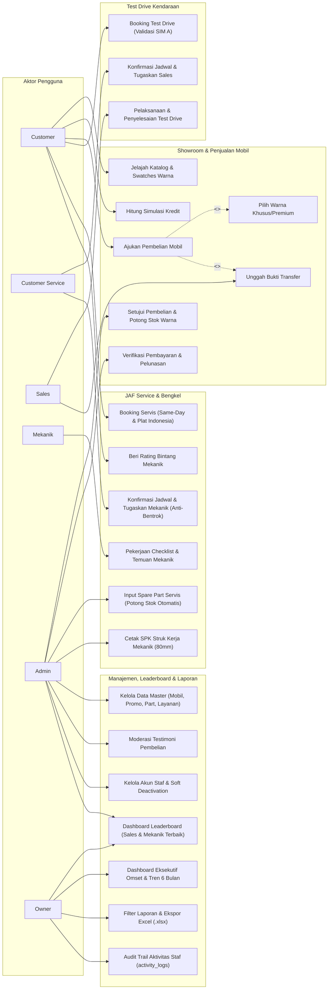

---

### 2.4 Tabel Skenario Use Case Rinci

#### Skenario 1: Simulasi Kredit, Pemilihan Warna/Warna Premium, & Pengajuan Pembelian Mobil
- **Use Case ID:** `UC-SHOWROOM-01`
- **Aktor:** Customer, Admin.
- **Pre-condition:** Mobil berstatus aktif (`is_active = true`), memiliki stok tersedia (`stock > 0`), dan Customer telah melakukan login.
- **Main Flow (Alur Utama):**
  1. Customer membuka halaman detail mobil (`/mobil/{slug}`).
  2. Customer mengeklik salah satu varian warna pada *color swatches*.
  3. Sistem mengubah foto galeri utama sesuai warna yang dipilih dan memperbarui label warna serta badge ketersediaan stok warna.
  4. Jika customer memilih warna khusus/premium (misal: *Midnight Purple*), sistem secara otomatis menambahkan biaya ekstra ke harga mobil dan mengalkulasi ulang seluruh baris tabel angsuran bulanan pada simulasi cicilan di bawahnya.
  5. Customer mengeklik tombol **Ajukan Pembelian**.
  6. Sistem mengalihkan ke formulir pengajuan dengan warna yang **otomatis terpilih** (*pre-selected*).
  7. Customer memilih metode pembayaran (Cash atau Kredit). Jika memilih kredit, customer menentukan uang muka (DP) dan tenor (12–60 bulan).
  8. Customer memasukkan nomor kontak telepon dan alamat pengiriman, lalu menekan tombol *Kirim Pengajuan Pembelian*.
  9. Sistem menyimpan data pengajuan berstatus `Menunggu Persetujuan` (*Pending*).
  10. Admin membuka detail pengajuan di portal admin dan mengeklik tombol **Setujui Pengajuan**.
  11. Sistem mengubah status pengajuan menjadi `Disetujui` dan **otomatis memotong 1 unit stok pada mobil serta 1 unit stok pada varian warna tersebut di database**.
  12. Customer mengunggah foto bukti transfer bank pada portal akun.
  13. Admin memverifikasi bukti pembayaran dan mengubah status menjadi `Lunas` (*Paid*).
- **Alternative Flow (Alur Alternatif / Validasi Gagal):**
  - *A1 (Warna Stok Habis):* Jika customer memilih varian warna yang stoknya `0`, lingkaran warna meredup, bertanda `✕`, dan tombol Ajukan Pembelian dinonaktifkan (`disabled`). Jika form diakses langsung lewat URL, backend melempar validasi error: *"Stok untuk warna [...] sedang habis"*.
  - *A2 (Uang Muka di Luar Batas):* Jika customer memasukkan nilai DP di bawah 20% atau di atas 90% dari harga mobil, sistem menolak pengiriman dan menampilkan batas nominal rupiah DP yang diizinkan.
  - *A3 (Pembatalan Pengajuan):* Jika customer membatalkan pengajuan atau Admin menolak pengajuan yang sempat disetujui, sistem otomatis mengembalikan 1 unit stok mobil dan varian warna tersebut ke stok katalog (*stock restored*).
- **Post-condition:** Pengajuan pembelian tercatat resmi, stok unit terpotong akurat, dan transaksi masuk ke laporan omset dealer.

---

#### Skenario 2: Penjadwalan & Pelaksanaan Test Drive (Validasi SIM A & Anti-Bentrok)
- **Use Case ID:** `UC-TESTDRIVE-01`
- **Aktor:** Customer, Customer Service, Sales.
- **Pre-condition:** Customer memiliki akun terdaftar dan mobil yang dipilih tersedia untuk uji kendara (`canBeTestDriven()`).
- **Main Flow (Alur Utama):**
  1. Customer membuka formulir pendaftaran test drive (`/test-drive`).
  2. Customer memilih mobil target, menentukan tanggal kedatangan (H+1 atau lebih), serta memilih slot jam kedatangan (09.00–16.00 WIB).
  3. Customer mencentang kotak pernyataan kepemilikan SIM A aktif dan mengeklik tombol *Kirim Pendaftaran Test Drive*.
  4. Sistem menyimpan tiket pendaftaran dengan status awal `Menunggu Konfirmasi`.
  5. Customer Service membuka tiket pendaftaran di portal `/admin/test-drive/{id}`.
  6. Customer Service memilih tenaga Sales penanggung jawab pada dropdown penugasan dan mengubah status menjadi `Dikonfirmasi`.
  7. Pada hari pelaksanaan, Sales mendampingi sesi test drive di showroom.
  8. Setelah sesi selesai, Sales membuka portal admin dan mengubah status menjadi `Selesai` serta mencatat ringkasan feedback pelanggan.
- **Alternative Flow (Alur Alternatif / Validasi Gagal):**
  - *A1 (Tidak Memiliki SIM A):* Jika kotak konfirmasi SIM A tidak dicentang, pengiriman form ditolak seketika dengan pesan: *"Anda wajib menyatakan memiliki SIM A aktif untuk melakukan test drive"*.
  - *A2 (Bentrok Jadwal Slot Mobil):* Jika unit mobil yang sama telah dipesan oleh customer lain pada tanggal dan jam yang sama persis, sistem menolak pemesanan dengan pesan: *"Jadwal test drive untuk mobil ini pada waktu tersebut sudah terisi. Silakan pilih jam atau tanggal lain"*.
- **Post-condition:** Sesi test drive tuntas tercatat dan metrik test drive selesai pada akun Sales yang bersangkutan bertambah 1 poin di papan peringkat (*leaderboard*).

---

#### Skenario 3: Booking Servis, Penugasan Mekanik Anti-Bentrok, Cetak SPK, & Pemakaian Spare Part
- **Use Case ID:** `UC-SERVICE-01`
- **Aktor:** Customer, Customer Service, Admin, Mekanik.
- **Pre-condition:** Pelanggan memiliki kendaraan yang hendak diservis dan bengkel dalam hari operasional aktif.
- **Main Flow (Alur Utama):**
  1. Customer membuka formulir booking servis online (`/servis/booking`).
  2. Customer memasukkan nomor plat polisi kendaraan (JavaScript otomatis memformat menjadi standar 3 segmen kapital berjarak, misal `B 1234 ABC`).
  3. Customer memilih tanggal servis: sistem mengizinkan pemilihan tanggal hari ini (*same-day service*).
  4. Sistem menyaring daftar jam kedatangan: jam yang telah lewat atau berjarak kurang dari 1 jam dari waktu saat ini otomatis disembunyikan.
  5. Customer memilih paket layanan servis, memasukkan jarak tempuh KM, memilih preferensi mekanik, serta menguraikan keluhan mobil.
  6. Customer mengirimkan form; sistem menerbitkan tiket servis berstatus `Menunggu Konfirmasi`.
  7. Customer Service mengonfirmasi jadwal dan menugaskan teknisi Mekanik 1.
  8. Di halaman detail servis `/admin/servis/{id}`, Admin mengecek ketersediaan mekanik melalui dropdown anti-bentrok.
  9. Admin mengeklik tombol **Cetak SPK** untuk menerbitkan lembar kerja teknisi struk thermal 80mm via browser (`window.print()`).
  10. Mekanik membuka panel `/mekanik/pekerjaan/{id}`, mencentang butir tugas checklist pekerjaan, serta mengidentifikasi suku cadang yang aus.
  11. Di meja administrasi bengkel, Admin menambahkan suku cadang pengganti (*Filter Oli Mesin*, Qty: 2) ke dalam nota servis.
  12. Sistem secara instan **memotong 2 pcs stok master filter oli di database**.
  13. Servis diselesaikan oleh mekanik; Admin mengubah status booking menjadi `Selesai`.
  14. Customer menerima notifikasi kendaraan selesai dan memberikan penilaian 5 bintang beserta ulasan ulasan teknisi di portal akunnya.
- **Alternative Flow (Alur Alternatif / Validasi Gagal):**
  - *A1 (Mekanik Bentrok Jadwal):* Jika Admin hendak menugaskan mekanik yang sudah memiliki jadwal servis aktif pada tanggal dan jam yang sama, dropdown mekanik menampilkan label `[Nama Mekanik] (Bentrok jadwal jam ini)` dan berstatus `disabled`. Jika form dipaksa kirim, backend melempar validasi error penugasan.
  - *A2 (Stok Suku Cadang Tidak Mencukupi):* Jika Admin menginput kuantitas spare part melebihi sisa stok gudang, sistem menolak penambahan dengan error: *"Stok tidak mencukupi (sisa X pcs)"*.
  - *A3 (Pembatalan/Hapus Suku Cadang):* Jika salah satu spare part dihapus dari nota servis, sistem otomatis mengembalikan kuantitas spare part tersebut ke stok master gudang (*stock increment*).
- **Post-condition:** Servis kendaraan selesai, nota rincian biaya jasa + part tercetak, stok gudang berkurang akurat, dan nilai rating kepuasan mekanik langsung teragregasi ke profil Mekanik 1.

---

#### Skenario 4: Manajemen Data Master, Soft Deactivation Staf, Dashboard Leaderboard, & Laporan Eksekutif Owner
- **Use Case ID:** `UC-MANAJEMEN-01`
- **Aktor:** Admin, Owner.
- **Pre-condition:** Pengguna telah terautentikasi dengan role `admin` atau `owner`.
- **Main Flow (Alur Utama):**
  1. Admin mengelola data master katalog mobil di `/admin/mobil`, menambah galeri foto, serta menentukan palet warna beserta stok masing-masing warna.
  2. Admin memoderasi ulasan testimoni customer di `/admin/ulasan` dengan mengeklik tombol *Setujui*, sehingga ulasan langsung tampil di Beranda publik.
  3. Owner masuk ke portal `/admin/dashboard` dan memantau metrik eksekutif bisnis: omset penjualan unit mobil (Rp), pendapatan bengkel servis (Rp), serta grafik tren performa 6 bulan terakhir.
  4. Owner dan Admin memantau widget **Performa Tim Terbaik**:
     - *Sales Terbaik (Top 3):* Ditampilkan peringkat berdasarkan unit terjual terbanyak, total omset penjualan, dan test drive selesai.
     - *Mekanik Terbaik (Top 3):* Ditampilkan peringkat berdasarkan skor rating bintang tertinggi dan jumlah servis selesai.
  5. Owner membuka menu `/admin/laporan`, memilih filter periode bulan berjalan, lalu mengeklik tombol **Export Excel**.
  6. Sistem men-generate dan mengunduh berkas spreadsheet `.xlsx` resmi berisi tabulasi omset dan performa dealer.
  7. Owner membuka menu `/admin/staf/aktivitas` untuk mengaudit jejak aktivitas sensitif seluruh staf (*Audit Trail*).
- **Alternative Flow (Alur Alternatif / Soft Deactivation Staf):**
  - *A1 (Penonaktifan Staf):* Admin/Owner membuka menu `/admin/staf` dan mengubah status staf bermasalah menjadi *Nonaktif* (`is_active = false`). Seketika itu juga, sesi login staf tersebut dibatalkan oleh middleware `EnsureUserIsActive`, dan saat staf tersebut mencoba login kembali, sistem menampilkan penolakan: *"Akun Anda dinonaktifkan. Hubungi pemilik dealer"*.
- **Post-condition:** Data master dan akun staf dealer terkelola aman, performa bisnis terpantau transparan, dan laporan finansial terdokumentasi rapi.

---

# BAB 3: FLOW / ALUR KERJA UNTUK SETIAP ROLE & SEMUA MODUL

---

### Bagian A: Flow Khusus untuk Setiap Role (6 Flow Terpisah)

Berikut adalah diagram alur kerja (*flowchart*) dan uraian tahapan operasional dari awal masuk (*login*) hingga aktivitas tuntas untuk masing-masing dari ke-6 role pengguna:

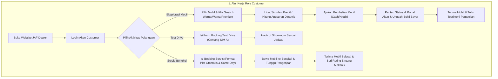

#### Penjelasan Langkah Flow Customer:
1. **Login & Eksplorasi:** Pelanggan masuk ke akun pribadinya, menelusuri katalog mobil Nissan, mencoba tombol pilihan warna (*swatches*), dan melihat perubahan foto serta simulasi angsuran secara interaktif.
2. **Transaksi Pembelian:** Pelanggan mengajukan pembelian unit mobil, sistem mengunci pilihan warna dan harga snapshot. Setelah disetujui, pelanggan mengunggah foto bukti transfer bank pada portal akun, lalu memberikan ulasan setelah mobil diserahkan.
3. **Pemesanan Test Drive:** Pelanggan memesan jadwal uji kendara dengan verifikasi kepemilikan SIM A aktif.
4. **Perawatan Servis & Rating:** Pelanggan mendaftarkan servis rutin dengan plat nomor yang terformat otomatis, membawa kendaraan ke bengkel, dan memberikan bintang evaluasi bagi mekanik setelah servis rampung.

---

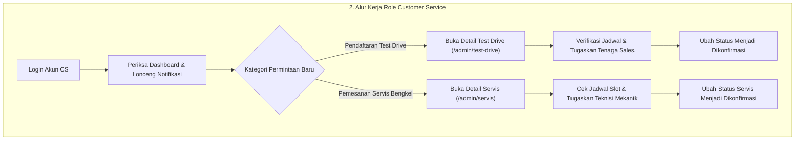

#### Penjelasan Langkah Flow Customer Service:
1. **Pemeriksaan Tugas:** Petugas CS masuk ke sistem dan memantau antrean permintaan baru melalui badge lonceng notifikasi.
2. **Penanganan Test Drive:** CS memverifikasi kesiapan jadwal unit test drive, menugaskan akun Sales pendamping, lalu mengonfirmasi pendaftaran.
3. **Penanganan Servis Bengkel:** CS memverifikasi data keluhan mobil pelanggan, memilih teknisi mekanik yang tersedia, dan mengonfirmasi jadwal servis pelanggan.

---

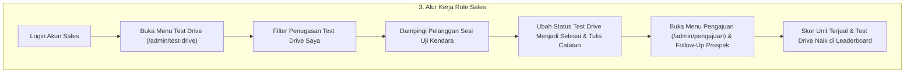

#### Penjelasan Langkah Flow Sales:
1. **Login & Cek Jadwal:** Tenaga Sales memeriksa penugasan test drive pelanggan yang diarahkan kepadanya.
2. **Pelaksanaan Uji Kendara:** Sales menyambut pelanggan di showroom, mendampingi proses test drive, dan mengedukasi keunggulan unit mobil.
3. **Penyelesaian & Prospek:** Sales memperbarui status tiket test drive menjadi *Selesai* beserta catatan follow-up, serta memantau pengajuan pembelian pelanggan agar poin penjualan tercatat di papan peringkat (*leaderboard*).

---

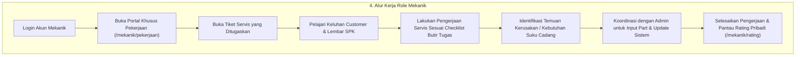

#### Penjelasan Langkah Flow Mekanik:
1. **Akses Portal Pekerjaan:** Teknisi Mekanik masuk ke antarmuka khusus `/mekanik/pekerjaan` dan membuka kendaraan yang ditugaskan ke dirinya.
2. **Pengerjaan & Inspeksi:** Mekanik mengecek keluhan, mencocokkan fisik kendaraan dengan lembar SPK, dan melakukan pemeriksaan butir per butir tugas checklist.
3. **Suku Cadang & Reputasi:** Mekanik mencatat temuan suku cadang aus untuk diinput oleh Admin ke sistem, menuntaskan pengerjaan kendaraan, dan memantau rekam jejak kepuasan bintang pelanggan di menu rating pribadinya.

---

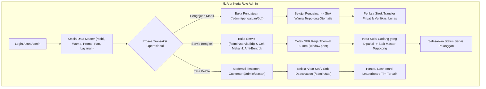

#### Penjelasan Langkah Flow Admin:
1. **Pengendalian Data Master:** Administrator memastikan katalog mobil, varian warna, promo harga, suku cadang gudang, dan layanan servis selalu mutakhir.
2. **Persetujuan Pembelian:** Admin menyetujui pesanan mobil (yang memotong stok warna otomatis) dan memvalidasi file transfer pembayaran pelanggan.
3. **Operasional Bengkel:** Admin memeriksa bentrok jadwal mekanik, mencetak struk SPK kerja, menginput pemakaian spare part (yang otomatis memotong stok gudang), serta memoderasi testimoni dan mengelola akun staf.

---

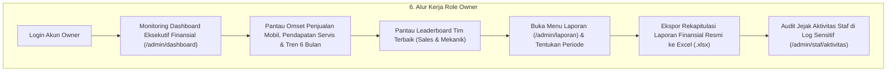

#### Penjelasan Langkah Flow Owner:
1. **Supervisi Eksekutif:** Pemilik dealer masuk untuk meninjau kesehatan finansial showroom melalui visualisasi omset penjualan mobil, total pemasukan bengkel, serta grafik tren pertumbuhan 6 bulan.
2. **Evaluasi SDM & Laporan:** Owner mengevaluasi peringkat Sales dan Mekanik berprestasi, menyaring laporan pendapatan berkala, mengunduh file spreadsheet `.xlsx` terformat rapi, dan memantau log audit aktivitas staf.

---

### Bagian B: Flow End-to-End Lintas Aktor per Proses Bisnis

#### 1. Alur End-to-End Proses Penjualan Mobil (Showroom)

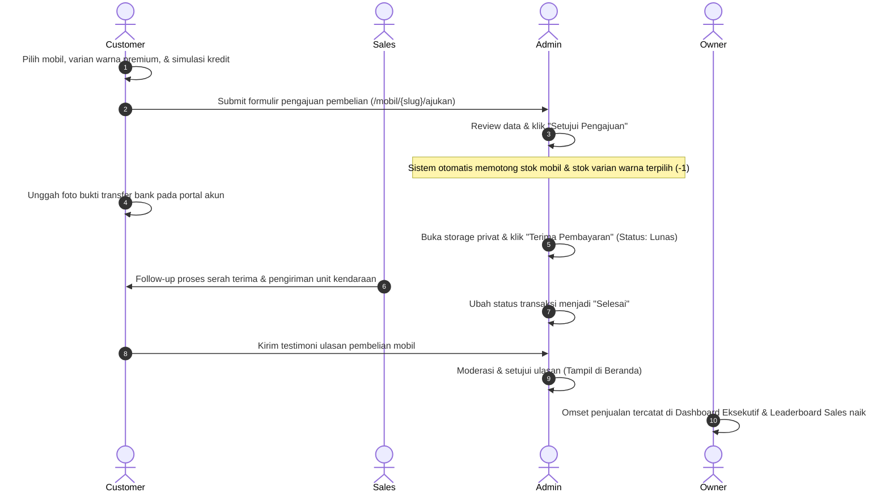

---

#### 2. Alur End-to-End Proses Booking & Pelaksanaan Test Drive

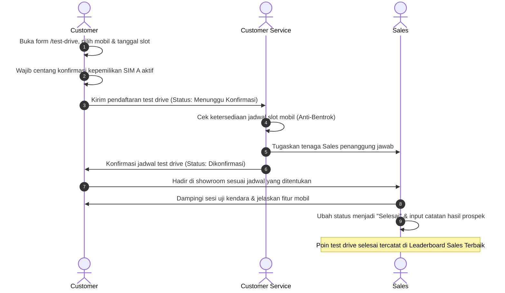

---

#### 3. Alur End-to-End Proses Servis Bengkel, SPK, & Spare Part

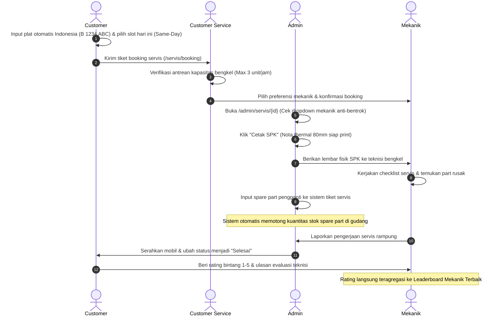

---

# BAB 4: ARSITEKTUR SISTEM & DATABASE

### 4.1 Arsitektur Aplikasi Secara Teknis
Sistem Informasi JAF Dealer dibangun dengan arsitektur web modern yang mengedepankan performa tinggi, struktur modular, dan kemudahan pemeliharaan:
1. **Backend Framework (Laravel 11 LTS):** Mengadopsi pola MVC (*Model-View-Controller*) yang diperkuat dengan pendekatan **Action Classes Pattern** (direktori `app/Actions/`) untuk memisahkan logika bisnis kompleks dari controller (contoh: `SubmitPurchaseRequest`, `ChangePurchaseRequestStatus`, `BookService`, `BookTestDrive`, `RescheduleBooking`).
2. **Dedicated Support Services:** Kalkulasi finansial dipisahkan ke dalam service kelas murni (`app/Support/CreditCalculator.php`) yang menggunakan operasi bilangan bulat (*integer/bigint arithmetic*) guna menghindari galat pembulatan angka desimal *floating point*.
3. **Frontend Presentation:** Memanfaatkan **Blade Templating Engine**, **Bootstrap 5.3**, dan **Vanilla JavaScript Native** yang terbebas dari ketergantungan framework JavaScript berat (*Single Page Application*). Menghasilkan waktu muat halaman (*First Contentful Paint*) di bawah 1 detik, mendukung SEO secara optimal, serta menyediakan fitur **Dark/Light Mode** adaptif berbasis CSS Variables.
4. **Database Engine (MySQL 8.0 / InnoDB):** Menggunakan skema relasional ketat dengan *Foreign Key Constraints*, transaksi database atomik (`DB::transaction()`), *pessimistic locking* (`lockForUpdate()`) saat memotong stok mobil dan spare part, serta konfigurasi `Model::preventLazyLoading(! app()->isProduction())` untuk mencegah masalah performa *N+1 Query*.
5. **Storage Architecture (Public vs Private):**
   - **Public Disk (`storage/app/public/`):** Digunakan untuk aset media katalog publik yang dapat diakses langsung oleh browser (foto mobil `cars/`, galeri warna, logo merek `brands/`, banner hero `settings/`, dan foto suku cadang `spare-parts/`).
   - **Private Disk (`storage/app/private/`):** Digunakan untuk dokumen sensitif pelanggan (bukti pembayaran `payment-proofs/` dan bukti refund `payment-refunds/`). Berkas dalam direktori ini **tidak dapat diakses melalui URL langsung publik**, melainkan dialirkan melalui controller otentikasi menggunakan response streaming dengan validasi hak akses kepemilikan transaksi.

---

### 4.2 Diagram Arsitektur Sistem (Format Mermaid)

```mermaid
flowchart TD
    subgraph ClientTier ["Client Tier (Browser)"]
        UI_Guest["Publik / Calon Pembeli (Web Browser)"]
        UI_Customer["Portal Akun Customer (Responsive Web)"]
        UI_Staff["Portal Staf & Mekanik (Admin Console)"]
        UI_Owner["Dashboard Eksekutif Owner (Monitoring)"]
    end

    subgraph PresentationLayer ["Presentation Layer (Blade & JS)"]
        Blade["Blade Template Engine (Laravel 11)"]
        CSS["Bootstrap 5.3 + Dark/Light Theme CSS"]
        JS["Vanilla JS (Format Plat, Swatches, Kalkulator Dinamis)"]
    end

    subgraph SecurityMiddleware ["Security & Middleware Layer"]
        SecHeaders["SecurityHeaders (CSP, X-Frame, X-XSS, No-Sniff)"]
        AuthMid["Authenticate / EnsureUserIsActive"]
        RBAC["Role & Gate Middleware (can:..., role:...)"]
        Throttle["Rate Limiting (Register, Login, Booking, Submit)"]
    end

    subgraph ApplicationLayer ["Application Logic Layer"]
        Controllers["Http Controllers (Showroom, Service, Admin, Account)"]
        Actions["Action Classes (SubmitPurchase, ChangeStatus, BookService)"]
        Support["Support Services (CreditCalculator, AdminReportXlsx)"]
    end

    subgraph DataStorageLayer ["Data & Storage Layer"]
        MySQL[("MySQL 8.0 Database (InnoDB Engine)")]
        PublicStorage["Public Storage (Foto Mobil, Logo, Spare Part)"]
        PrivateStorage["Private Storage (Bukti Transfer Bank & Refund)"]
    end

    ClientTier --> PresentationLayer
    PresentationLayer --> SecurityMiddleware
    SecurityMiddleware --> ApplicationLayer
    ApplicationLayer --> DataStorageLayer
```

---

### 4.3 Entity Relationship Diagram / ERD (Format Mermaid)

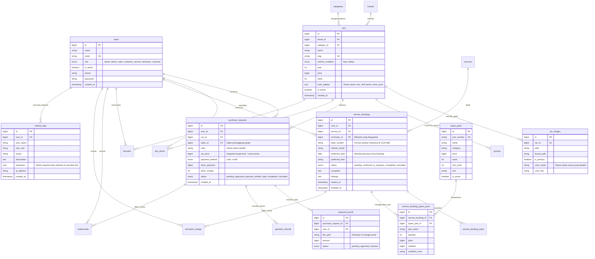

---

### 4.4 Kamus Data & Relasi Tabel Inti

1. **Tabel `cars` & Kolom Khusus JSON `color_palette`:**
   - Menyimpan seluruh data spesifikasi teknis mobil.
   - Kolom `color_palette` berformat JSON menyimpan struktur array varian warna mobil:
     `[{"name": "Ungu Mutiara (Midnight Purple)", "hex": "#3B1E54", "stock": 1, "extra_price": 35000000}, ...]`
   - Kolom `stock` utama merupakan hasil akumulasi total stok seluruh varian warna di dalam palet tersebut.
2. **Tabel `service_booking_spare_parts`:**
   - Menjadi tabel transaksi antara pemakaian suku cadang bengkel dengan tiket servis.
   - Menyimpan histori pemakaian part, harga saat transaksi, kuantitas yang dipasang, serta catatan teknisi mengenai kondisi part lama yang diganti.
3. **Tabel `activity_logs` & Kolom Khusus JSON `properties`:**
   - Menyimpan rekam jejak audit (*Audit Trail*) tindakan sensitif staf.
   - Tidak memiliki kolom `updated_at` (*append-only* / data tidak bisa dimanipulasi).
   - Kolom `properties` menyimpan konteks data aksi (misalnya nilai perubahan status dari *Pending* ke *Approved*, atau data akun staf yang dinonaktifkan).

---

# BAB 5: HAK AKSES & KEAMANAN SISTEM (RBAC & SECURITY)

---

### 5.1 Matriks Hak Akses (Role-Based Access Control / RBAC)

Matriks berikut didasarkan langsung pada konstanta resmi `User::PERMISSIONS` di [app/Models/User.php](file:///c:/laragon/www/dm/app/Models/User.php#L73-L106) dan didaftarkan sebagai Gate Laravel pada [app/Providers/AppServiceProvider.php](file:///c:/laragon/www/dm/app/Providers/AppServiceProvider.php#L58-L60):

| Kemampuan / Fitur (*Ability*) | Customer | Customer Service | Sales | Mekanik | Admin | Owner |
| :--- | :---: | :---: | :---: | :---: | :---: | :---: |
| **Katalog Mobil (Lihat)** | ✔ | ✔ | ✔ | ✔ | ✔ | ✔ |
| **Kelola Mobil (Tambah, Ubah, Galeri Warna)** | ❌ | ❌ | ❌ | ❌ | ✔ | ❌ |
| **Hapus Master Data (Mobil, Merek, Kategori)** | ❌ | ❌ | ❌ | ❌ | ✔ | ❌ |
| **Kelola Promo & Diskon** | ❌ | ❌ | ❌ | ❌ | ✔ | ❌ |
| **Booking & Lihat Test Drive** | Buat Sendiri | Lihat Semua | Ditugaskan | ❌ | Lihat Semua | Lihat Semua |
| **Ubah Status & Jadwal Test Drive** | Batalkan | ✔ | ✔ (Selesai) | ❌ | ✔ | ❌ |
| **Pengajuan Pembelian Mobil (Lihat)** | Milik Sendiri | Lihat Semua | Ditugaskan | ❌ | Lihat Semua | Lihat Semua |
| **Ubah Status Pengajuan Pembelian** | Batalkan | ❌ | Follow-up | ❌ | ✔ | ❌ |
| **Setujui Pengajuan Pembelian (`purchases.approve`)** | ❌ | ❌ | ❌ | ❌ | ✔ | ❌ |
| **Verifikasi Bukti Pembayaran (`payments.manage`)** | Upload | ❌ | ❌ | ❌ | ✔ | ❌ |
| **Booking Servis Kendaraan (Lihat)** | Milik Sendiri | Lihat Semua | ❌ | Ditugaskan | Lihat Semua | Lihat Semua |
| **Kelola Servis (Tugaskan Mekanik & Status)** | Batalkan | ✔ | ❌ | Kerjakan | ✔ | ❌ |
| **Kelola Suku Cadang Servis & Potong Stok** | ❌ | ❌ | ❌ | Rekomendasi | ✔ | ❌ |
| **Cetak SPK Kerja Mekanik (Thermal 80mm)** | ❌ | ✔ | ❌ | Menerima | ✔ | ❌ |
| **Kelola Master Suku Cadang (Spare Part)** | Lihat | ❌ | ❌ | ❌ | ✔ | ❌ |
| **Moderasi Testimoni Pelanggan** | Tulis | ❌ | ❌ | ❌ | ✔ | ❌ |
| **Rating Bintang Mekanik** | Beri Rating | ❌ | ❌ | Lihat Pribadi | Lihat Semua | Lihat Semua |
| **Monitoring Dashboard Eksekutif & Omset** | ❌ | ❌ | ❌ | ❌ | Operasional | ✔ (Omset Rp) |
| **Leaderboard Tim Terbaik (Sales & Mekanik)** | ❌ | ❌ | Peringkat | Peringkat | ✔ | ✔ |
| **Laporan Dealer & Ekspor Excel (`.xlsx`)** | ❌ | ❌ | ❌ | ❌ | Lihat Saja | ✔ (Full Excel) |
| **Audit Trail Aktivitas Sensitif (`activity_logs`)** | ❌ | ❌ | ❌ | ❌ | ✔ | ✔ |
| **Kelola Akun Staf & Soft Deactivation** | ❌ | ❌ | ❌ | ❌ | ✔ | ✔ |
| **Pengaturan Profil & Rekening Dealer** | ❌ | ❌ | ❌ | ❌ | ✔ | ✔ |

---

### 5.2 Tujuh Lapis Mekanisme Keamanan Sistem

1. **Route, Controller Policy, & Gate Protection:**
   Setiap rute back-office dilindungi oleh middleware ganda `['auth', 'admin']` atau `['auth', 'role:mechanic']` serta pengecekan Gate kemampuan spesifik (misal: `middleware('can:purchases.approve')` pada persetujuan pembelian, dan `middleware('can:reports.view')` pada laporan). Jika pengguna mencoba mengakses URL tanpa hak akses yang sah, Laravel seketika menghentikan eksekusi dan mengembalikan halaman standar **`403 Forbidden`**.
2. **Proteksi Pembuatan Akun Owner via CLI Khusus:**
   Sistem **tidak menyediakan tombol registrasi atau pembuatan akun Owner di antarmuka web** untuk mencegah celah eksploitasi eskalasi wewenang (*Privilege Escalation*). Akun Owner hanya dapat diangkat melalui perintah konsol server lokal:
   `php artisan user:make-owner pemilik@dealer.com`
3. **Mekanisme Soft Deactivation (`EnsureUserIsActive`):**
   Status staf dikontrol oleh kolom boolean `is_active`. Middleware [EnsureUserIsActive.php](file:///c:/laragon/www/dm/app/Http/Middleware/EnsureUserIsActive.php) memvalidasi keaktifan akun pada setiap *request*. Jika akun dinonaktifkan oleh administrator/owner, sesi staf tersebut langsung dimatikan paksa (*invalidated*), token sesi di-regenerate, dan pengguna dialihkan ke halaman login dengan pesan penolakan resmi.
4. **Pencegahan Brute-Force & Session Fixation:**
   - **Rate Limiting:** Rute autentikasi dan formulir transaksi publik dilindungi batas frekuensi pengiriman data (*throttling*), antara lain login maksimal 5 percobaan/menit, registrasi akun 5 kali/menit, dan pengajuan booking maksimal 5 kali/menit per alamat IP.
   - **Session Regeneration:** Setiap kali login berhasil, sesi PHP diperbarui (`session()->regenerate()`) untuk mencegah serangan pembajakan sesi (*Session Fixation*).
5. **HTTP Security Headers Middleware:**
   Setiap respon HTTP dari aplikasi diproteksi oleh middleware [SecurityHeaders.php](file:///c:/laragon/www/dm/app/Http/Middleware/SecurityHeaders.php) yang menyematkan header standar industri keamanan siber:
   - `X-Frame-Options: SAMEORIGIN` (Mencegah serangan *Clickjacking*).
   - `X-Content-Type-Options: nosniff` (Mencegah manipulasi tipe MIME file upload).
   - `Referrer-Policy: strict-origin-when-cross-origin`.
   - `Permissions-Policy: camera=(), microphone=(), geolocation=()`.
   - `Content-Security-Policy (CSP)` ketat yang hanya mengizinkan eksekusi skrip dari origin lokal dan CDN resmi terdaftar (jsDelivr, Google Fonts).
   - Menghapus header informasi versi bahasa pemrograman (`X-Powered-By`).
6. **Jejak Audit Kekal (*Immutable Audit Trail*):**
   Seluruh tindakan staf yang berpotensi memengaruhi integritas sistem (persetujuan pengajuan, transaksi finansial, penghapusan data master, dan pergantian status staf) dicatat ke tabel `activity_logs`. Model `ActivityLog` tidak memiliki timestamp `updated_at`, dan controller tidak menyediakan fungsi update atau delete, sehingga log aktivitas kebal dari manipulasi staf operasional.
7. **Penyelubungan Berkas Privat (*Private Storage Shielding*):**
   Bukti transfer bank dan nota pengembalian dana tidak diletakkan pada folder publik `public/storage`, melainkan pada folder sistem tertutup `storage/app/private/`. Berkas hanya dapat dibaca melalui controller perantara yang memverifikasi apakah akun yang meminta berkas adalah pemilik sah transaksi tersebut atau staf berwenang (`canViewProof()`).

---

# BAB 6: RENCANA ANGGARAN BIAYA (RAB) BESERTA PEMBAGIANNYA

Penyusunan Rencana Anggaran Biaya (RAB) proyek pengembangan sistem web **JAF Dealer** dihitung secara realistis berdasarkan standar tarif industri rekayasa perangkat lunak skala menengah (*medium enterprise*) di Indonesia dengan durasi pengerjaan intensif selama **4 bulan (16 minggu)**.

---

### 6.1 Rincian Biaya SDM / Tim Pengembang

Tim pengembang terdiri dari 3 orang personel inti dengan pembagian peran, tanggung jawab, dan estimasi honorarium profesional:

| No | Personel Tim | Peran & Tanggung Jawab Utama | Alokasi Waktu | Honorarium / Bulan | Subtotal Biaya SDM (4 Bulan) |
| :---: | :--- | :--- | :---: | :---: | :---: |
| 1 | **Yoseph Kewena Hayon** | **Lead Backend & Database Engineer** • Perancangan arsitektur database MySQL & skema ERD. • Implementasi Laravel 11, Action Classes, & Eloquent. • Logika bisnis: pemotongan stok otomatis, anti-bentrok jadwal, rumus kredit bunga flat, dan ekspor laporan Excel. | 4 Bulan | Rp 4.500.000 | **Rp 18.000.000** |
| 2 | **Albar Raya** | **Lead Frontend & UI/UX Designer** • Perancangan desain antarmuka responsif & sistem tema Dark/Light mode. • Implementasi Blade Templates & komponen Bootstrap 5. • Rekayasa Vanilla JS: interaksi color swatches, format plat nomor Indonesia, filter same-day service, dan kalkulasi dinamis cicilan. | 4 Bulan | Rp 4.000.000 | **Rp 16.000.000** |
| 3 | **Fadhlan Muhamad Hutasoit** | **System Analyst, QA / Tester, Integrasi & Dokumentasi** • Analisis kebutuhan pengguna & pemodelan diagram Use Case. • Penyusunan test suite otomatis (1.160 unit/feature tests) & pengujian manual *Black-Box*. • Penataan keamanan RBAC, migrasi data seeder, dan dokumentasi teknis sistem. | 4 Bulan | Rp 3.500.000 | **Rp 14.000.000** |
| **TOTAL** | | **Subtotal Biaya Tim Pengembang (SDM)** | | | **Rp 48.000.000** |

---

### 6.2 Rincian Biaya Infrastruktur, Server, & Deployment

Biaya penyediaan infrastruktur komputasi awan (*cloud*) dan layanan pihak ketiga untuk operasional tahun pertama (12 bulan):

| No | Komponen Infrastruktur | Spesifikasi & Vendor Penyedia | Durasi / Periode | Estimasi Biaya Satuan | Subtotal Biaya Infrastruktur |
| :---: | :--- | :--- | :---: | :---: | :---: |
| 1 | **Domain Resmi Dealer** | Domain kustom komersial Indonesia (`.co.id` / `.com`) | 1 Tahun | Rp 250.000 / tahun | Rp 250.000 |
| 2 | **Cloud Virtual Private Server (VPS)** | Cloud Server (2 vCPU, 4 GB RAM, 80 GB NVMe Storage, OS Ubuntu LTS, MySQL 8.0 & Nginx) — misal: IDCloudHost / DigitalOcean | 12 Bulan | Rp 275.000 / bulan | Rp 3.300.000 |
| 3 | **Sertifikat SSL / TLS** | DV SSL Commercial Wildcard 256-bit Encryption (atau Let's Encrypt Enterprise Managed Auto-Renewal) | 1 Tahun | Rp 450.000 / tahun | Rp 450.000 |
| 4 | **Layanan Email Transaksional (SMTP)** | Kuota 10.000 email/bulan untuk notifikasi otomatis konfirmasi booking, SPK, dan reset sandi (Brevo / Mailgun) | 12 Bulan | Rp 150.000 / bulan | Rp 1.800.000 |
| 5 | **Cloud Object Storage (Backup)** | S3-Compatible Cloud Storage 50 GB untuk arsip database backup harian dan file bukti pembayaran privat | 12 Bulan | Rp 50.000 / bulan | Rp 600.000 |
| **TOTAL** | | **Subtotal Biaya Infrastruktur & Server (Tahun ke-1)** | | | **Rp 6.400.000** |

---

### 6.3 Rincian Biaya Operasional, Pengujian, & Pemeliharaan

Biaya penunjang pengujian kelayakan sistem dan layanan garansi/pemeliharaan teknis paska peluncuran (*post-deployment support*):

| No | Komponen Operasional | Uraian Kegiatan | Satuan / Periode | Estimasi Biaya |
| :---: | :--- | :--- | :---: | :---: |
| 1 | **Pengujian Sistem & User Acceptance Testing (UAT)** | Sesi pengujian langsung bersama calon pengguna (Admin, CS, Sales, Mekanik, Owner), pengujian beban (*stress testing*), dan evaluasi bug. | 1 Paket | Rp 2.500.000 |
| 2 | **Pelatihan Staf & Panduan Pengguna (Training)** | Penyusunan buku manual operasional serta sesi bimbingan teknis (*hands-on workshop*) bagi seluruh staf operasional dealer. | 1 Paket | Rp 1.500.000 |
| 3 | **Garansi & Pemeliharaan Rutin (SLA 1 Tahun)** | Layanan perbaikan bug minor, pembaruan keamanan sistem (*security patches*), optimasi database, dan monitoring uptime server. | 12 Bulan (Rp 350.000/bln) | Rp 4.200.000 |
| **TOTAL** | | **Subtotal Biaya Operasional & Pemeliharaan** | | **Rp 8.200.000** |

---

### 6.4 Rekapitulasi Total Anggaran & Biaya Berjalan Tahunan

Berikut adalah rekapitulasi total investasi awal pengembangan sistem serta estimasi biaya operasional tahunan berikutnya:

| Kategori Pengeluaran | Subtotal Biaya (IDR) | Persentase Anggaran |
| :--- | :---: | :---: |
| **1. Biaya Rekayasa & Pengembangan SDM (4 Bulan)** | Rp 48.000.000 | 76,7% |
| **2. Biaya Infrastruktur Server & Cloud Deployment (Tahun ke-1)** | Rp 6.400.000 | 10,2% |
| **3. Biaya Operasional, UAT, Pelatihan & Garansi Pemeliharaan** | Rp 8.200.000 | 13,1% |
| **TOTAL ANGGARAN PENGEMBANGAN TAHUN PERTAMA** | **Rp 62.600.000** | **100,0%** |

#### Estimasi Biaya Operasional Berjalan (Tahun ke-2 dan Seterusnya):
Untuk tahun-tahun berikutnya paska pengembangan awal, dealer hanya mengeluarkan biaya perpanjangan infrastruktur dan pemeliharaan teknis berkala:
- Perpanjangan Domain & SSL: Rp 700.000 / tahun
- Cloud VPS Hosting (12 Bulan): Rp 3.300.000 / tahun
- Layanan SMTP Email & Cloud Storage Backup: Rp 2.400.000 / tahun
- Layanan Kontrak Pemeliharaan Sistem & Security Updates: Rp 4.200.000 / tahun
- **Total Biaya Berjalan Tahunan:** **± Rp 10.600.000 / tahun** (atau sekitar **Rp 880.000 / bulan**).

#### Justifikasi Kelayakan Proyek (Business Value Justification):
1. **Efisiensi Biaya Operasional Bengkel:** Otomasi penugasan mekanik dan pencatatan suku cadang secara real-time mengeliminasi kebocoran stok gudang dan mempercepat alur kerja teknisi di bengkel hingga 40%.
2. **Peningkatan Konversi Penjualan:** Keberadaan etalase interaktif (pilihan warna akurat, kalkulasi harga warna premium, dan simulasi kredit instan) memberikan pengalaman digital yang memikat bagi calon pembeli mobil.
3. **Pemberdayaan SDM & Transparansi:** Adanya papan peringkat (*leaderboard*) performa Sales dan Mekanik Terbaik menumbuhkan iklim kompetisi kerja yang sehat dan objektif bagi tim dealer.
4. **Keamanan & Kepatuhan Audit:** Proteksi berlapis RBAC, penyimpanan bukti transfer privat, dan log audit yang kekal memastikan tata kelola bisnis dealer terlindungi dari potensi kecurangan internal.
